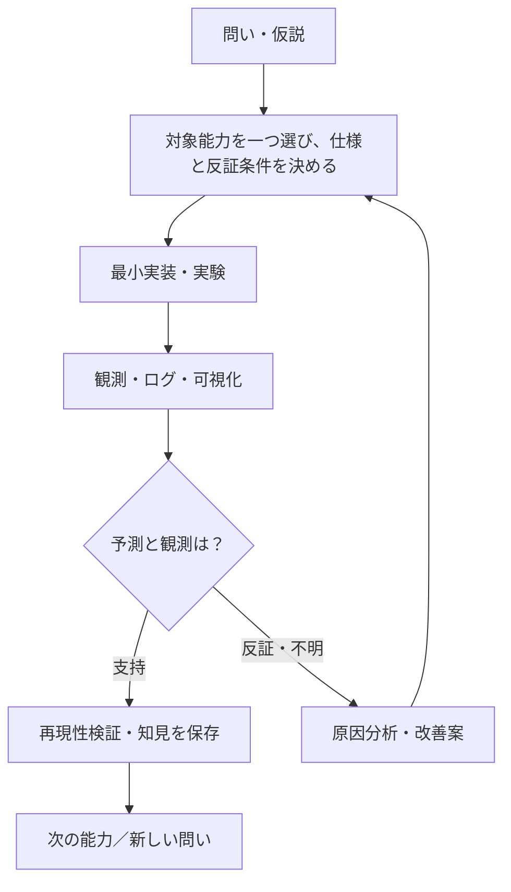

# SOMA — Synthetic Organism Morphogenesis Arena

> 身体の構造を知らない小さな機械が、相互作用と環境条件から新しい身体機能を発見するための研究室。

**現在（2026-10-16）：F001〜F003に加え、F004の「電池残量に制約された1セル1D内部駆動」を実装・検証済みとして正式採用。73テスト、A〜Fの10対照、17拒否例、保存証拠の独立照合と再実行一致、CIを確認。設計[PR #10](https://github.com/ryonakayama234/SOMA-Synthetic-Organism-Morphogenesis-Arena/pull/10)を先に統合し、実装と採用記録は[PR #11](https://github.com/ryonakayama234/SOMA-Synthetic-Organism-Morphogenesis-Arena/pull/11)で統合する。[F004検証記録](findings/F004-validation.md#2026-10-16-採用判断と統合)を参照。**

## 次の一能力（研究提案：F005／2026-10-16）

**現行mainはF001〜F004を正式採用済み。F005はPR #14上で実装・検証中の候補であり、正式採用・main統合は未了。** F004の速度反転時に再加速の正仕事が相殺される既知制約に対し、F005では1セル1Dの区間内正モーター仕事を積算する能力だけを検証する。これを先に整備してから、F003との力学的・電池的接続、資源制約、結合の有利不利の実験へ進む。

- [F005 Issue #12（研究課題）](https://github.com/ryonakayama234/SOMA-Synthetic-Organism-Morphogenesis-Arena/issues/12)
- [F005 仮説と受入基準](topics/F005-positive-work/SPEC.md)／[事前A〜F計画](experiments/F005/PLAN.md)／[検証ノート](findings/F005-validation.md)
- [F005 システム図](docs/ARCHITECTURE.md#f005速度反転時の正仕事積算2026-10-16-研究提案未実装)／[提案データ構造](docs/DATA_CONTRACTS.md#f005正仕事と符号付き仕事の分離2026-10-16-提案未実装)
- 詳細は設計PR（main未統合）で監査。コードと証拠は別の実装PRで同時更新し、ユーザー判断まで採用扱いにしない。

## F005 implementation candidate — positive motor work (2026-10-16; not adopted)

On `feat/F005-positive-work-20261016` (base: Draft design branch) the new F005 ideal one-cell 1D positive-work accounting runs independently of existing F004. **The feature remains a review candidate; `main` is unchanged and no adoption is claimed.**

- [F005 module](soma/f005.py), [tests](tests/test_f005.py), [A–F independent saved-evidence suite](experiments/F005/run_suite.py), [WSL2 reproducibility](experiments/F005/README.md).
- [Architecture diagram](docs/ARCHITECTURE.md), [data schema](docs/DATA_CONTRACTS.md), [preregistered plan](experiments/F005/PLAN.md), [findings](findings/F005-validation.md), [Issue #12](https://github.com/ryonakayama234/SOMA-Synthetic-Organism-Morphogenesis-Arena/issues/12).
- The separate `.github/workflows/f005.yml` runs all prior tests and F005 A–F and uploads raw CSV/ledger/SVG/source/hash/replay artifacts. No autonomous decision, two-cell motor coupling, hardware, or emergence is being claimed.

### F005 CI初回結果（2026-10-16、実装候補のまま）
[監査修正済みHEADのF005 Actions](https://github.com/ryonakayama234/SOMA-Synthetic-Organism-Morphogenesis-Arena/actions/runs/38876548177)は**90 Pythonテスト、10正常対照、17入力拒否、保存CSV独立照合と再実行一致でsuccess**。証拠：[artifact ID 12036090522](https://github.com/ryonakayama234/SOMA-Synthetic-Organism-Morphogenesis-Arena/actions/runs/38876548177/artifacts/12036090522)。端点パワーを先に掛けると微小仕事が0へアンダーフローする問題を監査で発見・修正し、`findings/F005-validation.md`へ反例と限界を記録した。これは**正式採用・main統合ではない**。

### PR #14 独立レビュー修正（2026-10-16）
保存ログの検証で、通常の反転でも演算順の差から1µJずれる問題、微小仕事の誤拒否、初期候補欄・微小正仕事の改変見逃しを修正。有理数の独立積分とbinary64の課金参照を分離し、0.1秒刻みの数量化差も記録する。ローカル93テスト、13対照、17拒否、73ファイルの再実行一致を確認。現行HEADのCIは[PR #14 Checks](https://github.com/ryonakayama234/SOMA-Synthetic-Organism-Morphogenesis-Arena/pull/14/checks)、反例・限界は[検証ノート](findings/F005-validation.md)を参照。

## 入口：どこから読む？

| 知りたいこと | 読む資料 |
| --- | --- |
| 研究の目的と守る原則 | [研究憲章](docs/PROJECT.md) |
| 全体の仕組みを図で見る | [システム図鑑](docs/ARCHITECTURE.md) |
| データの構造・流れを見る | [データの約束](docs/DATA_CONTRACTS.md) |
| 仮説→実験→改善の進め方 | [研究運営](docs/RESEARCH_PROCESS.md) |
| 最初の一機能 | [F001：単一セルの運動](topics/F001-single-cell-motion/SPEC.md)（実装・初回検証済み） |
| F001の実験結果 | [初回検証ノート](findings/F001-validation.md) / [再現方法](experiments/F001/README.md) |
| F003の設計・検証履歴 | [F003仕様案](topics/F003-attachment/SPEC.md) / [A〜F実験計画](experiments/F003/PLAN.md) / [検証記録・監査結果](findings/F003-validation.md) / [設計PR #7](https://github.com/ryonakayama234/SOMA-Synthetic-Organism-Morphogenesis-Arena/pull/7) |
| 論文や参考情報 | [文献図書館](library/INDEX.md) |
| なぜこの設計にしたか | [意思決定001](docs/decisions/0001-incremental-library.md) |
| AIエージェントの読み方 | [AI案内](AGENTS.md) |

## 研究の一周

## 当面の研究対象

- **F001：単一セルが動く（実装済み）**。位置・速度・力を検証。計算結果・誤差を記録済み。学習、結合、エネルギーはまだ追加しない。
- **F002：エネルギー取得・支出・セル間の数値移送を追跡（実装・初回検証済み）**。[再現手順](experiments/F002/README.md)／[CIによる検証ノート](findings/F002-validation.md)。物理的な電力消費は未実装。機械結合は独立のF003実装候補で検証。 [発案時の構想メモ（歴史資料）](topics/F002-energy-ledger/IDEA.md) は正式仕様ではない。
- **F003：二セルの理想機械結合と切断（実装・検証済み）**。身体の自律形成・学習・物理エネルギー移送は対象外。

## 守る原則

1. 一つの Issue / 実験では主要な能力一つを扱う。
2. 「接続したら得点」など結合自体への報酬を与えない。
3. 世界の真の状態と、細胞が観測できる情報を分離する。細胞に身体全体の構造は渡さない。
4. 否定的な結果、未解決事項、採用しなかった仮説も残す。
5. 文献が支持する事実・研究仮説・設計上の選択・実験結果を区別する。
6. 実験条件・シード・コード版・単位・生ログを対応づけて再現できるようにする。
7. 巨大な抽象化を先に作らず、必要になった機能を一つずつ足す。

**GitHub は進捗の台帳**：Issue = 一つの課題、Pull Request = 変更提案、Commit = 保存された変更。操作の知識がなくても研究判断を確認できることを目指す。

## 機能追加時に必ず同期するもの
F002以降は、**コード／テスト・システム図（docs/ARCHITECTURE.md）・データ契約（docs/DATA_CONTRACTS.md）・実験記録（findings/Fxxx-validation.md）・READMEの現在地**を同じPRで更新する。仮説と実装と観測を混同しない。詳細は[研究運営](docs/RESEARCH_PROCESS.md)。F002ではこの5点を同一PR #6で更新し、対照Fの同一設定での再実行証拠も保存する。[PR #6のChecks（最新HEADのCI）](https://github.com/ryonakayama234/SOMA-Synthetic-Organism-Morphogenesis-Arena/pull/6/checks)から常に現行HEADの実行ログ・保存artifactを確認できる。過去のCIと途中の不備・訂正履歴は[検証ノート](findings/F002-validation.md)に保持。

## F003実装候補（feat/F003-1d-coupling-validation-20261015）

- [事前登録の設計PR #7](https://github.com/ryonakayama234/SOMA-Synthetic-Organism-Morphogenesis-Arena/pull/7)を土台にした**別の実装ブランチ**。設計PRの正式レビューとmain統合を先取りしない。
- `soma/f003.py`：理想一次元リンクの力伝達と切断。`tests/test_f003.py`：独立参照・保存・拒否。`experiments/F003/run_suite.py`：A〜F対照。
- [F003アーキテクチャ](docs/ARCHITECTURE.md#f003-実装候補-2026-10-15) / [データ契約](docs/DATA_CONTRACTS.md#f003-実装候補-2026-10-15) / [実験ノート](findings/F003-validation.md) / [再実行方法](experiments/F003/README.md)。
- GitHub ActionsでF001/F002/F003の回帰、A〜F、SHA付き生ログの保存を確認し、別視点の監査で支持・反証・不明を判定するまで**正式採用しない**。

## F003 GitHub CI 履歴（監査修正前・2026-10-15）

- 実装HEAD: 1512206596ca8939705e6e1ab603e9aa1bbd626d
- F003 Actions: https://github.com/ryonakayama234/SOMA-Synthetic-Organism-Morphogenesis-Arena/actions/runs/38731190546 — success。Python 3.11で合計44テスト（F001 17、F002 16、F003 11）合格。
- A〜F正常7run、不正入力8件を拒否、B同条件再実行の生バイト一致。artifact: F003-A-F-evidence（ID 11970235937）。
- F001既存ワークフロー: https://github.com/ryonakayama234/SOMA-Synthetic-Organism-Morphogenesis-Arena/actions/runs/38731190562 — success。
- F002既存ワークフロー: https://github.com/ryonakayama234/SOMA-Synthetic-Organism-Morphogenesis-Arena/actions/runs/38731190549 — success。
- 以上は1D理想モデル・ソフトウェアの整合性を示す。実機による結合、エネルギー相互作用、身体創発を示さない。
- 独立第三者の監査は未了。PR #7の設計レビューと、PR #8の正式採用判断を区別する。

## 次期研究候補：F004 内部駆動・エネルギー接続（2026-10-15／提案・未実装）

F001（1D運動）、F002（整数µJ台帳）、F003（2セル理想リンク）はmain統合済み。次の一能力の**候補**は、単一セルの内部モーターによる正の理想機械仕事をF002残高から消費し、残高不足ならモーター力だけ停止すること。外力は電池消費に算入しない。F003との力学・エネルギー統合、資源獲得、学習・結合の自律選択は別の後続課題とする。

- [F004 Issue #9（研究提案）](https://github.com/ryonakayama234/SOMA-Synthetic-Organism-Morphogenesis-Arena/issues/9)
- [仮説・境界・受入基準](topics/F004-actuation-energy/SPEC.md)
- [A〜F事前登録とWolfram理論予測](experiments/F004/PLAN.md)
- [システム図のF004節](docs/ARCHITECTURE.md#f004内部駆動と電池の因果接続2026-10-15-設計提案未実装)
- [データのF004節](docs/DATA_CONTRACTS.md#f004内部駆動電池の入出力構造2026-10-15-提案未実装)
- [実験記録（未実施）](findings/F004-validation.md)

**採用ゲート**：事前レビュー → 別PRで最小実装・A〜F・回帰CI → 独立監査 → findingsへ結果と限界を確定 → 採否決定。実装PRではコード、システム図、データ契約、実験記録、READMEを同時更新し、mainへの統合は採用決定後。提案だけでは検証済みとしない。

### F004 設計レビュー追記（2026-10-16）
F004は引き続き**設計段階／実験未実施**。Draft PR #10で2つの設計上の問題を事前修正：①残量0かつ仕事0での内部駆動を禁止（外力は残す）、②数学的理想値とbinary64の各ステップµJ切上げ参照値を区別。Bの計画値は理想500000 µJ・binary64参照499995 µJ、Dは理想55000 µJ・binary64参照54996 µJ。既存F001〜F003は変更しない。仕様・図・データ契約・検証記録はこのPR内で同期。[設計PR #10](https://github.com/ryonakayama234/SOMA-Synthetic-Organism-Morphogenesis-Arena/pull/10)。

## F004 内部モーター駆動と電池残量の連携【2026-10-16 実装候補】

**状態：Draft実装PR #11でコード・自動検証を構築。main未統合、正式採用前。** 上に残る「F004未実装」はPR #10の設計時点の記録であり、当節は実装ブランチ上の現在地。

- [F004実装PR #11](https://github.com/ryonakayama234/SOMA-Synthetic-Organism-Morphogenesis-Arena/pull/11)は[事前登録の設計PR #10](https://github.com/ryonakayama234/SOMA-Synthetic-Organism-Morphogenesis-Arena/pull/10)に積んだPR。両者ともレビューなしにmainへ統合しない。
- [実装](soma/f004.py) / [テスト](tests/test_f004.py) / [実験実行](experiments/F004/run_suite.py) / [WSL2での再現手順](experiments/F004/README.md)。
- [システム図](docs/ARCHITECTURE.md#f004-実装候補2026-10-16pr-11正式採用前) / [データ契約](docs/DATA_CONTRACTS.md#f004-実装候補-f004v1-の確定予定スキーマ2026-10-16pr-11) / [仕様・仮説](topics/F004-actuation-energy/SPEC.md) / [初回検証結果・Wolfram独立理論値](findings/F004-validation.md)。
- [初回CI成功](https://github.com/ryonakayama234/SOMA-Synthetic-Organism-Morphogenesis-Arena/actions/runs/38829244901)：Python3.11の全68テスト成功、A〜F 10正常対照・16不正入力拒否、独立CSV検証と全スイート再実行一致。B残高499995µJ/D残高54996µJは実装前に記録したbinary64参照と一致。
- 既存F001/F002/F003のAPI変更なし。エネルギー制約付き1セル1D運動のみ。F003への結合・細胞の知能・実機・進化・創発の根拠にはならない。

### PR #11 実装監査の更新（2026-10-16）
時間格子のfloat正規化でステップが欠ける問題、Config直接生成での検証迂回、巨大な有限値のSVG座標overflow、保存証拠検証の抜けを修正。通常の物理・費用式と事前参照値は維持し、境界と改変に対する5テストを追加。[4件の反例・修正・検証結果](findings/F004-validation.md#2026-10-16-pr-11-独立視点の実装監査)。Draft維持、main統合・正式採用は別途判断する。

### F004 正式採用（2026-10-16）
ユーザーの採用・統合指示により、1セル1Dの離散理想モデルを採用する。上の提案・Draft・採用前の記載は各時点の履歴。[仕様の採用範囲](topics/F004-actuation-energy/SPEC.md#2026-10-16-正式採用の範囲と持越し課題)を優先する。

保持・待機消費ゼロ、負の区間仕事は無回生・支出ゼロ。粗い刻みで速度反転をまたぐと正負の仕事が相殺され、再加速を含むのに支出0となり得る。この制約とdt依存のµJ切上げを記録し、自律制御の消費最適化・生存課題へ広げる前に別課題で改善する。F003との結合、実機、知覚・学習・身体創発は今回の採用範囲に含めない。
