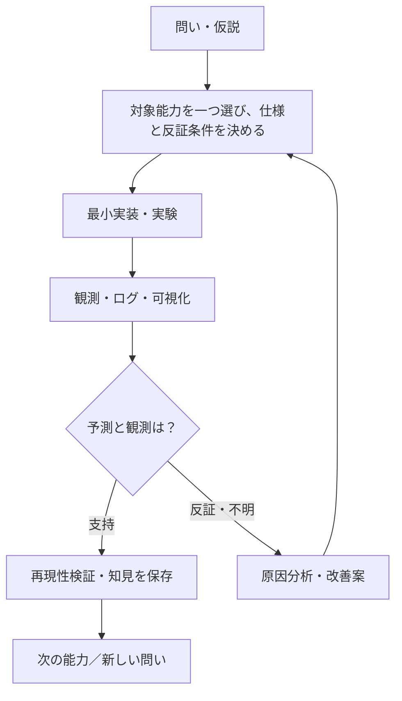

**F020 LIMITED SIMULATION MEASUREMENT INSTRUMENT MERGED INTO MAIN (2026-10-23).** 2026-10-23 formal bounded integration: [design #68](https://github.com/ryonakayama234/SOMA-Synthetic-Organism-Morphogenesis-Arena/pull/68) merged to main at `2d2ae185d428a4dfb685c22b7b9cfcbca2214b79`; [implementation #69](https://github.com/ryonakayama234/SOMA-Synthetic-Organism-Morphogenesis-Arena/pull/69) merged to main at `562dfc163791ffb68aa52e8b12c3fa2e33ada9c7` preserving first-world freeze `f3e3a4de4ff47677db575efaafe342655dede6c2`. **Adopted scope: 1D F020 same-cell k-end resource→k+1 motor eligibility simulation/measurement instrument ONLY**; not self-assembly, independently acting B, metabolic biology, learned consent or fitness. 1,536 primary scenes/6,144 worlds/3,072 timing contrasts; 321 motor/trajectory effects, 64 claimant-map changes (74 additional 1J A claims), of 321 changed-trajectory contrasts 263 A-net-negative, 36 equal, 22 A-net-positive; B net identical across modes. [Exact checked-out final implementation-head F001–F020 20/20 workflow success](https://github.com/ryonakayama234/SOMA-Synthetic-Organism-Morphogenesis-Arena/actions/runs/39966063549); [internal critical interpretation](docs/decisions/2026-10-23-F020-limited-acceptance.md). Post-main **all-workflow gate is tracked separately** and should not be asserted complete solely from the PR-head run. Internal AI review and code-independent auditor are NOT external human peer review.

Historical PR-stage/unexecuted banners below are preserved as dated stages, not current assertions.

**F020 INTERNAL LIMITED-ACCEPTANCE REVIEW (2026-10-23; pending final SHA and post-main gates).** An audited 6,144-world experiment (32 reused field seeds; 3,072 matched feedback/deferred comparisons) found **321 trajectory changes**, **64 resource-claimant-map changes**, but among those 321 only **22 positive A net-energy differences**, **263 negative**, **36 neutral**, **zero B net differences**; moving further is not necessarily a bilateral or energy-survival benefit. First exact current-source run `e32ae59bfeee321fc76c3bc9ccd3e9bf65781ccf` passed **20/20 workflows**, 239 tests Python 3.11/3.12, 9/9 rehashed attacks, independent data audit and byte replay; [internal critical review and conditional limited software acceptance](docs/decisions/2026-10-23-F020-limited-acceptance.md), [append-only findings](findings/F020-validation.md), [PR #69](https://github.com/ryonakayama234/SOMA-Synthetic-Organism-Morphogenesis-Arena/pull/69). Not autonomous metabolism, body formation or a main merge at this stage. Historical proposal banners below are NOT the latest status on this implementation branch.

**F020 IMPLEMENTATION PR #69 / PROTOCOL FROZEN / NOT ADOPTED (2026-10-23).** The exact pre-observation protocol is frozen at `f3e3a4de4ff47677db575efaafe342655dede6c2` ([FROZEN_V1](experiments/F020/FROZEN_V1.md)). [Stacked implementation PR #69](https://github.com/ryonakayama234/SOMA-Synthetic-Organism-Morphogenesis-Arena/pull/69) adds `soma/f020.py`, 6,144-world two-mode paired suite, no-producer-import archive verifier, nine rehashed-forgery controls and Python 3.11/3.12 exact-head CI. This note supersedes historical design-only banners **on this implementation branch only**. No main merge or scientific adoption; see [append-only F020 findings](findings/F020-validation.md) for actual verified outcome SHA. Existing F019 remains frozen.

**F020 PRE-OBSERVATION DESIGN REVIEW (2026-10-23; still UNEXECUTED).** Independent Wolfram/F005 work audit corrected the F020 draft high-budget parity control from 1,000,000 to 4,000,000 µJ: NN consumes 2,000,000 µJ (YY 1,000,000 µJ) for four ideal motor steps without harvest. No F020 simulation or adoption is asserted; draft seed/world count unchanged. [Audit](docs/reviews/2026-10-23-F020-preobservation-audit.md) / [candidate PLAN](experiments/F020/PLAN.md) / [Issue #67](https://github.com/ryonakayama234/SOMA-Synthetic-Organism-Morphogenesis-Arena/issues/67). Deferred harvest credits remain quarantined until episode end.

**NEXT RESEARCH F020 SELECTED (2026-10-23; DESIGN DRAFT / NO F020 EXECUTION / NOT ADOPTED).** [Issue #67](https://github.com/ryonakayama234/SOMA-Synthetic-Organism-Morphogenesis-Arena/issues/67) chooses the smallest missing causal link: F019 trajectory-first-claim external resources should be able to fund the **next** F007 A motor step through the same claimant's F002 balance. This remains a candidate [SPEC](topics/F020-metabolic-feedback/SPEC.md) / [PLAN](experiments/F020/PLAN.md), [unexecuted findings](findings/F020-validation.md), [architecture](docs/ARCHITECTURE.md), [data contract](docs/DATA_CONTRACTS.md) and [decision rationale](docs/decisions/2026-10-23-F020-selection.md). Candidate parameters are NOT frozen; no F020 module, run, ecological result or formal adoption yet. Exact current main: `7de755c79fed3b806417da5c15f0115ea7ac04c8`, F019 already merged, **19/19 post-main F001–F019 workflows successful**. Its evidence (580 claimant changes /1792 paired patch comparisons and 0/512 bilateral positive scenarios) belongs to F019 ONLY; older F019 preregistration/conditional headers below are historical snapshots. Keep F019 v1 data and physics unchanged. Design freeze and an implementation PR must precede F020 science claims. See [study process](docs/RESEARCH_PROCESS.md).

**F019 INTERNAL LIMITED-ADOPTION DECISION (2026-10-23; exact-final-head CI still required).** The preregistered 1D resource field, path-entry first claim/depletion, paired off-world outcomes and F002 ledger are accepted **conditionally as a bounded research measurement instrument**, not as a validated emergent organism. Previously audited HEAD `6186077e` passed all 20 GitHub workflows, independently verified 3584 worlds/512 scenarios, 580 claimant-or-unclaimed-status changes in 1792 patch comparisons and **0/512** bilateral benefit scenes. These comparisons reuse 32 independent resource seeds; neither 580 nor 512 are independent ecological draws. Extra calibration tests, adversarial same-AI review, and honest absence of external human review are documented in [findings](findings/F019-validation.md) and [solo research process](docs/RESEARCH_PROCESS.md). **Limited adoption does not mean human third-party review**, online learning, resource feedback into motor, dynamic joining, real-world physics or generalized biology. Do not merge if final exact-source or post-main checks fail. [Issue #64](https://github.com/ryonakayama234/SOMA-Synthetic-Organism-Morphogenesis-Arena/issues/64) / [design PR #65](https://github.com/ryonakayama234/SOMA-Synthetic-Organism-Morphogenesis-Arena/pull/65) / [implementation PR #66](https://github.com/ryonakayama234/SOMA-Synthetic-Organism-Morphogenesis-Arena/pull/66). Older paragraphs below are dated preregistration/implementation snapshots, not the latest state.

**F019 IMPLEMENTATION CANDIDATE — 2026-10-22; FROZEN PLAN; SCIENTIFIC STATUS NOT ADOPTED.** [Design freeze PR #65](https://github.com/ryonakayama234/SOMA-Synthetic-Organism-Morphogenesis-Arena/pull/65), [issue #64](https://github.com/ryonakayama234/SOMA-Synthetic-Organism-Morphogenesis-Arena/issues/64), [v1 locked protocol](experiments/F019/PLAN.md), [F019 run guide](experiments/F019/README.md), [audit findings](findings/F019-validation.md). F019 implements exogenous SHA256-seeded finite resources harvested along each 1D F007 trajectory, first-claim depletion, individual F002 net, same-field connected/unconnected counterfactuals, and an independent from-disk verifier. Exact 512/3584 worlds on 32 seeds; source-bound GitHub Actions / attack test results must be checked for the exact HEAD before any limited adoption. No learned policy, repeated attach/detach, true B motor or tools; positive joint attachment returns are secondary. **This code is not yet evidence of a discovered phenomenon.**

**NEXT STUDY F019 SELECTED — 2026-10-22, v1 PLAN FROZEN PRE-OBSERVATION / UNEXECUTED / NOT ADOPTED.** [F019 Issue #64](https://github.com/ryonakayama234/SOMA-Synthetic-Organism-Morphogenesis-Arena/issues/64) asks how the same untuned, finite, path-harvested/depletable resources yield different **encounter times, winners (A/B/unclaimed), resource ownership and individual net energy** when two 1D cells are linked versus separate. F018's hand-tailored terminal patch bias motivates the controlled counterfactual comparison, but mutual attachment gain is **secondary/exploratory**, not a mandatory positive result or code gate. [F019 draft SPEC](topics/F019-resource-ecology/SPEC.md), [PLAN](experiments/F019/PLAN.md), [UNEXECUTED findings](findings/F019-validation.md), [diagram](docs/ARCHITECTURE.md) and [data proposal](docs/DATA_CONTRACTS.md) are synchronized in the **draft design PR #65**. [Future-only dynamic morphology / repeated cooperation / temporary tool research memo](docs/research-notes/2026-10-22-temporary-morphology-and-resource-access.md) is separately indexed, **not in F019**. No F019 code, simulation, CI or new scientific observations exist. Only researcher-chosen step-0 link, A-only externally effective motor, 1D ideal motion and investigator-only counterfactuals are in scope; no repeated join/split, local learning, resource transport or tool absorption. v1 design frozen before first simulation; audit source-bound data and obtain review before considering scientific adoption.

**F018 2026-10-22 RESEARCH DECISION: LIMITED ADOPTION APPROVED for a strictly bounded 1D consent/value measurement tool, NOT self-assembled morphology.** [F018 preregistration PR #62](https://github.com/ryonakayama234/SOMA-Synthetic-Organism-Morphogenesis-Arena/pull/62) froze the 90-condition protocol before any F018 world and is merged in main. [F018 implementation PR #63](https://github.com/ryonakayama234/SOMA-Synthetic-Organism-Morphogenesis-Arena/pull/63) has the code, two-person consent gate, fixed externally driven F007 worlds, per-cell F002 energy net, 630 scenario-arm/outside worlds, and independent saved-data oracle plus 8 adversarial rehashed forgery negatives. [Review-hardened source Actions #39758187922](https://github.com/ryonakayama234/SOMA-Synthetic-Organism-Morphogenesis-Arena/actions/runs/39758187922) passed 18/18 workflows with Python3.11/3.12. Both cells' `Δoutside>0` in 18/90 **engineered DUAL_LINK** scenes only; `B_LINK` shows that A's +0.9J fixed-action improvement fails A's -1.1J outside option. [Append-only adoption judgment](findings/F018-validation.md) records H18a–d and the fixed Codex P1 finding. Exact documentation-inclusive final CI and post-main verification are mandatory; do NOT equate source acceptance or main merge with emergent voluntary joining, new physical docking, genuine B motor drive, unplanned resource terrain, or hardware energy conservation.

**F018 2026-10-22 INDEPENDENT REVIEW NOTE:** PR #63 received a P1 Codex finding: the saved-world oracle must verify F007 diagnostic/nullable and decision/event-index columns, not only state positions and totals. It is addressed as a separate post-review source change with additional rehashed-data negative tests. The function's limited scientific status and actual observed outcomes are unchanged, but source-specific CI is required before approving or merging. See [F018 findings](findings/F018-validation.md) and [PR #63](https://github.com/ryonakayama234/SOMA-Synthetic-Organism-Morphogenesis-Arena/pull/63).

**CURRENT F018 2026-10-22 — DESIGN FROZEN AND MERGED, IMPLEMENTATION CANDIDATE UNDER REVIEW (NOT SCIENTIFICALLY ADOPTED).** The pre-registered 90-scene/630-world bilateral gate and private payoff protocol is frozen in [F018 design PR #62](https://github.com/ryonakayama234/SOMA-Synthetic-Organism-Morphogenesis-Arena/pull/62) (merged at `0cab39b`) and [PLAN](experiments/F018/PLAN.md). A separate isolated implementation branch introduces [typed consent gate](soma/f018.py), [run and falsification guide](experiments/F018/README.md), independent raw-data oracle, unit tests and [F018 CI workflow](.github/workflows/f018.yml). [Actual schemas](docs/DATA_CONTRACTS.md), [system diagram](docs/ARCHITECTURE.md), and [append-only findings](findings/F018-validation.md) are versioned with the code. **Initial observed candidate evidence:** [F018 Actions #39737330499](https://github.com/ryonakayama234/SOMA-Synthetic-Organism-Morphogenesis-Arena/actions/runs/39737330499) passed Python 3.11/3.12 at `26160c5`, with 630 audited worlds, byte replay and rehashed semantic attack rejection. Both private outside-option deltas were positive in **18/90 deliberately constructed dual-terminal-patch cases only**; the B-only example still loses to A's idle option. [Raw evidence and exact findings](findings/F018-validation.md). The post-observation documentation/auditor commit requires fresh exact-SHA CI; no autonomous attachment, adoption or main integration is implied. Wolfram predicts possible private +1.9J A / +2.9J B for a deliberately engineered *dual terminal patch* and a restricted A-motor outside menu; this is NOT spontaneous informed joining. The B-only fixed-action improvement for A still loses to idle. Motor B ownership, contact docking, natural foraging and learned attachment choices are NOT implemented. Historic pre-freeze cautions below are retained as dated context and are superseded by the frozen design's status.

**F018 PRE-FREEZE SCIENTIFIC CAUTION (2026-10-22):** The Wolfram +0.9J A benefit compares joined versus *forced independent motor use*, but A still nets −1.1J when joined, versus 0J if it can simply remain idle. Therefore **no voluntary individual incentive has been established** by that worked example. Frozen F018 controls must include no-motor and best feasible individual outside options; [Issue #61](https://github.com/ryonakayama234/SOMA-Synthetic-Organism-Morphogenesis-Arena/issues/61) / [Draft PR #62](https://github.com/ryonakayama234/SOMA-Synthetic-Organism-Morphogenesis-Arena/pull/62) contain this falsification gate. F018 is still design-only / no simulation.\n\n**NEXT PROPOSED STUDY F018 (2026-10-22; DESIGN FEASIBILITY, UNFROZEN / UNEXECUTED / NOT ADOPTED).** Following F017's verified limited-receiver-learning adoption, [Issue #61](https://github.com/ryonakayama234/SOMA-Synthetic-Organism-Morphogenesis-Arena/issues/61) returns to the charter's body-emergence-first research path by asking when **both identical contact-ready cells could obtain individual, positive *physical/resource* value** from mutually consenting to an ideal link. [F018 candidate SPEC](topics/F018-attachment-value/SPEC.md), [experiment PLAN](experiments/F018/PLAN.md), [UNEXECUTED findings and Wolfram feasibility](findings/F018-validation.md), [architecture](docs/ARCHITECTURE.md) and [data contract](docs/DATA_CONTRACTS.md) distinguish researcher-fixed requests from actual autonomously learned choice. Wolfram theory (NOT experimental evidence): linked motor driver 0.625m / 1J vs independent driver 1.25m / 2J over four 0.25s +2N steps; hand-placed resource patches yield individual join-vs-free ΔA/ΔB (+0.9,+2.9)J vs (-2.1,-0.1)J. These are engineered positive/negative *feasibility examples* requiring frozen geometry/cost sweeps before any experiment, not self-organized aggregation. No main implementation, F018 code, experiments, CI or adoption; original F001–F017 unchanged.\n\n**F017 FINAL CURRENT STATUS (2026-10-22): LIMITED ADOPTED AND MERGED TO MAIN in ideal F007/F002 fixed linked 1D receiver-learning scope ONLY.** [Frozen design PR #59](https://github.com/ryonakayama234/SOMA-Synthetic-Organism-Morphogenesis-Arena/pull/59) merged before F017 experiments; [implementation PR #60](https://github.com/ryonakayama234/SOMA-Synthetic-Organism-Morphogenesis-Arena/pull/60) merged at `08b5ffe3563c6773f9bb77e843411dc46a4af1b0`; [post-main Actions #39694731552](https://github.com/ryonakayama234/SOMA-Synthetic-Organism-Morphogenesis-Arena/actions/runs/39694731552) **all 17/17 SUCCESS**, Python 3.11 and 3.12 each 23,296 F007/F002 episodes, independent saved-world/Q/RNG/ledger audit, malicious SHA-rehash rejection and two-root byte replay. [Detailed formal H17a–f scientific verdict](findings/F017-validation.md). I first unseen holdout 95.703125% / +1.82109375J; no-bit N 48.2421875% / +0.447265625J; surprise reversal 8.59375% followed by no-reset final 93.75%. This does NOT demonstrate B voluntary send incentive, sender/receiver protocol co-emergence or body morphological emergence. Prior candidate/not-yet-merged banners below are dated historical snapshots.

**F017 SCIENTIFIC DECISION (2026-10-22): LIMITED ADOPTION APPROVED under frozen ideal fixed 1D F007/F002 receiver-learning task only; integration/post-main CI pending.** [Findings](findings/F017-validation.md) record strict H17a–f criteria, controls, proof limits and exact 23,296-episode evidence. Repaired full-trained-RNG causal fork [Actions #39693731056](https://github.com/ryonakayama234/SOMA-Synthetic-Organism-Morphogenesis-Arena/actions/runs/39693731056) **17/17 SUCCESS**, both Python 3.11/3.12 full saved-world audit and SHA-rehash forgery controls, [3.11 artifact](https://github.com/ryonakayama234/SOMA-Synthetic-Organism-Morphogenesis-Arena/actions/runs/39693731056/artifacts/12389897730), [3.12 artifact](https://github.com/ryonakayama234/SOMA-Synthetic-Organism-Morphogenesis-Arena/actions/runs/39693731056/artifacts/12389148653). Observed first I vs N unseen hit 95.703% vs 48.242%, net +1.82109J vs +.44727J, secret inversion 8.594% immediate then 93.75% recovered. No B self-invented signaling, no body emergence, no human external scientific review. Merge only after final documentation source SHA CI and record post-main status.

**F017 SCIENTIFIC REVIEW / SOURCE-CONTRACT CORRECTION (2026-10-22):** Frozen H17f called for literal cloning of learned Q+policy RNG at the observation checkpoint; prior positive listening results used matched freshly seeded draws. The implementation PR #60 now includes full Q+RNG clone and independent checkpoint SHA reconstruction, plus sign-reversal gate enforcement. Preserved earlier actual 23,296-run results, but **new final-source CI/artifacts required before limited adoption and main merge**. See append-only [findings](findings/F017-validation.md) and [data contracts](docs/DATA_CONTRACTS.md).

**F017 FIRST ACTUAL 23,296-EPISODE NUMERICAL STUDY (2026-10-22; SCIENTIFIC ADOPTION/MAIN MERGE NOT YET APPROVED).** [Frozen design #59](https://github.com/ryonakayama234/SOMA-Synthetic-Organism-Morphogenesis-Arena/pull/59) merged before the run. [Candidate implementation #60](https://github.com/ryonakayama234/SOMA-Synthetic-Organism-Morphogenesis-Arena/pull/60) on observed pre-findings source HEAD `8694cd36`: [Actions #39688112315](https://github.com/ryonakayama234/SOMA-Synthetic-Organism-Morphogenesis-Arena/actions/runs/39688112315) all 17/17 workflows SUCCESS; Python3.11+3.12 each 23,296 frozen F007/F002 episodes with independent saved-world/Q/ledger audit, malicious SHA-rehashed result rejection and two-root byte replay. Actual informative receiver I first unseen holdout hit **95.703125%**, **+1.82109375 J net**, no-bit N **48.2421875%**, **+0.447265625 J**; secret inversion immediate I **8.59375%**, final after continued learning **93.75%**. All H17a–f candidate gates supported **only** in designer-fixed ideal 1D task; not self-emergent sender communication, physical body formation, real energy hardware, human peer review. Append-only [findings](findings/F017-validation.md) are authoritative. After this README/findings change, source SHA changes: review final documentation-inclusive CI and artifacts before considering integration.


**F017 IMPLEMENTATION CANDIDATE (2026-10-22; SCIENTIFIC VERDICT PENDING):** [Frozen design PR #59](https://github.com/ryonakayama234/SOMA-Synthetic-Organism-Morphogenesis-Arena/pull/59) was merged to main **before first F017 world experiment**. Stacked [implementation Draft PR #60](https://github.com/ryonakayama234/SOMA-Synthetic-Organism-Morphogenesis-Arena/pull/60) adds `soma/f017.py` receiver learning, frozen 23,296-episode F007/F002 producer, separate saved-world oracle, causal listening forks, sample-cluster analysis, rehashed forgery negative, Python3.11/3.12 CI and two-root replay. **Candidate code is not scientific adoption.** Confirm actual final-SHA Actions, source-bound raw artifacts and post-analysis decision in [findings](findings/F017-validation.md), rather than assuming good results. Keep body-emergence first; B roles and sensor remain researcher fixed.

**NEXT CANDIDATE STUDY F017 — DESIGN DRAFT ONLY (2026-10-21; NOT FROZEN / NOT EXECUTED / NOT ADOPTED).** Following F016's limited-adopted, fixed-decoder ideal 1D communication value, [F017 Issue #57](https://github.com/ryonakayama234/SOMA-Synthetic-Organism-Morphogenesis-Arena/issues/57) asks whether A can learn unknown opaque B symbol→signed action values from A's own realized energy feedback and re-adapt after secret inversion. Proposed [SPEC](topics/F017-signal-action-learning/SPEC.md), [PLAN](experiments/F017/PLAN.md), [UNEXECUTED findings](findings/F017-validation.md), [architecture](docs/ARCHITECTURE.md) and [contracts](docs/DATA_CONTRACTS.md) are design-only on a separate Draft PR, **not main / not scientific acceptance**. No F017 source, observations, tests, CI or artifacts; old F016, V001 and F011 #37 unchanged. Experimental roles A/B and B's direction sensor are fixed, so this tests *receiver-side embodied association learning*, NOT co-invention of signaling, a self-organized body or general semantic understanding. Design review and freeze must precede any implementation.

**RESEARCH NORTH STAR / BODY EMERGENCE FIRST (2026-10-21):** Independent initially uncommitted cells may discover incentives to gather, attach, persist, separate or reconfigure under local physical/resource constraints. **Communication is optional and subordinate**—force, contact, strain, vibration, behavioral/survival traces, environmental cues or later active signaling may contribute; do not mandate a bit protocol, sender/decoder roles, or reward for joining/sending. Negative nonaggregation and noncommunication outcomes are legitimate. See [research charter](docs/PROJECT.md) and [long-term research Issue #51](https://github.com/ryonakayama234/SOMA-Synthetic-Organism-Morphogenesis-Arena/issues/51). F016 remains a deliberately pre-semantic fixed-message positive control, not body or signaling emergence. **No code/experiment added by this charter clarification.**

**F016 FINAL RESEARCH STATUS (2026-10-21): LIMITED ADOPTED AND MERGED TO MAIN, within the fixed ideal F007 1D numerical resource task only.** Frozen [SPEC](topics/F016-communication-value/SPEC.md) and [PLAN](experiments/F016/PLAN.md) were separately merged through [design PR #54](https://github.com/ryonakayama234/SOMA-Synthetic-Organism-Morphogenesis-Arena/pull/54) (merge `bd0effcd`) before the experiment. The implementation and append-only evidence were merged through [PR #55](https://github.com/ryonakayama234/SOMA-Synthetic-Organism-Morphogenesis-Arena/pull/55) (main merge `146e51db0e2356ed671599266b6c4acd7b7ec954`). [Post-main Actions #39582766235](https://github.com/ryonakayama234/SOMA-Synthetic-Organism-Morphogenesis-Arena/actions/runs/39582766235): **all 16/16 workflows SUCCESS**; F016 both Python3.11/3.12 197 full +6 optimized tests, 24 raw episodes, 49 authenticated evidence files, independent saved-world oracle, false-science negatives, two-root byte replay. Main artifacts [3.11](https://github.com/ryonakayama234/SOMA-Synthetic-Organism-Morphogenesis-Arena/actions/runs/39582766235/artifacts/12337931463) / [3.12](https://github.com/ryonakayama234/SOMA-Synthetic-Organism-Morphogenesis-Arena/actions/runs/39582766235/artifacts/12336773011). **Observed net means J/episode** A0=.50,K=.45,S=.45,T=1.95,H=0,I=−1.05, matching preregistered theory. These are *designer-selected* fixed-signal/terminal reward outcomes, not autonomously emergent communication, real sensor/radio, electrical power, unknown environment, human peer review or body-topology identification. [Findings](findings/F016-validation.md) is authoritative; dated earlier candidate/pending banners below remain historical snapshots.

**F016 first observed 24-run study (2026-10-21, exact source HEAD 3fc7b0a7):** [Actions #39581144450](https://github.com/ryonakayama234/SOMA-Synthetic-Organism-Morphogenesis-Arena/actions/runs/39581144450) passed 16/16 inherited+F016 PR workflows. Both Python3.11/3.12 jobs: 197 full +6 optimized tests, 24/24 raw 1D resource-reaching trials, 49 source-bound JSON/CSV/replay artifacts; independent saved-world oracle/rehash negatives and byte-replay passed. Actual mean net J for A0/K/S/T/H/I: 0.5/0.45/0.45/1.95/0/−1.05. T true bit beats no bit by +1.45J in a deliberately designed ideal 1D task; high sender cost and inverted bit negate this gain. [Append-only findings](findings/F016-validation.md) / [frozen SPEC](topics/F016-communication-value/SPEC.md). **LIMITED ADOPTION RECOMMENDED, not yet main integrated and not confirmation of emergent protocol, radio/optics or learned body topology.** This evidence note modifies SHA; re-run final HEAD CI before integration.

**F016 implementation candidate (2026-10-21; NOT YET VERIFIED / NOT ADOPTED):** Following frozen [SPEC](topics/F016-communication-value/SPEC.md) and [24-run PLAN](experiments/F016/PLAN.md), separate implementation adds `soma/f016.py`, raw producer + independent saved-data auditor, falsification tests and Python3.11/3.12 CI; exact results/CI and adoption remain PENDING at this history snapshot. B initial local resource-direction bit (not F014 movement bit), F007 external effective motor on ideal 1D links, sidecar F002 sender fee + motor spend + conditional resource gain; no source changes to F001–F015. [Experiment execution README](experiments/F016/README.md) / [findings](findings/F016-validation.md). Earlier design-only notes below are historical.


**F016 2026-10-21 frozen preregistration / important continuous-to-discrete correction (NOT RUN):** [F016 SPEC](topics/F016-communication-value/SPEC.md) / [PLAN](experiments/F016/PLAN.md) / [theory-only correction log](findings/F016-validation.md). The earlier feasibility ±0.5m target is **invalid for F007 semi-implicit Euler at dt=0.25s**; corrected ±0.625m resource location, midpoint positive mechanical motor work still 1J. Pre-register 24 comparisons (A0 no message, K constant, S shuffled, T true-low-cost, H true-high-cost, I inverted), with B sender cost and F007 actual A motor spent reconciled in F002. F016 no simulator results or adopted API at this frozen design stage; old draft feasibility paragraph below remains an archived earlier proposal, not an experiment.

**NEXT STUDY F016 — DESIGN FEASIBILITY ONLY (2026-10-21, UNFROZEN / UNEXECUTED):** [Issue #52](https://github.com/ryonakayama234/SOMA-Synthetic-Organism-Morphogenesis-Arena/issues/52) / [candidate feasibility](topics/F016-communication-value/FEASIBILITY.md) / [candidate PLAN](experiments/F016/PLAN.md) / [empty experiment evidence log + Wolfram theory precheck](findings/F016-validation.md) / [architecture](docs/ARCHITECTURE.md) / [candidate data contracts](docs/DATA_CONTRACTS.md). On latest main F015 design #49 and implementation #50 are both actually merged, main at 5497e8262f47a3c3df5f74e65ccac44bb8bd839e. F015's B-bit provided ZERO unique discrimination in its frozen A-only comparison; this **does not** rule out useful communication for downstream action. A proposed F016 1D resource-reaching positive/negative control yields only *theoretical*, intentionally designed net-gain contrasts (no communication 0.5 J, correct bit low-cost 1.95 J, shuffled bit 0.45 J, correct bit high-cost 0 J). No F016 simulator, raw results, CI, accepted API, physical hardware claim, spontaneously invented communication, or main merge. [Long-term body–communication research backlog #51](https://github.com/ryonakayama234/SOMA-Synthetic-Organism-Morphogenesis-Arena/issues/51) and separate [Draft documentation PR #53](https://github.com/ryonakayama234/SOMA-Synthetic-Organism-Morphogenesis-Arena/pull/53) are NOT the F016 experiment. This new F016 design remains a separate Draft PR requiring review and preregistration before implementation.

**F015 2026-10-21 RESEARCH DECISION: LIMITED ADOPTION APPROVED for fixed ideal 1D active-probe observation comparison ONLY** — [Issue #48](https://github.com/ryonakayama234/SOMA-Synthetic-Organism-Morphogenesis-Arena/issues/48) / [design PR #49](https://github.com/ryonakayama234/SOMA-Synthetic-Organism-Morphogenesis-Arena/pull/49) / [implementation PR #50](https://github.com/ryonakayama234/SOMA-Synthetic-Organism-Morphogenesis-Arena/pull/50) / [F015 findings](findings/F015-validation.md). On reviewed implementation HEAD `9725c556741b373184a53e6a407644644ff75952`, [Actions #39538071630](https://github.com/ryonakayama234/SOMA-Synthetic-Organism-Morphogenesis-Arena/actions/runs/39538071630) succeeded Python3.11+3.12 (191 full tests + 5 optimized per version), 15 frozen F007 trials/60 A-local + 60 B bits, 138 byte-replayed files and three dropout diagnostics, source-bound rehashed false-science negatives. All **15/15 inherited + F015 workflows** passed on this HEAD. H15a/b/c/d/e supported within frozen gates: L/F/T identical at 2N, L/F separate already using A-only at reduced force, L/T remain observationally equivalent at all forces, B adds **zero unique discrimination** in these controls. Wolfram exact fractions independently checked, but same-assistant saved-data oracle is **not external human peer review**. Formal acceptance is restricted to ideal F007 1D numerical observations under declared reference and fixed/nuisance-force assumptions: **no topology or real coupling verification, online autonomous choice, physical ground/electric drive, sensor noise, 2D/3D or emerging body schema**. This is a **scientific scope decision**, not a claim that PRs are merged. Documentation-inclusive final SHA CI must also pass; merge design then implementation, then check post-main CI and record final SHAs separately in Issue #48. Historical earlier UNEXECUTED notes remain as dated provenance.

**F015 IMPLEMENTATION CANDIDATE (2026-10-21; NOT SCIENTIFICALLY ADOPTED / NOT MAIN):** [Issue #48](https://github.com/ryonakayama234/SOMA-Synthetic-Organism-Morphogenesis-Arena/issues/48) / [Design Draft #49](https://github.com/ryonakayama234/SOMA-Synthetic-Organism-Morphogenesis-Arena/pull/49) / [frozen SPEC](topics/F015-active-body-probing/SPEC.md) / [frozen PLAN](experiments/F015/PLAN.md) / [execution README](experiments/F015/README.md) / [F015 findings](findings/F015-validation.md). Separate F015 typed `soma/f015.py` compare-only local probe, frozen F007 15 runs, independent saved-data oracle and Python 3.11/3.12 CI now **proposed in an implementation branch**. Its outcome is NOT verified until exact implementation HEAD CI and raw artifacts are audited. Linked-vs-held-disturbance A-only improvement and linked-vs-command-tracking counterexample are both critical; B-bit incremental discrimination may be zero. No physical topology success claim, no autonomy/2D/real sensor, no human peer review; legacy F001–F014 and V001/F011 backlog untouched.

**NEXT STUDY F015 — DESIGN ONLY / NO F015 SIMULATOR EVIDENCE (2026-10-21):** [Issue #48](https://github.com/ryonakayama234/SOMA-Synthetic-Organism-Morphogenesis-Arena/issues/48) / [frozen SPEC](topics/F015-active-body-probing/SPEC.md) / [15-run PLAN](experiments/F015/PLAN.md) / [UNEXECUTED evidence log](findings/F015-validation.md) / [architecture](docs/ARCHITECTURE.md) / [data contracts](docs/DATA_CONTRACTS.md). F014 is ALREADY limited-adopted and merged via [PR #47](https://github.com/ryonakayama234/SOMA-Synthetic-Organism-Morphogenesis-Arena/pull/47); 14 main workflows passed on `01ed29196b82e483231148240d8f8f75169d9a8a`. F015 asks whether A's controlled u=2/1/0 interventions distinguish a held-force unlinked mimic from a mechanical link and whether command-tracking hidden disturbances defeat all interventions. Wolfram exact rational precheck is theory, NOT F015 simulator output. No F015 code, runtime data, CI, scientific adoption or main merge. Historical F014 design-only block below is retained as dated context.


**NEXT RESEARCH PROPOSAL F014 (2026-10-20; DESIGN ONLY, NOT IMPLEMENTED):** [Issue #45](https://github.com/ryonakayama234/SOMA-Synthetic-Organism-Morphogenesis-Arena/issues/45) asks whether an extra **one-bit B-local motion message** resolves F010's linked-vs-hidden-force A-only indistinguishability, and where a coordinated unlinked counterexample defeats even that channel. [frozen SPEC](topics/F014-peer-body-observability/SPEC.md) / [prospective PLAN](experiments/F014/PLAN.md) / [UNEXECUTED findings and Wolfram arithmetic](findings/F014-validation.md) / [architecture](docs/ARCHITECTURE.md) / [data contracts](docs/DATA_CONTRACTS.md). Proposed packet/estimator are **not code and not empirical data**. No verified topology/body schema, autonomous probing, real robot communication or main merge. Preserve F001–F013 limited scientific claims, V001 draft and F011 no-ground backlog.

**F013 formal research decision (2026-10-20): LIMITED ADOPTION APPROVED** for the preregistered **ideal 1D two-cell alternative-contact numerical robustness** study — not real ground physics, general locomotive capability, battery sufficiency, self-organized morphology or autonomous cell policy. Source and [Issue #42](https://github.com/ryonakayama234/SOMA-Synthetic-Organism-Morphogenesis-Arena/issues/42), [pre-experiment design PR #43](https://github.com/ryonakayama234/SOMA-Synthetic-Organism-Morphogenesis-Arena/pull/43) and [implementation PR #44](https://github.com/ryonakayama234/SOMA-Synthetic-Organism-Morphogenesis-Arena/pull/44) record the evidence and exact actual merge / post-main CI hashes. H13a/H13b/H13d SUPPORTED within frozen gates; H13c INCONCLUSIVE; 36 primary and 24 post-review independent RK4 diagnostics, Python3.11/3.12, complete source-bound immutable replay and negative controls verified on review commit `a2b8e2678378acc09f04731b89f1e55520aca110`. Friction is **continuous C0, not globally C1**; original F011/F012 and V001 untouched. Formal decision grants merge authorization **subject to documentation-inclusive final CI and actual GitHub merge/post-main verification**; never confuse a decision with a completed merge.

**Historical F013 candidate record (2026-10-20, before subsequent formal limited adoption):** [Issue #42](https://github.com/ryonakayama234/SOMA-Synthetic-Organism-Morphogenesis-Arena/issues/42) / frozen [SPEC](topics/F013-contact-rectification/SPEC.md) and [36-case PLAN](experiments/F013/PLAN.md) / [findings](findings/F013-validation.md). Independent smooth passive-directional friction is tested WITHOUT changing F011/F012; 36 B/C/D/E × epsilon × dt controls with independent world-truth CSV audit, symmetry, passivity and convergence checks. Scientific H13 results and exact-HEAD CI must be read from the latest findings/PR; implementing a different contact constitutive model does NOT establish hardware locomotion or autonomous discovery. Design and implementation remain separate Draft PRs pending researcher adoption/merge authorization. V001 and F011 Issue #37 unaffected.

# SOMA — Synthetic Organism Morphogenesis Arena

**F012 latest formal research decision (2026-10-20; authorized by researcher delegation in conversation): LIMITED ADOPTION / integration authorized after verification, NOT a claim that all energy budgets sustain locomotion.** The frozen ideal 1D 2-cell F011-ground model plus F012 finite positive internal motor work gate, accurate whole-µJ budget accounting and B/C/D/E × 0/1/3/10J × 3 dt evaluation are accepted only within the preregistered numerical assumptions. C/D 10J persistent within the frozen gates; C/D 1J and 3J not persistent (3J r-period error .06201153m vs preregistered .01m), 0J static, isotropic B COM zero and E no drive static. 3J C signed COM shows material dt sensitivity (dt .01=2.752360m, .005=2.758467m, .0025=3.052423m), so no quantitative real-world power efficiency or smooth convergence claim. Verified pointwise C↔D mirror and B/E every-step controls on ALL dt and budgets; same-assistant independently coded oracle plus Wolfram does NOT constitute external human peer review. The previous failing independent-auditor code and correction remain in commit/Actions history. Source and full CI evidence are reviewed on [F012 implementation PR #40](https://github.com/ryonakayama234/SOMA-Synthetic-Organism-Morphogenesis-Arena/pull/40), corresponding preregistration on [design PR #39](https://github.com/ryonakayama234/SOMA-Synthetic-Organism-Morphogenesis-Arena/pull/39), findings [F012](findings/F012-validation.md); **merge completion and merged HEAD are verified in GitHub separately, not inferred from this decision statement**. F011 A's no-contact 9.6s failure remains INCONCLUSIVE, Issue #37 distinct; V001 and F001–F011 untouched.


**F012 implementation candidate (2026-10-20; NOT FORMALLY ADOPTED):** [Issue #38](https://github.com/ryonakayama234/SOMA-Synthetic-Organism-Morphogenesis-Arena/issues/38) / design [Draft #39](https://github.com/ryonakayama234/SOMA-Synthetic-Organism-Morphogenesis-Arena/pull/39) / stacked implementation [Draft #40](https://github.com/ryonakayama234/SOMA-Synthetic-Organism-Morphogenesis-Arena/pull/40). B/C/D/E x 0/1/3/10J x 3dt (48 experimental conditions) now have a separately versioned finite ideal-positive-work internal motor gate; independent raw-data oracle, per-step energy accounting, negative/tamper tests and replay. **At finest dt C final COM: 0J=0m, 1J=+1.027505m, 3J=+3.052423m, 10J=+3.502382m**. Only 10J C satisfies the preregistered last-two-period persistence + stroke-return tests; 3J is NOT SUPPORTED for persistence (last-period r-return +.062012m), though it moves. Initial independent verifier failed on pre-/post-state indexing; corrected and original red CI preserved. Results are only for frozen ideal 1D software; no autonomous morphology, real electric energy or independent human peer review. Final branch SHA and checks must be verified before any adoption/merge. [Experiment findings](findings/F012-validation.md).


**F012 DESIGN ONLY (2026-10-20; researcher authorized work, not adoption/main merge):** [Issue #38](https://github.com/ryonakayama234/SOMA-Synthetic-Organism-Morphogenesis-Arena/issues/38). [Frozen SPEC](topics/F012-finite-energy/SPEC.md), [48-case PLAN](experiments/F012/PLAN.md), [UNEXECUTED findings](findings/F012-validation.md). Finite integer-µJ positive-mechanical-work budget for F011's separate 1D B/C/D/E ground dynamics; no change to F011 or V001. Speculation about F012 outcomes is NOT observed evidence.


> 身体の構造を知らない小さな機械が、相互作用と環境条件から新しい身体機能を発見するための研究室。

**F011 最新研究判断（2026-10-20／条件付き限定的正式採用・main統合承認）**：二つの同一セルに等大反対の周期内力を与え、研究者が固定した**方向依存の受動摩擦**を介して重心が正味移動することを、指定1D離散モデルのC/D完全試行・鏡映対照・収束・保存CSV監査に限り採用。Cは最細刻みで +3.5023819308m、Dは符号反転。**ただし無接地Aは約2.1sで固定ストローク上限を超過し、9.6s全期間H1と全対照完走の事前登録ゲートは未達・INCONCLUSIVEのまま**。これは基準を変更しない研究責任者の明示的な例外判断であり、全条件成功・実機接触・自律学習・形態創発・実電力の採用ではない。[採用範囲と逸脱記録](topics/F011-grounded-internal-drive/SPEC.md#2026-10-20-post-experiment-decision-conditional-limited-adoption-not-part-of-the-preregistration)／[検証と証拠](findings/F011-validation.md)／[Issue #34](https://github.com/ryonakayama234/SOMA-Synthetic-Organism-Morphogenesis-Arena/issues/34)。設計[PR #35](https://github.com/ryonakayama234/SOMA-Synthetic-Organism-Morphogenesis-Arena/pull/35)→実装[PR #36](https://github.com/ryonakayama234/SOMA-Synthetic-Organism-Morphogenesis-Arena/pull/36)の**実際の統合・CI状態はGitHubを正とする**。以下の候補・未採用表記はその時点の履歴。

**最新判断（2026-10-17）**：F007 `f007.v1` は**固定1D・2セル片側A駆動とA電池支出の離散モデル整合性に限って正式採用**。9条件のWolfram/保存データ独立照合、3.11/3.12各126全回帰＋14最適化、58ファイル再現、改ざん・失敗時保存試験を通過。[採用範囲・非採用事項](findings/F007-validation.md#2026-10-17-f007-限定的正式採用--最新の研究判断)を優先し、下の「設計のみ／未採用」などは当時の履歴として読む。PR #20（設計）→#21（実装）の統合状況はGitHubを正とする。**実機・創発・任意dt・二宛先crash-atomicは非採用。**

**F006研究の最新段階（2026-10-17／限定的正式採用：fixed A〜E・15runのdt差分監査）**：独立監査のP2（証拠出所の未照合、失敗時に出力が残る）を修正し、分類を事前ラベルと観測signatureへ分離。F001〜F005本体は不変。[設計PR #17](https://github.com/ryonakayama234/SOMA-Synthetic-Organism-Morphogenesis-Arena/pull/17)／[実装PR #18](https://github.com/ryonakayama234/SOMA-Synthetic-Organism-Morphogenesis-Arena/pull/18)／[仕様](topics/F006-timestep-diagnostics/SPEC.md)／[検証ノート](findings/F006-validation.md)／[再現手順](experiments/F006/README.md)。旧v1・初回CIと旧候補記述は各時点の履歴。最終監査の成功とユーザーの研究判断に基づき限定的に正式採用し、統合の実際の状態はPR #18で追跡する。

**現在（2026-10-16）：F001〜F003に加え、F004の「電池残量に制約された1セル1D内部駆動」を実装・検証済みとして正式採用。73テスト、A〜Fの10対照、17拒否例、保存証拠の独立照合と再実行一致、CIを確認。設計[PR #10](https://github.com/ryonakayama234/SOMA-Synthetic-Organism-Morphogenesis-Arena/pull/10)を先に統合し、実装と採用記録は[PR #11](https://github.com/ryonakayama234/SOMA-Synthetic-Organism-Morphogenesis-Arena/pull/11)で統合する。[F004検証記録](findings/F004-validation.md#2026-10-16-採用判断と統合)を参照。**

## 次の一能力（研究提案：F005／2026-10-16）

**現行mainはF001〜F004を正式採用済み。F005はPR #14上で実装・検証中の候補であり、正式採用・main統合は未了。** F004の速度反転時に再加速の正仕事が相殺される既知制約に対し、F005では1セル1Dの区間内正モーター仕事を積算する能力だけを検証する。これを先に整備してから、F003との力学的・電池的接続、資源制約、結合の有利不利の実験へ進む。

- [F005 Issue #12（研究課題）](https://github.com/ryonakayama234/SOMA-Synthetic-Organism-Morphogenesis-Arena/issues/12)
- [F005 仮説と受入基準](topics/F005-positive-work/SPEC.md)／[事前A〜F計画](experiments/F005/PLAN.md)／[検証ノート](findings/F005-validation.md)
- [F005 システム図](docs/ARCHITECTURE.md#f005速度反転時の正仕事積算2026-10-16-研究提案未実装)／[提案データ構造](docs/DATA_CONTRACTS.md#f005正仕事と符号付き仕事の分離2026-10-16-提案未実装)
- 詳細は設計PR（main未統合）で監査。コードと証拠は別の実装PRで同時更新し、ユーザー判断まで採用扱いにしない。


## F005 implementation candidate — positive motor work (2026-10-16; not adopted)

On `feat/F005-positive-work-20261016` (base: Draft design branch) the new F005 ideal one-cell 1D positive-work accounting runs independently of existing F004. **The feature remains a review candidate; `main` is unchanged and no adoption is claimed.**

- [F005 module](soma/f005.py), [tests](tests/test_f005.py), [A–F independent saved-evidence suite](experiments/F005/run_suite.py), [WSL2 reproducibility](experiments/F005/README.md).
- [Architecture diagram](docs/ARCHITECTURE.md), [data schema](docs/DATA_CONTRACTS.md), [preregistered plan](experiments/F005/PLAN.md), [findings](findings/F005-validation.md), [Issue #12](https://github.com/ryonakayama234/SOMA-Synthetic-Organism-Morphogenesis-Arena/issues/12).
- The separate `.github/workflows/f005.yml` runs all prior tests and F005 A–F and uploads raw CSV/ledger/SVG/source/hash/replay artifacts. No autonomous decision, two-cell motor coupling, hardware, or emergence is being claimed.


### F005 CI初回結果（2026-10-16、実装候補のまま）
[監査修正済みHEADのF005 Actions](https://github.com/ryonakayama234/SOMA-Synthetic-Organism-Morphogenesis-Arena/actions/runs/38876548177)は**90 Pythonテスト、10正常対照、17入力拒否、保存CSV独立照合と再実行一致でsuccess**。証拠：[artifact ID 12036090522](https://github.com/ryonakayama234/SOMA-Synthetic-Organism-Morphogenesis-Arena/actions/runs/38876548177/artifacts/12036090522)。端点パワーを先に掛けると微小仕事が0へアンダーフローする問題を監査で発見・修正し、`findings/F005-validation.md`へ反例と限界を記録した。これは**正式採用・main統合ではない**。

### PR #14 独立レビュー修正（2026-10-16）
保存ログの検証で、通常の反転でも演算順の差から1µJずれる問題、微小仕事の誤拒否、初期候補欄・微小正仕事の改変見逃しを修正。有理数の独立積分とbinary64の課金参照を分離し、0.1秒刻みの数量化差も記録する。ローカル93テスト、13対照、17拒否、73ファイルの再実行一致を確認。現行HEADのCIは[PR #14 Checks](https://github.com/ryonakayama234/SOMA-Synthetic-Organism-Morphogenesis-Arena/pull/14/checks)、反例・限界は[検証ノート](findings/F005-validation.md)を参照。

### F005の意味論監査と採用範囲案（2026-10-16）
[意味論監査](findings/F005-validation.md#2026-10-16-意味論監査正式採用範囲の判断材料)で、位置と仕事の軌道差、刻みによる受否/支出の変化、微小な正残量による無償保持、反作用相手を持たない有効駆動力という境界を具体例で確認。**正仕事積算の離散計算部品として限定採用を推奨可能**だが、自律移動・生存・形態比較の標準環境としての採用を意味しない。[仕様の判断案](topics/F005-positive-work/SPEC.md#2026-10-16-意味論監査限定採用の判断案未採用)を参照。正式採用・マージは未実施。

### F006 独立監査後の修正方針（2026-10-17）
[PR #18の独立レビュー](https://github.com/ryonakayama234/SOMA-Synthetic-Organism-Morphogenesis-Arena/pull/18#pullrequestreview-5550332235)で数値は支持、証拠出所と失敗時保存にP2が2件。設計PR #17で[v2契約](topics/F006-timestep-diagnostics/SPEC.md)を追補し、実装側で修正・負例・新証拠を準備する。分類は固定対照ラベルと観測の参照一致として扱う。正式採用・main統合は未了。

## 入口：どこから読む？

| 知りたいこと | 読む資料 |
| --- | --- |
| 研究の目的と守る原則 | [研究憲章](docs/PROJECT.md) |
| 全体の仕組みを図で見る | [システム図鑑](docs/ARCHITECTURE.md) |
| データの構造・流れを見る | [データの約束](docs/DATA_CONTRACTS.md) |
| 仮説→実験→改善の進め方 | [研究運営](docs/RESEARCH_PROCESS.md) |
| 最初の一機能 | [F001：単一セルの運動](topics/F001-single-cell-motion/SPEC.md)（実装・初回検証済み） |
| F001の実験結果 | [初回検証ノート](findings/F001-validation.md) / [再現方法](experiments/F001/README.md) |
| F003の設計・検証履歴 | [F003仕様案](topics/F003-attachment/SPEC.md) / [A〜F実験計画](experiments/F003/PLAN.md) / [検証記録・監査結果](findings/F003-validation.md) / [設計PR #7](https://github.com/ryonakayama234/SOMA-Synthetic-Organism-Morphogenesis-Arena/pull/7) |
| 論文や参考情報 | [文献図書館](library/INDEX.md) |
| なぜこの設計にしたか | [意思決定001](docs/decisions/0001-incremental-library.md) |
| AIエージェントの読み方 | [AI案内](AGENTS.md) |

## 研究の一周



## 当面の研究対象

- **F001：単一セルが動く（実装済み）**。位置・速度・力を検証。計算結果・誤差を記録済み。学習、結合、エネルギーはまだ追加しない。
- **F002：エネルギー取得・支出・セル間の数値移送を追跡（実装・初回検証済み）**。[再現手順](experiments/F002/README.md)／[CIによる検証ノート](findings/F002-validation.md)。物理的な電力消費は未実装。機械結合は独立のF003実装候補で検証。 [発案時の構想メモ（歴史資料）](topics/F002-energy-ledger/IDEA.md) は正式仕様ではない。
- **F003：二セルの理想機械結合と切断（実装・検証済み）**。身体の自律形成・学習・物理エネルギー移送は対象外。

## 守る原則

1. 一つの Issue / 実験では主要な能力一つを扱う。
2. 「接続したら得点」など結合自体への報酬を与えない。
3. 世界の真の状態と、細胞が観測できる情報を分離する。細胞に身体全体の構造は渡さない。
4. 否定的な結果、未解決事項、採用しなかった仮説も残す。
5. 文献が支持する事実・研究仮説・設計上の選択・実験結果を区別する。
6. 実験条件・シード・コード版・単位・生ログを対応づけて再現できるようにする。
7. 巨大な抽象化を先に作らず、必要になった機能を一つずつ足す。

**GitHub は進捗の台帳**：Issue = 一つの課題、Pull Request = 変更提案、Commit = 保存された変更。操作の知識がなくても研究判断を確認できることを目指す。

## 機能追加時に必ず同期するもの
F002以降は、**コード／テスト・システム図（docs/ARCHITECTURE.md）・データ契約（docs/DATA_CONTRACTS.md）・実験記録（findings/Fxxx-validation.md）・READMEの現在地**を同じPRで更新する。仮説と実装と観測を混同しない。詳細は[研究運営](docs/RESEARCH_PROCESS.md)。F002ではこの5点を同一PR #6で更新し、対照Fの同一設定での再実行証拠も保存する。[PR #6のChecks（最新HEADのCI）](https://github.com/ryonakayama234/SOMA-Synthetic-Organism-Morphogenesis-Arena/pull/6/checks)から常に現行HEADの実行ログ・保存artifactを確認できる。過去のCIと途中の不備・訂正履歴は[検証ノート](findings/F002-validation.md)に保持。

## F003実装候補（feat/F003-1d-coupling-validation-20261015）

- [事前登録の設計PR #7](https://github.com/ryonakayama234/SOMA-Synthetic-Organism-Morphogenesis-Arena/pull/7)を土台にした**別の実装ブランチ**。設計PRの正式レビューとmain統合を先取りしない。
- `soma/f003.py`：理想一次元リンクの力伝達と切断。`tests/test_f003.py`：独立参照・保存・拒否。`experiments/F003/run_suite.py`：A〜F対照。
- [F003アーキテクチャ](docs/ARCHITECTURE.md#f003-実装候補-2026-10-15) / [データ契約](docs/DATA_CONTRACTS.md#f003-実装候補-2026-10-15) / [実験ノート](findings/F003-validation.md) / [再実行方法](experiments/F003/README.md)。
- GitHub ActionsでF001/F002/F003の回帰、A〜F、SHA付き生ログの保存を確認し、別視点の監査で支持・反証・不明を判定するまで**正式採用しない**。

## F003 GitHub CI 履歴（監査修正前・2026-10-15）

- 実装HEAD: 1512206596ca8939705e6e1ab603e9aa1bbd626d
- F003 Actions: https://github.com/ryonakayama234/SOMA-Synthetic-Organism-Morphogenesis-Arena/actions/runs/38731190546 — success。Python 3.11で合計44テスト（F001 17、F002 16、F003 11）合格。
- A〜F正常7run、不正入力8件を拒否、B同条件再実行の生バイト一致。artifact: F003-A-F-evidence（ID 11970235937）。
- F001既存ワークフロー: https://github.com/ryonakayama234/SOMA-Synthetic-Organism-Morphogenesis-Arena/actions/runs/38731190562 — success。
- F002既存ワークフロー: https://github.com/ryonakayama234/SOMA-Synthetic-Organism-Morphogenesis-Arena/actions/runs/38731190549 — success。
- 以上は1D理想モデル・ソフトウェアの整合性を示す。実機による結合、エネルギー相互作用、身体創発を示さない。
- 独立第三者の監査は未了。PR #7の設計レビューと、PR #8の正式採用判断を区別する。

## 次期研究候補：F004 内部駆動・エネルギー接続（2026-10-15／提案・未実装）

F001（1D運動）、F002（整数µJ台帳）、F003（2セル理想リンク）はmain統合済み。次の一能力の**候補**は、単一セルの内部モーターによる正の理想機械仕事をF002残高から消費し、残高不足ならモーター力だけ停止すること。外力は電池消費に算入しない。F003との力学・エネルギー統合、資源獲得、学習・結合の自律選択は別の後続課題とする。

- [F004 Issue #9（研究提案）](https://github.com/ryonakayama234/SOMA-Synthetic-Organism-Morphogenesis-Arena/issues/9)
- [仮説・境界・受入基準](topics/F004-actuation-energy/SPEC.md)
- [A〜F事前登録とWolfram理論予測](experiments/F004/PLAN.md)
- [システム図のF004節](docs/ARCHITECTURE.md#f004内部駆動と電池の因果接続2026-10-15-設計提案未実装)
- [データのF004節](docs/DATA_CONTRACTS.md#f004内部駆動電池の入出力構造2026-10-15-提案未実装)
- [実験記録（未実施）](findings/F004-validation.md)

**採用ゲート**：事前レビュー → 別PRで最小実装・A〜F・回帰CI → 独立監査 → findingsへ結果と限界を確定 → 採否決定。実装PRではコード、システム図、データ契約、実験記録、READMEを同時更新し、mainへの統合は採用決定後。提案だけでは検証済みとしない。

### F004 設計レビュー追記（2026-10-16）
F004は引き続き**設計段階／実験未実施**。Draft PR #10で2つの設計上の問題を事前修正：①残量0かつ仕事0での内部駆動を禁止（外力は残す）、②数学的理想値とbinary64の各ステップµJ切上げ参照値を区別。Bの計画値は理想500000 µJ・binary64参照499995 µJ、Dは理想55000 µJ・binary64参照54996 µJ。既存F001〜F003は変更しない。仕様・図・データ契約・検証記録はこのPR内で同期。[設計PR #10](https://github.com/ryonakayama234/SOMA-Synthetic-Organism-Morphogenesis-Arena/pull/10)。

## F004 内部モーター駆動と電池残量の連携【2026-10-16 実装候補】

**状態：Draft実装PR #11でコード・自動検証を構築。main未統合、正式採用前。** 上に残る「F004未実装」はPR #10の設計時点の記録であり、当節は実装ブランチ上の現在地。

- [F004実装PR #11](https://github.com/ryonakayama234/SOMA-Synthetic-Organism-Morphogenesis-Arena/pull/11)は[事前登録の設計PR #10](https://github.com/ryonakayama234/SOMA-Synthetic-Organism-Morphogenesis-Arena/pull/10)に積んだPR。両者ともレビューなしにmainへ統合しない。
- [実装](soma/f004.py) / [テスト](tests/test_f004.py) / [実験実行](experiments/F004/run_suite.py) / [WSL2での再現手順](experiments/F004/README.md)。
- [システム図](docs/ARCHITECTURE.md#f004-実装候補2026-10-16pr-11正式採用前) / [データ契約](docs/DATA_CONTRACTS.md#f004-実装候補-f004v1-の確定予定スキーマ2026-10-16pr-11) / [仕様・仮説](topics/F004-actuation-energy/SPEC.md) / [初回検証結果・Wolfram独立理論値](findings/F004-validation.md)。
- [初回CI成功](https://github.com/ryonakayama234/SOMA-Synthetic-Organism-Morphogenesis-Arena/actions/runs/38829244901)：Python3.11の全68テスト成功、A〜F 10正常対照・16不正入力拒否、独立CSV検証と全スイート再実行一致。B残高499995µJ/D残高54996µJは実装前に記録したbinary64参照と一致。
- 既存F001/F002/F003のAPI変更なし。エネルギー制約付き1セル1D運動のみ。F003への結合・細胞の知能・実機・進化・創発の根拠にはならない。

### PR #11 実装監査の更新（2026-10-16）
時間格子のfloat正規化でステップが欠ける問題、Config直接生成での検証迂回、巨大な有限値のSVG座標overflow、保存証拠検証の抜けを修正。通常の物理・費用式と事前参照値は維持し、境界と改変に対する5テストを追加。[4件の反例・修正・検証結果](findings/F004-validation.md#2026-10-16-pr-11-独立視点の実装監査)。Draft維持、main統合・正式採用は別途判断する。

### F004 正式採用（2026-10-16）
ユーザーの採用・統合指示により、1セル1Dの離散理想モデルを採用する。上の提案・Draft・採用前の記載は各時点の履歴。[仕様の採用範囲](topics/F004-actuation-energy/SPEC.md#2026-10-16-正式採用の範囲と持越し課題)を優先する。

保持・待機消費ゼロ、負の区間仕事は無回生・支出ゼロ。粗い刻みで速度反転をまたぐと正負の仕事が相殺され、再加速を含むのに支出0となり得る。この制約とdt依存のµJ切上げを記録し、自律制御の消費最適化・生存課題へ広げる前に別課題で改善する。F003との結合、実機、知覚・学習・身体創発は今回の採用範囲に含めない。


### F005：限定的な正式採用（2026-10-16）
F005は「単一セル1Dの離散正仕事積分と整数µJ台帳への接続」として採用。[F005仕様の採用範囲](topics/F005-positive-work/SPEC.md#2026-10-16-正式採用f005の限定的な研究上の位置づけ)／[A〜Fと実装監査記録](findings/F005-validation.md)／[設計PR #13](https://github.com/ryonakayama234/SOMA-Synthetic-Organism-Morphogenesis-Arena/pull/13)／[実装PR #14](https://github.com/ryonakayama234/SOMA-Synthetic-Organism-Morphogenesis-Arena/pull/14)。旧提案・Draft・未実施の節はその時点の履歴。

**採用外**：位置と仕事で異なる補間軌道、時間刻み依存の駆動拒否と毎ステップ切上げ、電池1µJでの無償保持、推進反作用相手未定義。これらを解決するまで自律移動、資源到達、移動効率、生存、身体形態/協調の優劣を評価する環境としては採用しない。次の優先課題は電池制約付き運動・課金の刻み幅収束。


### F006実装候補（2026-10-16）

- [設計Draft PR #17](https://github.com/ryonakayama234/SOMA-Synthetic-Organism-Morphogenesis-Arena/pull/17)を事前登録とし、[実装Draft PR #18](https://github.com/ryonakayama234/SOMA-Synthetic-Organism-Morphogenesis-Arena/pull/18)をその設計ブランチに積んでいる。どちらも`main`に未統合。
- `experiments/F006/run_suite.py`が5系列×3刻み=15 runを`soma/f005.py`で実行。`diagnostics.py`が保存CSVをF005の独立オラクルで照合したうえで横断診断し、`comparison.csv`・`diagnostics.json`・`comparison.svg`を出力する。
- `tests/test_f006.py`は7テスト（正常対照、異常入力、ハッシュ更新付き証拠改変、完全バイト再現）。CIは既存F001〜F005を含む100テスト、F005+F006の`python -O`を検査する。
- [初回実装CI](https://github.com/ryonakayama234/SOMA-Synthetic-Organism-Morphogenesis-Arena/actions/runs/38916091762)は成功し、[生証拠162ファイル](https://github.com/ryonakayama234/SOMA-Synthetic-Organism-Morphogenesis-Arena/actions/runs/38916091762/artifacts/12052835687)を保存。最終HEADのCI・別視点監査・正式採否は別確認。
- [再現方法](experiments/F006/README.md) ／ [検証ノート](findings/F006-validation.md) ／ [アーキテクチャ](docs/ARCHITECTURE.md) ／ [データ契約](docs/DATA_CONTRACTS.md)。


### F006 v2修正候補の検証入口（2026-10-17）
ローカルPython3.12で全112テスト、最適化F006 19/F005 20、15runと81ファイル再生を確認する。CIは3.11/3.12両版を別job・別artifactで検査する。v2の主な変更は原本の数値ではなく、出自の期待値照合、公開前の一時保存とrollback、分類契約。結果は[findings](findings/F006-validation.md)へ記録し、PRの最終HEAD CIと照合する。

### F006 限定的正式採用（2026-10-17）
採用範囲は `f006.v2` の**固定A〜E・15runのdt依存診断**に限る。Wolfram離散参照、3.11/3.12各112テスト・F006 19最適化テスト、139 step/126 eventの別計算、各81ファイルのバイト一致を照合。P2 2件をv2で修正して再監査し、ユーザーが採用・統合を指示した。設計[PR #17](https://github.com/ryonakayama234/SOMA-Synthetic-Organism-Morphogenesis-Arena/pull/17)はmain統合済み。実装[PR #18](https://github.com/ryonakayama234/SOMA-Synthetic-Organism-Morphogenesis-Arena/pull/18)に本記録を含め、最新CI確認後にmain統合する。詳しい採用ゲート・ZIPのSHA・既知制限は[findings](findings/F006-validation.md#2026-10-17-f006-限定的な正式採用--最新研究判断)へ。**非採用**：汎用原因推論、F005物理の修正・dt不変性、実機電力、生存/創発、多セル運動。上に残る「実装候補」「未採用」「PR未統合」は時点別履歴。

## F007：次の一能力の提案（2026-10-17・**設計のみ／未実装／未採用**）

F006までの限定採用後、**F003二セルリンク + F005一セルの正仕事 + F002電池台帳**の境界をつなぎ、「片側Aの電池で結合Bを動かすと何が変わるか」を一能力として事前登録する。Bに新しい電力は与えず、理想リンクの機械的な力伝達とAの支出帰属を比較する。運動可能性/省エネ優位性を目的関数で押しつけない。

- [F007 Issue #19](https://github.com/ryonakayama234/SOMA-Synthetic-Organism-Morphogenesis-Arena/issues/19) / [F007 仮説・受入基準](topics/F007-linked-motor-work/SPEC.md)
- [A〜F事前実験計画](experiments/F007/PLAN.md) / [実験記録（未実施）](findings/F007-validation.md)
- [提案システム図](docs/ARCHITECTURE.md#f007-提案片側の電池で結合した2セルが動く2026-10-17設計のみ) / [提案データ構造](docs/DATA_CONTRACTS.md#f007-提案データ構造保存フロー2026-10-17未実装)

**境界**：F005の有効モーター力の反作用元が未実装、半陰的Euler位置と仕事積分が異なる、dt変更で電池支出・拒否が変わる。2セルの自律結合、局所感覚、身体図式、創発は未実装。設計レビュー→**別実装PR**→独立監査→ユーザーの採否決定まで、mainと既存証拠は変更しない。

### F007 実装候補（2026-10-17、検証と正式採用前）

上の「F007設計のみ」はPR #20提出時点の履歴。`soma/f007.py`に`f007.v1`の2セル片側A駆動・F005正仕事・F002台帳の結合候補を追加し、`experiments/F007/verify.py`の保存ファイル独立参照、`run_suite.py`の9物理対照/12負例/改変/バイト再生、`tests/test_f007.py`、Python3.11/3.12 CIを同一実装PRに含める。

[再現コマンド](experiments/F007/README.md) / [事前A〜Fと追加F-01〜F-06](experiments/F007/PLAN.md) / [研究ノート](findings/F007-validation.md) / [実装の構造](docs/ARCHITECTURE.md#f007-実装候補の実際の責務とデータフロー2026-10-17) / [確定列契約](docs/DATA_CONTRACTS.md#f007-v1-実装候補の保存契約2026-10-17)。

現段階はまだ結果検証前の候補。Wolfram理論予測をSOMA観測と混ぜず、最終HEAD CIと別視点証拠監査を完了するまでは正式採用・main統合を行わない。実機の自力推進・結合による省エネ優位・身体創発の主張は対象外。


## 次の一能力 — F008 局所運動から未知の有効負荷を検知【2026-10-17・提案のみ】

F007は2026-10-17に固定1D・2セルの片側駆動／電池支出を**限定採用・main統合**。次のF008は「セルが自分の速度応答だけから、単体モデルで予測できない有効負荷に気づくか」を研究する**事前登録段階**。F008の実装・実験・正式採用・main統合はまだ行っていない。接続グラフの同定、学習、実機自走を主張しない。

[Issue #22](https://github.com/ryonakayama234/SOMA-Synthetic-Organism-Morphogenesis-Arena/issues/22) / [研究仕様と仮説](topics/F008-local-load-detection/SPEC.md) / [A〜F事前計画](experiments/F008/PLAN.md) / [システム図](docs/ARCHITECTURE.md#f008-提案局所運動から未知の負荷変化に気づく2026-10-17設計のみ未実装) / [データ構造](docs/DATA_CONTRACTS.md#f008-提案世界真値からセル別観測推定研究証拠へ2026-10-17未実装) / [研究記録（未実施）](findings/F008-validation.md)。

GitHub進行は **Issue（問い）→ 設計Draft PR（事前登録）→ 別実装PR（試行）→ CI・証拠・独立監査 → 研究者の明示的採否 → 採用したときだけmain統合**。設計とコードの作業では、図・データの約束・findings・索引を同じPRで更新する。


## F008 現在地（2026-10-18：実装Draft候補、**未採用**）

F007は限定採用済み。F008は[設計Draft #23](https://github.com/ryonakayama234/SOMA-Synthetic-Organism-Morphogenesis-Arena/pull/23)を基底とする[実装Draft #27](https://github.com/ryonakayama234/SOMA-Synthetic-Organism-Morphogenesis-Arena/pull/27)に、Aだけの局所速度・駆動・電池を射影して既知の単体モデルとの差を判定する候補を保存した。**main未統合、正式採否未決定**。この節以降の進捗が上記「提案のみ」の履歴を更新する。

- [実装 `soma/f008.py`](soma/f008.py) / [事前A〜F](experiments/F008/PLAN.md) / [F008実験器](experiments/F008/run_suite.py) / [独立保存監査](experiments/F008/verify.py) / [手元再現](experiments/F008/README.md)。
- [実装の責務図](docs/ARCHITECTURE.md#f008-implementation-candidate-actual-a-local-pipeline-2026-10-18-unadopted) / [確定候補のCSVと情報境界](docs/DATA_CONTRACTS.md#f008-v1-implementation-candidate-local-observation-and-evidence-2026-10-18-unadopted) / [F008 findings](findings/F008-validation.md) / [監査上の判断履歴](experiments/F008/IMPLEMENTATION_DECISIONS.md)。
- 正規化したF007世界真値とF008の局所CSVは別に保存する。B接続とD非接続・隠れた外力−1Nの**A側全観測系列は同一**のはずであり、異常≠接続の同定。駆動不能Eは判定保留。
- F008自身のコード・実験器・監査器・試験・workflow・仕様・図・findings・索引も出自hash対象とする。Actionsの結果は**そのコミットのrunを確認したときに限って**実施として記録する。独立した外部レビューと研究者の正式採否は別ゲート。

再現コマンド（Linux / WSL2、未実行なら結果を仮定しない）：

```bash
python -m unittest discover -s tests -v
python -O -m unittest discover -s tests -p test_f008.py -v
python -m experiments.F008.run_suite --output-dir runs/F008-ci --replay-output-dir runs/F008-replay
```

## 最新研究判断（2026-10-18）：F008の限定的正式採用を研究者が承認

この節は上の「F008未採用」「実装候補」という履歴より新しい。研究者は監査P2-01/P2-02の修正、Wolfram有理数計算、Python 3.11/3.12と全回帰・保存生証拠の別式照合を踏まえて **F008 `f008.local.v1` の限定採用とmain統合を明示承認**した。対象はF007理想1D離散モデルの固定A〜E条件における**A自身の運動応答異常**の検出のみ。局所観測からの接続一意同定、実機センサ/推進、創発は非採用。

[Issue #22](https://github.com/ryonakayama234/SOMA-Synthetic-Organism-Morphogenesis-Arena/issues/22)／[設計PR #23](https://github.com/ryonakayama234/SOMA-Synthetic-Organism-Morphogenesis-Arena/pull/23)（main統合済）／[実装PR #27](https://github.com/ryonakayama234/SOMA-Synthetic-Organism-Morphogenesis-Arena/pull/27)／[最新採用判断と証拠](findings/F008-validation.md)。実装PRの統合完了およびmain CIは**GitHubの最新状態を根拠に**確認すること。外部人間審査と同一支援AIの別視点監査は別扱い。旧「未採用」は当時の履歴であり、F008の最新段階はfindings末尾に記載する。


## F009：力の源泉と二セルの運動量収支（2026-10-18、設計Draft・未実装）

[Issue #28](https://github.com/ryonakayama234/SOMA-Synthetic-Organism-Morphogenesis-Arena/issues/28) / [SPEC](topics/F009-reaction-momentum/SPEC.md) / [A-F preregistration](experiments/F009/PLAN.md) / [findings: not executed](findings/F009-validation.md)。F007外部有効力と、内部対作用・地面牽引/反作用を同一1D条件で識別する研究者専用の実験計画。F001-F008の履歴およびV001 Draft #25/#26は不変。設計と実装は別Draft PR。数理予測をSOMA実測や採用と混同せず、明示的な研究者判断までmainへマージしない。


### F009 implementation and first evidence (2026-10-18; **candidate only**)
[Implementation Draft PR #30](https://github.com/ryonakayama234/SOMA-Synthetic-Organism-Morphogenesis-Arena/pull/30), stacked on [Design Draft PR #29](https://github.com/ryonakayama234/SOMA-Synthetic-Organism-Morphogenesis-Arena/pull/29). Contains soma/f009.py, experiments/F009/{run_suite,verify}.py, tests/test_f009.py, separate f009.yml and [reproduction guide](experiments/F009/README.md). [Initial PR HEAD 74180c5 CI #39121301906](https://github.com/ryonakayama234/SOMA-Synthetic-Organism-Morphogenesis-Arena/actions/runs/39121301906): Python3.11/3.12 each 144 regressions, 7 optimized F009 tests, 6 cases × 5 rows, same-checkout 20-file×2 exact replay, negative/tamper tests. All eight legacy workflows passed. **This README update requires a new latest-HEAD CI before final verification.** The supported result is fixed 1D discrete force/momentum accounting, NOT physical propulsion or formally adopted science. [Findings and limits](findings/F009-validation.md).


## F009 最新判断（2026-10-19）：固定A〜F・理想1D運動量会計を限定的正式採用

**研究者が現状の限界を明記した限定採用と設計PR #29 → 実装PR #30のmain統合を明示承認**。旧「提案のみ」「候補」「未採用」は当時の履歴。採用の正確な範囲・未検証事項・生証拠・実際の統合状況は[Issue #28](https://github.com/ryonakayama234/SOMA-Synthetic-Organism-Morphogenesis-Arena/issues/28)、[F009 SPECの最新判断](topics/F009-reaction-momentum/SPEC.md)、[F009 findings](findings/F009-validation.md)、[設計PR #29](https://github.com/ryonakayama234/SOMA-Synthetic-Organism-Morphogenesis-Arena/pull/29)、[実装PR #30](https://github.com/ryonakayama234/SOMA-Synthetic-Organism-Morphogenesis-Arena/pull/30)を参照。

**採用する能力**：1D、理想二セル、固定質量・dt・A〜F対照の、内部対作用/既存外部有効力/上限付き理想地面牽引について、位置・速度・運動量・外力積・リンク力・研究者向け地面反作用モデル値を計算し保存/照合する`f009.momentum.v1`。Python3.11/3.12各144全回帰+F009 7 optimized、全30保存行・artifact・byte replay・改変負例、Wolfram/別式Fractionを確認。**限界**：地面反作用は観測ではなく事前定義値`-traction`。実機接触・実推進、摩擦/法線/滑り/脚/車輪、汎用条件・2D/3D、モーター電力/効率、学習・局所構造推定、身体創発/形態優位、時間刻み不変性は未検証・非採用。2出力のcrash原子性と独立の外部/人間査読も未確認。F001〜F008の既存機能/証拠とV001は変更しない。

## F010 — 能動的局所応答と識別不能性（2026-10-19、**設計のみ／未実装／未採用**）

[Issue #31](https://github.com/ryonakayama234/SOMA-Synthetic-Organism-Morphogenesis-Arena/issues/31) / [研究仕様](topics/F010-local-identifiability/SPEC.md) / [Wolfram事前実験A〜F](experiments/F010/PLAN.md) / [未実施の検証ノート](findings/F010-validation.md)。採用済F007/F008の1D世界とA局所観測を変更せず、2/1/.5 Nの複数独立試行から応答勾配・切片を推定する**提案**。一定未知外力と有効負荷の違い、および力に依存する未知外力による**識別不能な反例**を同時に検証する。セルによる自律的な能動制御、実機、接続同定、創発は実装も実証もされていない。今回の研究者承認は着手のみ。正式採用とmain統合は別途承認を必要とする。歴史的なF001〜F009採否文は上書きしない。

### F010 implementation Draft candidate (2026-10-19; **not adopted**)

An independent-trial A-only response estimator (`soma/f010.py`), frozen A–E 15-run F007 world harness (`experiments/F010/run_suite.py`), researcher-only independent Fraction saved-data oracle (`verify.py`), source-sha/manifest/replay workflow, tests and Python 3.11/3.12 CI have been **implemented as candidates on a separate stacked Draft PR**. This does not establish that CI ran or the experiments passed; results must be appended with actual HEAD SHA and Actions run only after observing them. [Reproduction guide](experiments/F010/README.md). Signature `inertia_like` is equally consistent with linked cells and input-dependent hidden force d(u)=-u/2. Main remains F001–F009 only until separately approved.

### F010 validated implementation candidate — 2026-10-19 (not formally adopted)

[F010 Draft PR #33](https://github.com/ryonakayama234/SOMA-Synthetic-Organism-Morphogenesis-Arena/pull/33) (stacked on [design #32](https://github.com/ryonakayama234/SOMA-Synthetic-Organism-Morphogenesis-Arena/pull/32)) passed [Python3.11/3.12 initial hardened CI #39228478362](https://github.com/ryonakayama234/SOMA-Synthetic-Organism-Morphogenesis-Arena/actions/runs/39228478362) for `c370562`: 153 full tests, nine F010 optimized, 15 independent trials/60 A-local intervals, 107-file same-byte replay plus rehashed-tamper rejection. Actual results/false-conclusion counterexample, failed earlier CI and limits are in [F010 findings](findings/F010-validation.md). Later documentation HEADs require their own checks. This success is **model-only SUPPORTED, adoption still pending**; no topology inference, autonomous agent, hardware, physical ground force or shape emergence is certified.

### F010 current acceptance decision (2026-10-19; supersedes earlier candidate status)

F010 is **approved for limited adoption** as a fixed idealized F007 1D offline A-local response-signature experiment after independent review and hardened CI on `e1c664e` (Python 3.11/3.12: 155 regressions, 11 optimized F010 tests, 15 trials/60 observations, 107 evidence files and exact replay; all 10 workflows green). This accepts the distinction from a *constant* hidden force and the **non-identifiability counterexample** from input-dependent hidden force, **not** topology/body-schema identification or autonomous probing. No hardware, noise robustness, online learning, generalized dynamics or emergent morphology claim is adopted. Historical design/unexecuted entries above remain frozen; [dated adoption and constraints](findings/F010-validation.md) and [Issue #31](https://github.com/ryonakayama234/SOMA-Synthetic-Organism-Morphogenesis-Arena/issues/31) distinguish the decision from the final actual merge and post-merge CI.


## F011 grounded internal locomotion — preregistration 2026-10-20 (DESIGN ONLY)

The researcher authorized work on **one question**: can a two-cell internal equal/opposite actuator and passive ground friction enable sustained net 1D COM drift under fixed symmetric vs directional conditions? Frozen hypothesis, negative controls, timestep/energy/momentum gates: [Issue #34](https://github.com/ryonakayama234/SOMA-Synthetic-Organism-Morphogenesis-Arena/issues/34), [SPEC](topics/F011-grounded-internal-drive/SPEC.md), [PLAN](experiments/F011/PLAN.md), [unexecuted findings](findings/F011-validation.md), [architecture](docs/ARCHITECTURE.md), [data contract](docs/DATA_CONTRACTS.md). New F011 implementation is not yet present in main. F001–F010 remain limited-adopted; V001 PR #25/#26 remain independent Draft. No acceptance or main merge authorized by this start approval.


### F011 implementation candidate, 2026-10-20 (not adopted)

Stacked Draft implementation follows preregistration PR #35. New isolated `soma/f011.py`, `tests/test_f011.py`, `experiments/F011/{run_suite,verify}.py` plus CI and [reproduction instructions](experiments/F011/README.md). Local model observation: C directional ground causes +3.5023819308m drift at finest dt and D mirrored -3.5023819308m; isotropic B and unpowered E remain zero. **Negative:** A no-contact exceeds preregistered allowed stroke at ~2.1 seconds, so H1 for full duration remains INCONCLUSIVE; no silent expansion of stroke. These are ideal 1D numerical-model results, not physical/morphological emergence. [Findings](findings/F011-validation.md) separates preregistered predictions, local output, exact-head CI, external review and formal adoption; PR/CI/acceptance state must be independently checked.


## F014 one-bit peer-response implementation candidate — 2026-10-20 (NOT YET ADOPTED)

F014 [frozen preregistration Issue #45](https://github.com/ryonakayama234/SOMA-Synthetic-Organism-Morphogenesis-Arena/issues/45) / [design Draft PR #46](https://github.com/ryonakayama234/SOMA-Synthetic-Organism-Morphogenesis-Arena/pull/46). A separate stacked implementation branch adds `soma/f014.py`, [15-run producer and independent evidence oracle](experiments/F014/README.md), 3.11/3.12 [CI](.github/workflows/f014.yml), tests and synchronized [architecture](docs/ARCHITECTURE.md), [contracts](docs/DATA_CONTRACTS.md) and [findings](findings/F014-validation.md). The *expected* result is L/G distinguishable using a B-origin binary movement packet while linked L/coforced-unlinked C remain indistinguishable on the complete A-local-plus-B-bit observation. Both results are essential; no attachment inference or autonomous self-body-schema claim. Code creation does not establish that GitHub ran or passed the trial; rely only on actual same-SHA CI logs for observed evidence. No main merge or formal adoption before separate science review.

## 2026-10-21 F014限定採用の決定（実際のmain統合はGitHubを確認）

F014は固定F007理想1DのB運動1bitの観測能力、およびその識別不能な構造反例として**限定正式採用**を承認。[設計PR #46](https://github.com/ryonakayama234/SOMA-Synthetic-Organism-Morphogenesis-Arena/pull/46)、[実装PR #47](https://github.com/ryonakayama234/SOMA-Synthetic-Organism-Morphogenesis-Arena/pull/47)、[Issue #45](https://github.com/ryonakayama234/SOMA-Synthetic-Organism-Morphogenesis-Arena/issues/45)、[SPEC](topics/F014-peer-body-observability/SPEC.md)、[検証記録](findings/F014-validation.md)、[WSL2再現手順](experiments/F014/README.md)。15ラン×4区間・全既存回帰・独立監査・改ざん負例・byte replayを検証。A局所履歴が同じL/GはB運動の真偽値で区別できるが、L/Cは観測同値なので物理接続・身体所属は推論できない。人間による独立査読はリソース上未実施、他の実機/通信真正性/閉ループ・学習/2Dなども未検証。事前登録時の『未実施』は歴史として残し、実際の採用統合SHAとCIはIssue #45を正とする。
