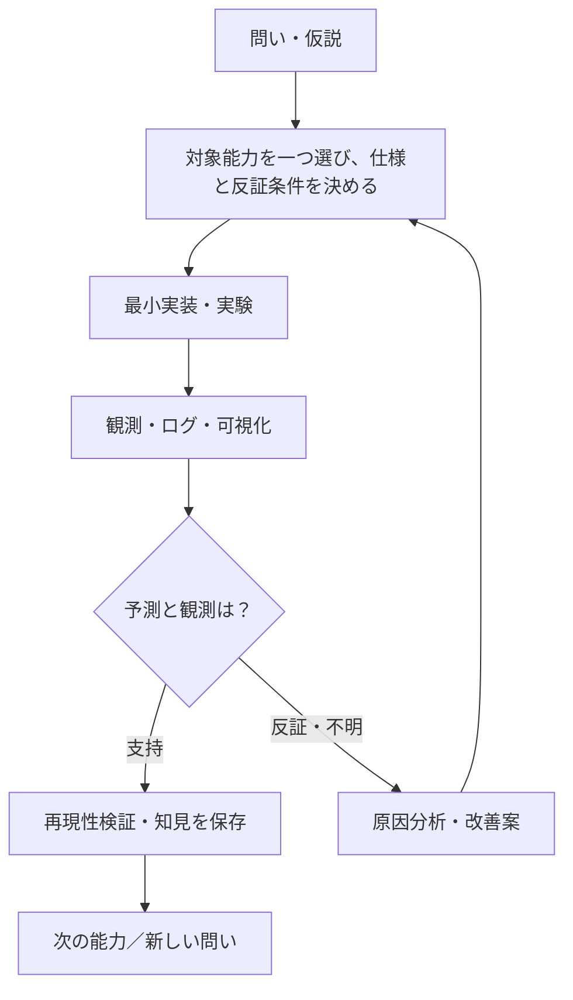

# SOMA — Synthetic Organism Morphogenesis Arena

> 身体の構造を知らない小さな機械が、相互作用と環境条件から新しい身体機能を発見するための研究室。

**現在（2026-10-15）：F001・F002は実装・検証を経てmain統合済み（33テスト、各CI成功）。F003は[設計PR #7](https://github.com/ryonakayama234/SOMA-Synthetic-Organism-Morphogenesis-Arena/pull/7)で審査中。本設計ブランチでは機械結合の実装・実験は未実施。独立視点の設計監査で数値範囲と保存証拠の検証契約を補足済み。後続の実装候補は[PR #8](https://github.com/ryonakayama234/SOMA-Synthetic-Organism-Morphogenesis-Arena/pull/8)で管理。**

## 入口：どこから読む？

| 知りたいこと | 読む資料 |
| --- | --- |
| 研究の目的と守る原則 | [研究憲章](docs/PROJECT.md) |
| 全体の仕組みを図で見る | [システム図鑑](docs/ARCHITECTURE.md) |
| データの構造・流れを見る | [データの約束](docs/DATA_CONTRACTS.md) |
| 仮説→実験→改善の進め方 | [研究運営](docs/RESEARCH_PROCESS.md) |
| 最初の一機能 | [F001：単一セルの運動](topics/F001-single-cell-motion/SPEC.md)（実装・初回検証済み） |
| F001の実験結果 | [初回検証ノート](findings/F001-validation.md) / [再現方法](experiments/F001/README.md) |
| 次の研究能力 | [F003仕様案](topics/F003-attachment/SPEC.md) / [A〜F実験計画](experiments/F003/PLAN.md) / [検証記録・未実施](findings/F003-validation.md) / [設計PR #7](https://github.com/ryonakayama234/SOMA-Synthetic-Organism-Morphogenesis-Arena/pull/7) |
| 論文や参考情報 | [文献図書館](library/INDEX.md) |
| なぜこの設計にしたか | [意思決定001](docs/decisions/0001-incremental-library.md) |
| AIエージェントの読み方 | [AI案内](AGENTS.md) |

## 研究の一周

## 当面の研究対象

- **F001：単一セルが動く（実装済み）**。位置・速度・力を検証。計算結果・誤差を記録済み。学習、結合、エネルギーはまだ追加しない。
- **F002：エネルギー取得・支出・セル間の数値移送を追跡（実装・初回検証済み）**。[再現手順](experiments/F002/README.md)／[CIによる検証ノート](findings/F002-validation.md)。物理的な電力消費・機械結合は未実装。 [発案時の構想メモ（歴史資料）](topics/F002-energy-ledger/IDEA.md) は正式仕様ではない。
- **F003：二セルの理想機械結合と切断（設計PR審査中・未実装）**。身体の自律形成・学習・物理エネルギー移送は対象外。

## 守る原則

1. 一つの Issue / 実験では主要な能力一つを扱う。
2. 「接続したら得点」など結合自体への報酬を与えない。
3. 世界の真の状態と、細胞が観測できる情報を分離する。細胞に身体全体の構造は渡さない。
4. 否定的な結果、未解決事項、採用しなかった仮説も残す。
5. 文献が支持する事実・研究仮説・設計上の選択・実験結果を区別する。
6. 実験条件・シード・コード版・単位・生ログを対応づけて再現できるようにする。
7. 巨大な抽象化を先に作らず、必要になった機能を一つずつ足す。

**GitHub は進捗の台帳**：Issue = 一つの課題、Pull Request = 変更提案、Commit = 保存された変更。操作の知識がなくても研究判断を確認できることを目指す。

## 機能追加時に必ず同期するもの
F002以降は、**コード／テスト・システム図（docs/ARCHITECTURE.md）・データ契約（docs/DATA_CONTRACTS.md）・実験記録（findings/Fxxx-validation.md）・READMEの現在地**を同じPRで更新する。仮説と実装と観測を混同しない。詳細は[研究運営](docs/RESEARCH_PROCESS.md)。F002ではこの5点を同一PR #6で更新し、対照Fの同一設定での再実行証拠も保存する。[PR #6のChecks（最新HEADのCI）](https://github.com/ryonakayama234/SOMA-Synthetic-Organism-Morphogenesis-Arena/pull/6/checks)から常に現行HEADの実行ログ・保存artifactを確認できる。過去のCIと途中の不備・訂正履歴は[検証ノート](findings/F002-validation.md)に保持。
