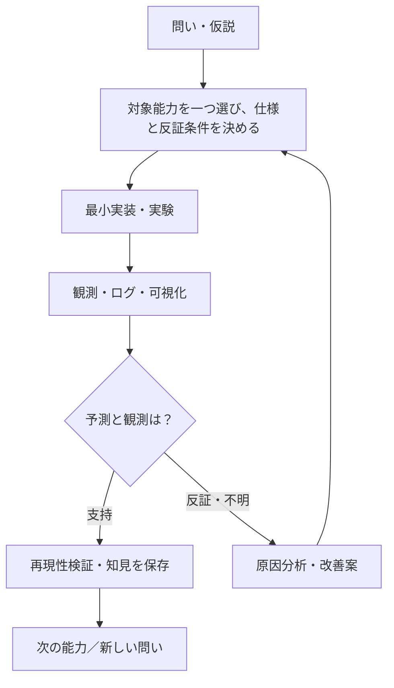

# SOMA — Synthetic Organism Morphogenesis Arena

> 身体の構造を知らない小さな機械が、相互作用と環境条件から新しい身体機能を発見するための研究室。

**現在：研究基盤の設計段階。シミュレータ・実験結果はまだ実装／取得していません。**

## 入口：どこから読む？

| 知りたいこと | 読む資料 |
| --- | --- |
| 研究の目的と守る原則 | [研究憲章](docs/PROJECT.md) |
| 全体の仕組みを図で見る | [システム図鑑](docs/ARCHITECTURE.md) |
| データの構造・流れを見る | [データの約束](docs/DATA_CONTRACTS.md) |
| 仮説→実験→改善の進め方 | [研究運営](docs/RESEARCH_PROCESS.md) |
| 最初の一機能 | [F001：単一セルの運動](topics/F001-single-cell-motion/SPEC.md) |
| 次に扱う候補 | [F002：エネルギー収支](topics/F002-energy-ledger/IDEA.md) / [F003：結合](topics/F003-attachment/IDEA.md) |
| 論文や参考情報 | [文献図書館](library/INDEX.md) |
| なぜこの設計にしたか | [意思決定001](docs/decisions/0001-incremental-library.md) |
| AIエージェントの読み方 | [AI案内](AGENTS.md) |

## 研究の一周

## 当面の研究対象

- **F001：単一セルが動く**。位置・速度・力の因果を正しく測る。学習、結合、エネルギーはまだ追加しない。
- F002：エネルギーの獲得・消費・移送を帳簿として扱う（構想）。
- F003：細胞の接続・切断と力学的影響を扱う（構想）。

## 守る原則

1. 一つの Issue / 実験では主要な能力一つを扱う。
2. 「接続したら得点」など結合自体への報酬を与えない。
3. 世界の真の状態と、細胞が観測できる情報を分離する。細胞に身体全体の構造は渡さない。
4. 否定的な結果、未解決事項、採用しなかった仮説も残す。
5. 文献が支持する事実・研究仮説・設計上の選択・実験結果を区別する。
6. 実験条件・シード・コード版・単位・生ログを対応づけて再現できるようにする。
7. 巨大な抽象化を先に作らず、必要になった機能を一つずつ足す。

**GitHub は進捗の台帳**：Issue = 一つの課題、Pull Request = 変更提案、Commit = 保存された変更。操作の知識がなくても研究判断を確認できることを目指す。
