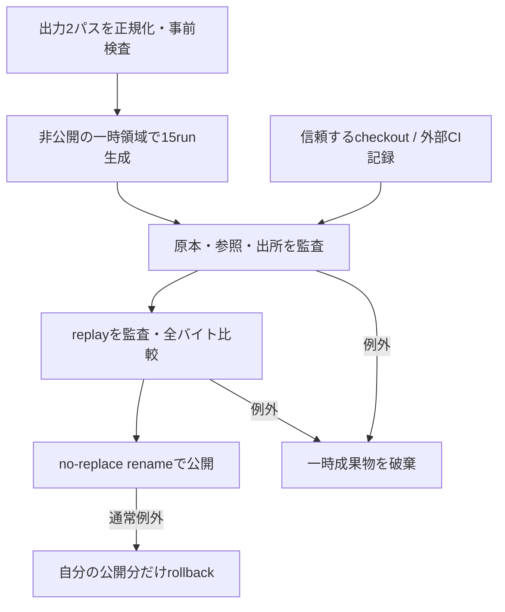

# システム図鑑（実装済み・提案の境界を明記）

全体図は**概念上の境界**。各機能の節で実装済み・未実装を区別し、実験結果を示す図と混同しない。

## 全体図
~~~mermaid
flowchart TB
  R["研究者・実験設定\n問い／仮説／条件"] --> W["環境と物理モデル\n真の状態を持つ"]
  W --> S["局所センサー\nセルに見える情報だけ"]
  S --> C["各セルの行動選択\n初期は固定／簡単なルール"]
  C --> A["アクチュエータへの命令"]
  A --> W
  W --> L["記録器\n真の状態と実験ログ"]
  L --> V["グラフ／再生"]
  V --> J["研究者が解釈し次の仮説を立てる"]
  J -.-> R
~~~

## 最も重要な情報境界
~~~mermaid
flowchart LR
  subgraph TRUTH["環境側：真の状態（正解）"]
    X["セル全体の位置・速度\n接続グラフ／内部力\n残量／資源分布"]
  end
  subgraph OBS["各セル側：自分が観測できる範囲"]
    Y["自分の局所状態\n感覚値／通信された値"]
    Z["行動決定器"]
    Y --> Z
  end
  X -->|センサーによる射影のみ| Y
  Z -->|行動命令のみ| X
  X -->|研究用には全状態を見せる| K["評価・可視化"]
~~~

**禁止事項：** 将来の未知の身体学習を壊さないため、細胞の制御器に環境側の完全な接続グラフを渡さない。実装上のデバッグ情報と細胞の観測情報は別の入口にする。

## F001だけを実装するときの図
~~~mermaid
flowchart LR
  U["入力：力 F\n設定：質量 m・抵抗係数 gamma・刻み dt"] --> P["一段階の運動計算"]
  P --> X["出力：位置 x・速度 v"]
  X --> LOG["CSVの記録"]
  LOG --> G["距離・速度グラフ"]
~~~

次の実験で追加される要素（接続、電源、学習）は今は描いても**実装しない**。

## 設計しないと危険な点
- 物理エンジンの真の状態と、セルの学習用観測を混ぜると「自己発見」の実験が成立しなくなる。
- 時間刻み・長さ・質量・力の単位を曖昧にすると、結果が再現できない。
- 運動に伴うエネルギーの消費は F002 で別に検証する。F001で黙って消費を導入しない。

[データの約束](DATA_CONTRACTS.md) / [研究の進め方](RESEARCH_PROCESS.md)

## 実装状況（2026-10-13）
- F001の `設定 → 運動計算 → 位置と速度のCSV → グラフ／比較` は `soma/f001.py` と `experiments/F001/run_suite.py` に実装済み。
- 局所センサー・セルの行動選択・機械結合は未実装。エネルギー台帳はF002として実装済みだが、運動とは未連携。
- [F001の実験ノート](../findings/F001-validation.md)

## F002 実装後のシステム図【Python実装・数値検証済み】

~~~mermaid
flowchart LR
  SET["config.json\n初期電力量・イベント列"] --> L["F002 台帳\n整数 µJ を原子的に更新"]
  L --> ST["セル別残量\ncapacity / balance"]
  L --> TX["供給・支出・移送損失\n収支残差"]
  ST --> LOG["events.csv / balances.csv"]
  TX --> LOG
  LOG --> EVAL["グラフ energy.svg\n検証 manifest.json"]
  F1["F001: 1D運動（既存）"] -. "電池との因果関係未定義・接続しない" .-> L
  F3["F003: 機械結合（将来）"] -. "物理結合は別課題" .-> L
~~~

F002での `transfer` は**数値台帳上の取引**であり、力学的な結合・電線・電力供給ポートを意味しない。研究者・物理環境の真の状態と、将来のセルが局所センサーで取得できる状態は分ける。F002の台帳・トランザクション・CSV・manifest・可視化部分は `soma/f002.py` と `experiments/F002/run_suite.py` で実装済み。F001の外部力からF002の蓄電量への結合と、F003の機械結合は未実装。図は実装境界を明示する。

[仕様案](../topics/F002-energy-ledger/SPEC.md) / [入力出力とデータ構造](DATA_CONTRACTS.md)。

### コードの責務分割（F002）

- `Cell`：個体ID、最大容量、現在残量（immutable）。
- `LedgerState`：セル群、初期残量合計、外部供給・支出・移送損失の累積、取引番号。構築時に残差0を検証。
- `Event`/`apply_event`：取得・支出・数値移送。入力を検査し、成功したときだけ新しいstateを返す。失敗時に元stateを変更しない。
- `save_run`：設定・イベント・セル別残量・SVG・manifestを新しい出力先へ保存。
- `experiments.F002.run_suite`：A〜Fの対照実験とEの13件の拒否監査。出力をCI artifactへ保管。

[実験記録](../findings/F002-validation.md) / [コード](../soma/f002.py)。

### レビュー #6 後の保存証拠の検査
取引 → 中間残量の全履歴（balances.csv）→ CSVに対応するイベント推移・台帳内訳（energy.svg）→ manifest（Git SHA、dirty判定、モジュールSHA256、artifact SHA256）の順に検証できる。なお、グラフの間引きは表示だけであり、CSVは間引かない。

### F002の再現性証拠データフロー
`experiments.F002.run_suite` → F-bulkとF-splitの**各同一設定を2回実行** → 元run・replay runそれぞれにconfig／events／balances／SVG／manifest → 5ファイルずつのバイト一致とSHA256 → `comparison.json.f_replay_checks`に保存。新規出力ディレクトリのみを使用し、F001運動モデルには接続しない。

### 出自取得と保存の順序（2026-10-15）

スイート開始 → 出力前のGit SHA/dirtyを一度取得 → 各runとreplayの`save_run(..., provenance=...)` → 同一開始状態を8 manifestへ保存。単独runは自身で保存前に取得する。未追跡の実験出力によるdirty判定の変化を防ぐため、開始時の出自取得をスイートの責務とする。台帳の演算やF001との境界は変わらない。

### 条件生成・判定コードの保存（2026-10-15）

スイート開始 → Git出自とsuiteソースを取得 → `suite_source.py`を証拠へ保存 → A〜Fと再実行 → `comparison.json`へsuite SHA256と保存先を記録。台帳モジュールのhashだけでなく、条件生成・事前予測の照合を担当するスクリプトも識別する。

## F003の設計追加（2026-10-14、PRで審査中・未実装）
「二つのセルが理想的な機械リンクで拘束される」能力のみを新設する案。F002のエネルギー台帳とは独立させる。

~~~mermaid
flowchart LR
  EXT["研究用の外力入力 F_A / F_B"] --> W["世界：2セルの真の運動状態"]
  W --> G{"リンクON?"}
  G -->|OFF| U["セルごとにF001運動式を適用"]
  G -->|ON| C["合成質量・共通速度で更新\n内部力は作用反作用"]
  U --> W
  C --> W
  W --> O["研究専用ロガー\n位置・速度・リンク真値・内部力"]
  O --> V["単独 / 結合 / 切断の対照比較"]
~~~

これは**中央制御器の構築ではない**。実験者が力とリンク状態を指定する最小モデルで、セル自身には完全な接続グラフを提供しない。ロガーは世界の真値を見てよいが、将来の局所センサーからは明確に隔離する。

- 力学：非結合の各セル＝F001式。結合中は2セル合成質量の一次元運動（等速度・一定距離）。
- 拘束：接続時に初期距離・速度が整合している場合だけ許可。位置や速度を飛ばす瞬間修正はしない。
- 切断：それまでの位置・速度をそのまま引き継いで独立運動へ戻す。
- 非目標：2D/3D、接触・衝突、実機コネクタ、通信、電力移送、AI、創発。

[詳しいF003仕様とシステム図](../topics/F003-attachment/SPEC.md) / [F003の対照実験計画](../experiments/F003/PLAN.md)。
F002はmainに統合済み。F003は機械結合のみ提案し、F002台帳との接続は未実装のまま維持。

## F003 イベント時刻の状態遷移（2026-10-15、事前設計・未実装）

~~~mermaid
flowchart TD
  C["設定JSON"] --> V{"開始前検査"}
  V -->|拒否| R["suite: rejections.json"]
  V -->|受理| A["結合状態に従い区間の運動を更新"]
  A --> B["時刻tの位置・速度を確定"]
  B --> D{"tに切断イベント？"}
  D -->|yes| E["位置・速度を変えずON→OFF"]
  D -->|no| S["状態を保持"]
  E --> L["post-event states.csv／before-after events.csv"]
  S --> L
  L --> N["次の時間区間へ"]
~~~

切断時刻のstates.csvはイベント反映後1行。切断前後の位置・速度はevents.csvで直接照合する。拒否入力は正常runのイベントではない。すべて将来F003の設計で、現在の実装はF001/F002まで。

### F003 設計監査の補足（2026-10-15）
入力検査→有限な世界状態・派生量→新規出力の保存→CSV/イベント読み戻し→独立離散参照による全ゲート照合、という責務を分離する。数値表現不能は保存前の拒否経路へ流し、内部力や重心のinfを正常な世界真値と扱わない。仕様・許容差は維持し、実装・観測は後続PR #8で検証する。

## F003 実装候補（2026-10-15）

下図は実装ブランチ `feat/F003-1d-coupling-validation-20261015` の責務とデータフロー。**mainへの統合前**であり、F002との物理結線・局所知覚・AI制御は存在しない。

~~~mermaid
flowchart TD
  SET["config.json: 2セルと結合/切断設定"] --> VALID{"入力検証: dt格子/距離/初速"}
  VALID -->|不正| REJ["suiteのrejections.json"]
  VALID -->|正常| W["世界真値 (A,B,リンク状態)"]
  W --> G{"attached?"}
  G -->|yes| COUPLED["合成質量+合計外力 -> F001 step"]
  G -->|no| FREE["A/BそれぞれF001 step"]
  COUPLED --> EVENT{"時刻kで切断?"}
  FREE --> EVENT
  EVENT -->|yes| POST["位置/速度は不変、リンクだけOFF"]
  EVENT -->|no| POST
  POST --> LOG["states.csv (post-event) / events.csv (before/after)"]
  LOG --> EVAL["comparison.json + motion.svg"]
  EVAL --> PROV["manifest.json: Git SHA / ソースhash / artifacts SHA"]
  F2["F002：エネルギー台帳"] -. "物理的に未接続" .-> W
~~~

`Config.from_dict` が不正入力を実行前に拒否。`simulate` は世界の真値の時系列とイベントを返す。`save_run` は新しいフォルダにのみ保存する。`experiments.F003.run_suite` は開始時のGit出自と実験スクリプトhashを全runで共有し、生ログと再実行のバイト一致を判定する。**これらの真値をセル自身へ渡す制御器は実装しない。**

[事前登録SPEC](../topics/F003-attachment/SPEC.md) / [実装テスト](../tests/test_f003.py) / [検証台帳](../findings/F003-validation.md)。

## F003 GitHub CI 履歴（監査修正前・2026-10-15）

- 実装HEAD: 1512206596ca8939705e6e1ab603e9aa1bbd626d
- F003 Actions: https://github.com/ryonakayama234/SOMA-Synthetic-Organism-Morphogenesis-Arena/actions/runs/38731190546 — success。Python 3.11で合計44テスト（F001 17、F002 16、F003 11）合格。
- A〜F正常7run、不正入力8件を拒否、B同条件再実行の生バイト一致。artifact: F003-A-F-evidence（ID 11970235937）。
- F001既存ワークフロー: https://github.com/ryonakayama234/SOMA-Synthetic-Organism-Morphogenesis-Arena/actions/runs/38731190562 — success。
- F002既存ワークフロー: https://github.com/ryonakayama234/SOMA-Synthetic-Organism-Morphogenesis-Arena/actions/runs/38731190549 — success。
- 以上は1D理想モデル・ソフトウェアの整合性を示す。実機による結合、エネルギー相互作用、身体創発を示さない。
- 独立第三者の監査は未了。PR #7の設計レビューと、PR #8の正式採用判断を区別する。

## F003 監査修正後の証拠検証（2026-10-15、実装候補）
~~~mermaid
flowchart TD
  C["設定・数値表現可能性・厳密時間格子"] --> W["F001 stepを再利用する世界更新"]
  W --> V["全状態・内部力・重心の有限性検査"]
  V --> S["CSV・イベント・SVGを新規保存"]
  S --> R["保存済みCSV・イベントを読み戻す"]
  R --> O["stepを呼ばない独立離散オラクル"]
  O --> G["全A〜Fゲート・最大誤差・拒否証拠SHA"]
  G --> P["比較JSONを含む全スイート再実行一致"]
~~~
不正状態は保存前に拒否する。スイートは別のsimulate結果を合否根拠にしない。F001依存モジュールSHAも開始時出自に保存する。F002との物理結線とセル制御器は対象外。監査前の未実装・未監査表記は設計時点の履歴。

### F003の採用判断（2026-10-15）
監査修正・50テスト・A〜F・再現性・CI検証を経て、記載した1D二セル理想リンクの実装を採用する。設計#7はmain統合済み、実装の統合はPR #8で追跡。既存の図・スキーマ・観測境界は不変で、候補・未統合表記は過去時点の履歴。

## F004：内部駆動と電池の因果接続【2026-10-15 設計提案・未実装】

F001の運動とF002の整数µJ台帳の間に、**一セルの内部モーター仕事**だけを扱う薄い接続層を追加する案。F003の二セル理想リンクはmainに存在するが、F004とは**未接続**。

~~~mermaid
flowchart TD
  CONF["設定：モーター指令 u、外力 f_ext、初期残高"] --> CAND["F004：F001による候補1Dステップ"]
  CAND --> W["台形速度による内部機械仕事 W_motor"]
  W --> G{"F002の残高は足りるか"}
  G -->|足りる| YES["内部＋外力で運動／spendをF002へ記帳"]
  G -->|足りない| NO["内部力0／外力のみでF001を再計算"]
  YES --> WORLD["世界の真値：位置・速度・残高"]
  NO --> WORLD
  WORLD --> LOG["研究ロガー：states／spendイベント／manifest"]
  LOG --> GATE["独立予測／不変条件／対照A〜F／図"]
  F003["F003：2セル機械結合（既存）"] -. "F004の範囲外" .-> CAND
  WORLD -. "セルの局所観測へ直結しない" .-> SENSOR["将来のセンサーAPI（未実装）"]
~~~

役割：F001は運動更新、F002は残高・会計不変条件、F004はモーター仕事と実行可否の調停のみを担当。**外力は電池消費対象ではない**。研究側ロガーは世界の真値を知るが、セルの意思決定器には真値を渡さない。モーターの実機効率、待機電力、熱、回生、二セル協調は未実装。

[仕様・仮説](../topics/F004-actuation-energy/SPEC.md) / [A〜F計画](../experiments/F004/PLAN.md) / [未実施の記録](../findings/F004-validation.md) / [Issue #9](https://github.com/ryonakayama234/SOMA-Synthetic-Organism-Morphogenesis-Arena/issues/9)。

### F004 2026-10-16 設計ゲート修正（未実装）
~~~mermaid
flowchart TD
 S["世界状態とF002電池残量"] --> B{"残量が0？"}
 B -->|Yes| Z["モーター力0／外力だけをF001.stepへ"]
 B -->|No| C["モーター+外力でF001候補運動を仮計算"]
 C --> W["binary64正仕事をceilしてµJ費用確定"]
 W --> E{"費用が残量以下か"}
 E -->|Yes| Y["候補運動とF002 spendを一体採用（費用0ならイベントなし）"]
 E -->|No| Z
 Y --> V["有限値・原子的確定の検査"]
 Z --> V
 V --> L["世界真値ログ・台帳イベント・Git出自"]
 L --> O["独立の全時系列オラクルと対照比較"]
~~~
反例：残量0でu=+1 N、外力=-1 N、初速0の候補仕事は0だが、**内部モーター力は0にする**。電池残量0の判定は費用計算より先に置く。これは設計修正であり、現時点の動作する実装ではない。

## F004 実装候補（2026-10-16／PR #11、正式採用前）

~~~mermaid
flowchart TD
 C["設定: f004.v1、全コンストラクタで共通検証"] --> V{"有限値・範囲・float変換前後の格子一致"}
 V -->|reject| X["何も保存しない・ValueError"]
 V -->|valid| W["世界真値: Motion(x,v) + F002 LedgerState(A)"]
 W --> B{"残量=0？"}
 B -->|Yes| Z["内部力0でF001.stepに外力のみ"]
 B -->|No| T["F001.stepで候補運動を仮計算"]
 T --> E["台形速度による理想正仕事をceil(µJ)"]
 E --> G{"候補費用 <= 残量？"}
 G -->|Yes| Y["候補運動 + F002 spend（費用0はeventなし）"]
 G -->|No| Z
 Y --> A["有限派生量検査、物理+台帳の不可分commit"]
 Z --> A
 A --> S["states.csv: 各ステップの世界真値"]
 A --> L["ledger/events.csv: F002で受理した支出のみ"]
 S --> O["初期行を含む独立CSV参照・必須4成果物のhash照合"]
 L --> O
 O --> M["comparison.json、SHA付きmanifest、motion_energy.svg"]
 M -.-> N["後続研究: F003結合や局所センサーは未接続"]
~~~

実装責務：\`soma/f001.py\`＝運動更新、\`soma/f002.py\`＝エネルギー台帳、\`soma/f004.py\`＝エネルギーに依存する内部駆動の採否と不可分step。\`experiments/F004/run_suite.py\`＝**CSVを読み戻す**独立計算・比較。内部エージェントへの世界全体情報の付与、F003との統合、実電池・実モーターのモデル化はしない。初回CI 68テスト合格／10対照／16拒否は実装候補の範囲のみ。

### PR #11 独立視点の実装監査修正（2026-10-16）
Configの検証は`__post_init__`に集約し、JSON/dict、直接生成、`dataclasses.replace`で同じ条件を課す。生入力とfloat正規化後の十進有理数による時間比が同じ整数でなければ保存前に拒否する。SVGは時間と状態を先に正規化してから座標へ変換し、有限状態からの表示計算のoverflowを回避する。保存検証では4成果物の完全なhash一覧と、初期行の全仕事・運動エネルギー差・残差0を必須にする。物理更新・費用式・F001〜F003のAPIは変更しない。

### F004 採用決定（2026-10-16）
ユーザーの指示で上記F004の離散理想モデルを正式採用。設計PR #10はmain統合済み、実装と採用記録はPR #11で統合する。既存の実装図・世界真値と観測の境界は維持。物理コードと費用式は変更なし。保持/待機電力、区間内の速度反転時の正負仕事相殺、dt依存の切上げ差を制限として記録し、自律制御・実機への適用前に別途設計する。[採用記録](../findings/F004-validation.md#2026-10-16-採用判断と統合)。

## F005：速度反転時の正仕事積算【2026-10-16 研究提案・未実装】

**責務境界**：F001（離散運動）・F002（整数µJ台帳）・F004（既存の符号付き区間仕事と残高制約）は採用済み。F005はF004の既知の「反転区間の無料再加速」を防ぐ**代替費用計算の候補**。F003の二セルリンクは接続しない。**以下の図のF005部分は未実装**。

~~~mermaid
flowchart TD
  C["設定 config.json：1セル/力/速度/残高"] --> V{"F005入力事前検査"}
  V -->|妥当| A["F001候補運動：v0→v1（世界真値）"]
  V -->|不正| RJ["rejections.json（正常runは作らない）"]
  A --> SG["符号付き仕事 W_signed：機械収支用"]
  A --> PG["F005提案・未実装：線形速度を区間内で補間し正仕事 W_plusを積分"]
  PG --> B{"F002電池：残高 > 0 かつ費用を賄えるか"}
  B -->|yes| APPLY["内部力+外力を採用／F002 spend（正額時のみ）"]
  B -->|no| EXT["モーター力0でF001を再計算／外力は残す"]
  APPLY --> T["states.csv：世界真値（signed/positive/spent/残高）"]
  EXT --> T
  SG --> T
  APPLY --> L["ledger/events.csv：受理支出だけ"]
  T --> J["comparison.json／motion_energy.svg：独立照合・表示"]
  L --> J
  C --> M["manifest.json：入力・Git/ソース・成果物SHA256"]
  J --> M
~~~

- **新しい計量** `W_plus = integral(max(0, u*v(t)), t=0..dt)`。現ステップの前後速度を線形補間する理想離散近似。F001の位置・速度更新自体は変更しない。
- `W_signed = u*dt*(v0+v1)/2` は引き続き**運動エネルギー恒等式**のために保存する。`W_plus`を代用して機械エネルギー保存を主張しない。
- 残高不足は**候補運動を棄却**して内部力0で再計算。F002の台帳と状態は原子的に確定。世界真値を将来のセルの観測値として露出しない。
- F004を上書きせず、提案F005の版を明示した別実験とする。機械力学も費用も「実機の電気消費」ではない。

[仕様](../topics/F005-positive-work/SPEC.md) / [実験計画](../experiments/F005/PLAN.md) / [検証記録・未実施](../findings/F005-validation.md) / [Issue #12](https://github.com/ryonakayama234/SOMA-Synthetic-Organism-Morphogenesis-Arena/issues/12)。

### F005 implementation candidate (2026-10-16; implementation PR, not adopted)

The implementation branch adds `soma/f005.py` without modifying F001–F004. F005 reuses the F001 semi-implicit Euler `step()` and F002 immutable ledger `apply_event(spend)`; it computes positive mechanical work by exact integration of the **chosen linear-in-time velocity interpolant**, but does not simulate electrical motor loss.

~~~mermaid
flowchart TD
    IN["Config f005.v1 / Motion / F002 LedgerState"] --> V{"Validate immutable input and time grid"}
    V -->|valid and balance>0, motor nonzero| P["F001 candidate with motor+external force"]
    V -->|empty battery or zero motor| X["F001 external-force-only"]
    P --> PW["F005 positive work of linear velocity interpolant"]
    P --> SW["F004-compatible signed midpoint work for mechanical identity"]
    PW --> COST["ceil positive joules to integer microjoules"]
    COST --> BAL{"candidate cost <= balance"}
    BAL -->|yes| PAY["Accept candidate + F002 spend if positive"]
    BAL -->|no| X
    PAY --> COMMIT["Atomic motion and immutable ledger result"]
    X --> COMMIT
    SW --> LOG["Signed work stays separate from positive work"]
    COMMIT --> LOG
    LOG --> CSV["states.csv and ledger/events.csv"]
    CSV --> VERIFY["Independent saved-CSV Euler/positive-work oracle"]
    VERIFY --> EVIDENCE["comparison.json, SHA manifests, SVG, replay comparison"]
~~~

- `f005.v1` adds candidate and accepted **positive** motor work fields; existing signed work is unchanged in meaning.
- The F005 `experiments/F005/run_suite.py` verifier reads saved CSV and event files and checks every timestep without using F005's step or positive-work function. SHA checks alone are insufficient; numeric semantic checks are mandatory.
- `tests/test_f005.py` and `.github/workflows/f005.yml` exercise all F001–F004 regressions, F005 A–F, reject cases, and replay; complete raw evidence is stored as GitHub Actions artifacts.
- A successful automated suite is not adoption, a real motor-battery model, or evidence of emergent morphology. F003 link is still not attached to F005.

### F005 PR #14 独立監査後の検証経路（2026-10-16）
上図の `VERIFY` は保存CSVから再計算する二段階の照合を含む。①入力binary64端点を厳密有理数に変換した区分積分で正仕事を確認、②仕様に固定したbinary64演算順で整数µJ課金と受否を確認する。端点パワーの浮動小数点積で符号を失わない。初期行の候補2欄はnull、正仕事が微小でもゼロへの改変を拒否する。`comparison.json`に積分誤差・厳密切上げ差・binary64支出差を分離して保存する。運動器と台帳の経路は変更しない。

### F005 正式採用後の責務境界（2026-10-16）
上記のF005「implementation candidate」はレビュー時点の記録。現在の採用済み範囲は**正仕事をF002整数µJ台帳へ接続する離散計算部品のみ**。F001の位置は半陰的Euler、F005仕事は線形補間速度を積分するため、保存軌道との距離効率は保証しない。dt依存のモーター棄却・数量化、無償保持、反作用相手未定義が残る。セルの局所センサー、F003へのモーター統合、生存・身体優劣の評価環境は未承認。[採用判断と反例](../topics/F005-positive-work/SPEC.md#2026-10-16-正式採用f005の限定的な研究上の位置づけ)。

## F006：時間刻み収束性の診断（2026-10-16／設計提案・未実装）

**F006の新しい能力は、F005の計算を変更せず、同じ条件を複数のdtで走らせて違いと原因候補を記録すること。** F001〜F005は採用済み。図中のF006計測・照合は未実装。

~~~mermaid
flowchart LR
  H["研究者の問い / 仮説H006"] --> CFG["F006 sweep.json\nA〜F固定条件＋dt一覧"]
  CFG --> LOOP["F006 比較実行器\n提案・未実装"]
  LOOP --> MODEL["F005 1セル1D運動＋正仕事＋電池\n採用済み・変更なし"]
  MODEL --> RAW["F005各dtの原本\nstates / events / manifest"]
  CFG --> REF["独立の理論参照\n有理数・binary64を区別"]
  RAW --> CHECK["F006 原本検証／誤差分類\n提案・未実装"]
  REF --> CHECK
  CHECK --> OUT["比較CSV / diagnostics.json\n比較SVG / provenance"]
  OUT --> NOTE["findings/F006-validation.md\n支持・反証・不明"]
~~~

**世界の真値とセルの観測の境界**：F006はオフラインの研究者用検証器。原本ログ（位置、速度、残高、受否）は解析側にだけ提供し、セルの局所観測APIや制御入力に直結させない。

- **A（運動離散化）**：電池十分の場合でも、F001半陰的Eulerの位置がdtに依存する。
- **B（受否の離散化）**：F005は残高不足時、当該ステップのモーターを丸ごと拒否する。
- **C（会計の離散化）**：正仕事が同じでも、各ステップのµJ切上げ回数が変わる。
- F006の合格は**診断の正確さ**。dt不変・実機妥当・自律移動の成立とは異なる。部分時間駆動、端数繰越、共通軌道などの修正は後続研究。

[仕様](../topics/F006-timestep-diagnostics/SPEC.md) / [事前A〜F](../experiments/F006/PLAN.md) / [研究記録（未実施）](../findings/F006-validation.md) / [Issue #16](https://github.com/ryonakayama234/SOMA-Synthetic-Organism-Morphogenesis-Arena/issues/16)

### F006 v2 証拠と公開の設計改訂（2026-10-17、未採用）

診断本体とF005保存検証器もソース照合範囲に含める。出力ラベルは事前登録のexpected_classification、観測はsignatureの参照一致と数値として分離する。セルへの経路を追加しない。2パスの公開間に強制終了すると監査済み一次出力だけが残り得るため、crash時の一括原子性は保証しない。

### F006実装候補の責務境界（設計詳細・未実装）

~~~mermaid
flowchart TD
  SET["F006 run_suite.py\n固定条件をdtごとに展開"] --> EXIST["採用済み soma/f005.py\nConfig.from_dict → save_run"]
  EXIST --> RAW["変更しないF005原本\nconfig / states / events / manifest"]
  RAW --> V["既存 verify_saved_run\n全行・イベント独立照合"]
  RAW --> NEW["新規 diagnostics.py\ndt横断の比較と原因候補"]
  V --> NEW
  THEORY["独立の有理数・binary64参照\n事前に固定"] --> NEW
  NEW --> OUT["comparison.csv / diagnostics.json\ncomparison.svg / manifest"]
  OUT --> F["findings/F006-validation.md\n再現性・反証・採否"]
~~~

F006は研究者の**後処理**専用。セル制御器や物理エンジン内部に横断比較値を戻さない。表示の補間は可視化に限定し、観測値と区別する。測定不能な寄与は`mixed`・`undetermined`で記録する。実装後のコードと図を必ず同一実装PRで更新する。

## F006 実装候補の実際の流れ（PR #18、2026-10-16・未採用）

~~~mermaid
flowchart TD
  P["事前登録A〜E：同一条件、dtのみ変更"] --> RUN["experiments/F006/run_suite.py"]
  RUN --> F005["既存soma/f005.py\nConfig → save_run"]
  F005 --> RAW["15組の既存F005生ログとmanifest"]
  RAW --> ORACLE["既存F005保存証拠オラクル\n全行とイベントの独立数式検査"]
  RAW --> ANALYZE["F006 diagnostics.py\n5系列の横断比較"]
  ORACLE --> ANALYZE
  REF["Wolframの厳密有理数事前参照"] --> ANALYZE
  ANALYZE --> OUT["comparison.csv + diagnostics.json\ncomparison.svg + SHA256 manifest"]
  OUT --> REPLAY["同条件15run再実行\n全バイト一致を検査"]
  REPLAY --> CI["F006 GitHub Actions\n全回帰・-O・証拠artifact"]
~~~

**境界**：比較器はログを読み、物理系・セルの観測／方策に返さない。比較図は表示用であり記録済み数値の証拠はCSVとイベント。F対照の不正入力とハッシュ付替えによる改変はテストで実施し、A〜Eと混同しない。設計上のG1〜G5全体の独立監査・正式採用は未了。

### F006 v2実装対応（2026-10-17）
run_pairが両パスの正規化・事前確認→非公開の生成/監査→全バイト比較→Linux no-replace公開を担う。通常の公開例外は自分の公開分のみrollbackする。diagnosticsの監査は信頼するcheckoutの9ソース/参照hashと外部に固定した実行identityを使い、原本manifestの出自も照合する。上のv2図が現行実装責務で、旧図の最終出力への直接生成は履歴。F005の運動/仕事・会計・観測境界は変更しない。

## F006 限定的正式採用後のシステム境界（2026-10-17）

上のF006提案・候補図は履歴。現行採用済みは既存F005の**オフライン検証機能だけ**。ユーザーの採用判断に従い、実装[PR #18](https://github.com/ryonakayama234/SOMA-Synthetic-Organism-Morphogenesis-Arena/pull/18)で次の責務を統合する。

~~~mermaid
flowchart TD
    P["凍結A〜E設定と各dt"] --> R["F006 run_suite / private staging"]
    R --> M["既存F005 v1 の運動・台帳（変更なし）"]
    M --> LOG["15runのF005生CSV・events・config・manifest"]
    LOG --> O["F005 saved-file独立オラクル＋F006 cross-dt参照照合"]
    W["Wolfram厳密有理数：離散モデル参照"] --> O
    O --> A["v2 suite/run出自・9依存hashを照合"]
    A --> Q["81ファイル完全再実行／比較"]
    Q --> OUT["Linux no-replace公開：comparison / diagnostics / SVG / manifest"]
    OUT --> CI["3.11・3.12のCI artifactと研究監査"]
    OUT -. "世界真値をセルに戻さない" .-> N["将来の局所観測／制御器（未接続）"]
~~~

固定条件のみ`expected_classification`を事前ラベルとして出し、観測からの一致は`signature_matches_reference`、汎用`causal_attribution=null`。二保存先間のcrash原子性と実機・F003統合は非採用。実証値・制限・採用判断は[findings](../findings/F006-validation.md#2026-10-17-f006-限定的な正式採用--最新研究判断)。

## F007 提案：片側の電池で結合した2セルが動く（2026-10-17・設計のみ）

> **まだ動かない構想図。** F003のリンク、F005の正仕事、F002の整数µJ台帳を接続する予定の境界。既存F001〜F006は現行mainのまま。

~~~mermaid
flowchart LR
  CFG["設定: A/B質量・リンク・外力・Aモーター・電池"] --> CAND["F003型候補運動 ON: 合成質量 / OFF: 独立"]
  CAND --> WORK["F005: Aの正仕事（区間速度補間）"]
  WORK --> GATE{"F002: A電池が足りる?"}
  GATE -->|Yes| ACCEPT["採用 + Aのみspend"]
  GATE -->|No| RETRY["Aモーター=0で力学再計算"]
  ACCEPT --> TRUE["研究用世界真値: A/B運動・リンク力・残高"]
  RETRY --> TRUE
  TRUE --> RAW["時系列CSV・イベント・manifest・SHA"]
  RAW --> ORACLE["独立参照 + A〜F対照 + CI"]
  TRUE -. "感覚データに直結させない" .-> OBS["将来の局所観測（未実装）"]
~~~

このリンクは**機械仕事の授受**を扱い、F002のセル間**電力量移送**とは別。結合による加速度変化を観測するだけで「有利」と結論しない。F005の外部有効力に物理的な推進反力は未実装。F006のdt依存を引き継ぎ、形態間の効率比較は現段階の非目標。

[研究仕様](../topics/F007-linked-motor-work/SPEC.md) / [事前A〜F](../experiments/F007/PLAN.md) / [検証ノート（未実施）](../findings/F007-validation.md) / [Issue #19](https://github.com/ryonakayama234/SOMA-Synthetic-Organism-Morphogenesis-Arena/issues/19)。

### F007 実装前レビュー：モーター拒否時も結合・外力は残す（2026-10-17、未実装）

追加のF-01〜F-06対照は、モーター仕事と機械的な拘束の責務を切り分けるためのもの。以下は**設計検証用のフロー図**であり、実装済みフローではない。

~~~mermaid
flowchart TD
  Q["Aの指令uA、A/B外力、リンク状態、A/B残高"] --> K{"A残高 > 0 かつ指令あり?"}
  K -->|yes| C["F003型の候補力学：uA + 外力 + リンク"]
  C --> W["F005型のA正仕事からµJ候補費用"]
  W --> G{"A残高で支払える?"}
  G -->|yes| Y["候補運動を確定／Aのみ支出"]
  G -->|no| Z["Aモーター0：外力とリンクは保持"]
  K -->|no| Z
  Z --> R["F003型の力学・リンク力を再計算"]
  Y --> S["世界真値：位置速度・A/B電池・力・受否"]
  R --> S
  S --> L["元CSVとリンク/台帳イベント"]
  L --> D["独立参照／F-01〜F-06／manifest／CI"]
  S -. "ロボット自身には公開しない" .-> O["将来の局所観測（未実装）"]
~~~

F-01は時間途中の残高枯渇、F-02は0仕事の非ゼロ指令、F-03は電池空でもBの外力が拘束でAへ伝わるケース、F-04は速度反転で正仕事と符号付き仕事が異なるケース。世界真値は実験器にだけ与える。研究対象は一能力（F007）だけで、局所知覚・自己学習・結合意思決定は追加しない。

## F007 実装候補の実際の責務とデータフロー（2026-10-17）

~~~mermaid
flowchart TD
  Q["f007.v1 Config: 2セル、A motor、外力、電池とリンク"] --> V["厳密な時間格子・有限値・リンク拘束・容量の入力検査"]
  V --> C{"A残量とmotor指令"}
  C -->|正の残量かつ非ゼロ指令| P["F001/F003型で候補運動を計算"]
  P --> W["F005 positive_motor_work -> ceil µJ"]
  W --> G{"候補費用をAだけが支払える?"}
  G -->|yes| Y["候補運動を採用し、F002のA spend"]
  G -->|no| R["A motor=0: 外力と理想リンクで運動・力を再計算"]
  C -->|zero balance or zero command| R
  Y --> L["世界真値：両セル状態と台帳"]
  R --> L
  L --> T["指定時刻でリンクだけ切断（x/v無ジャンプ）"]
  T --> LOG["config、states、ledger/events、link_events、SVG、SHA manifest"]
  LOG --> ORC["別実装のverify.pyが全行・イベントを再計算"]
  ORC --> SUITE["A〜E/F-01〜04対照 + F-05/06拒否・改変・byte replay"]
  SUITE --> CI["3.11 / 3.12 CI Evidence（検証待ち）"]
  L -. "世界真値はセルの観測に渡さない" .-> FUT["局所知覚（未実装）"]
~~~

研究者だけが完全な状態、拒否候補、リンク内部力と出自を閲覧する。これは物理的に結合するユニットが自律的に力を分配する実証ではなく、**有効外力と理想リンクの離散計算**の整合検証である。[F007実験手順](../experiments/F007/README.md)。

## F007 限定的正式採用後のフロー（2026-10-17）

旧「提案」「検証待ち」図は当時の履歴。実装済みの流れは、入力検証 → Aモーター候補力学・正仕事積分 → A電池ゲート → A/B運動・F002台帳 → *私有ステージ*内CSV/イベント/manifest生成 → 保存バイトの独立監査 → 1宛先ずつ既存結果を置換しない原子的公開 → 9条件・58ファイル再生とCI検査。CI成功時のみ証拠ZIPを公開。二宛先全体の停電原子性はなし。詳細は[最新研究判断](../findings/F007-validation.md#2026-10-17-f007-限定的正式採用--最新の研究判断)を優先。

## F008 提案：局所運動から未知の負荷変化に気づく【2026-10-17・設計のみ／未実装】

F007の物理真値を**研究者専用**と**セル自身に許される局所観測**に分離する。単体予測からの速度応答のズレだけを観測し、接続グラフの真値やBの状態は教えない。新しい制御・学習・身体改造は今回実装しない。

~~~mermaid
flowchart TB
  SET["研究者：A〜Fの設定・反証条件"] --> W["F007 世界：A/B・力・接続・電池（真値）"]
  W --> SENSOR["F008 局所センサー射影：セル別に分離"]
  SENSOR --> A["A自身：Δv・自分の指令/実行力・自分の電池"]
  A --> R["単体モデルの予測と比べて負荷異常を検知"]
  W --> TRUTH["研究者専用：A/B真値、接続イベント"]
  R --> VERIFY["保存ログを別式照合・反証条件で評価"]
  TRUTH --> VERIFY
  VERIFY --> LOG["観測CSV・評価・出自SHA・findings"]
~~~

**情報境界**：観測データにリンク状態・Bの位置速度・結合全質量・世界側ケース名を含めてはならない。研究者用の全状態ログは別ファイルに残す。非接続でも外力によって同じ減速が生じ得るので、応答異常を「接続を同定した」と呼ばない。モデルはF007の外部有効力（地面反力未定義）を継承し、実機推進の証拠にはしない。

[研究Issue #22](https://github.com/ryonakayama234/SOMA-Synthetic-Organism-Morphogenesis-Arena/issues/22) / [F008仕様](../topics/F008-local-load-detection/SPEC.md) / [事前実験](../experiments/F008/PLAN.md) / [実験記録（未実施）](../findings/F008-validation.md) / [データの境界](DATA_CONTRACTS.md)。
