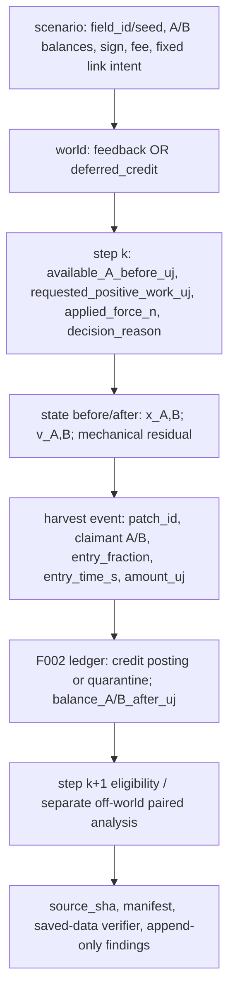

# データの構造と流れ

「どんな情報が、どこからどこへ移るか」を図で保持するための、最小限の約束。**F001・F002は実装済みの契約を含み、F003は提案中。** 状態を節ごとに区別する。

## 三つに分けて考える
~~~mermaid
flowchart LR
  I["① 設定\n実験条件"] --> E["② 実行中の状態\n刻々と変化"]
  E --> O["③ 記録\n再解析できる保存物"]
~~~

| 種別 | 意味 | F001の例 |
| --- | --- | --- |
| 設定（input） | 何を固定して試すか | 質量 kg、力 N、抵抗 1/s、刻み s、総時間 s |
| 状態（state） | いまどうなっているか | 時刻 s、位置 m、速度 m/s |
| 記録（output） | 実験後にも調べられる証拠 | 時系列CSV、設定JSON、要約と図 |

## 一個のセルの状態（F001）
~~~mermaid
flowchart TD
  ID["Cell-001"] --> X["位置 x [m]"]
  ID --> V["速度 v [m/s]"]
  ID --> M["質量 m [kg]\n変更しない設定値"]
  ID -. "未導入・将来" .-> E["電力量 [J]"]
  ID -. "未導入・将来" .-> B["接続情報"]
~~~

## 仮の入力形式例
~~~json
{
  "schema_version": "0.1-proposal",
  "experiment_id": "F001-run-001",
  "seed": 1,
  "model": "1d_linear_drag",
  "mass_kg": 1.0,
  "drag_per_s": 0.2,
  "force_n": 1.0,
  "dt_s": 0.01,
  "duration_s": 10.0
}
~~~
**数値は実験準備の例で、確定仕様ではない。**

## 仮の時系列記録
~~~csv
time_s,x_m,v_m_s,force_n
0.00,0.0,0.0,1.0
0.01,0.0001,0.01,1.0
~~~
これは説明用の2行。実験結果を示すものではない。F001の仕様が承認されたら正式な列を固定する。

## 研究の再現性に必要な紐づけ
- 実験識別子 → 設定 → 乱数シード → 実行コードのコミットID → 生ログ → 図 → 解釈
- 記録は追記または新規作成。別条件の結果を同じファイルに上書きしない。
- 物理エンジン用の真の状態ログと、セルが実際に知覚した観測ログを分ける。

[システム図鑑](ARCHITECTURE.md)

## F001で確立した入出力（2026-10-13）
- 設定は `schema_version=f001.v1` を使用。 `model=1d_linear_drag`。
- `initial_x_m`、`initial_v_m_s` も入力として追加。
- 時系列 `states.csv` の列順は `time_s,x_m,v_m_s,force_n` で確定。
- 各実験に `config.json`、`manifest.json`（コードコミットIDとチェックサム）、`motion.svg` を出力。
- 実行結果の上書きを禁止し、出力先には未使用のディレクトリを指定。
- 詳細： [F001の再現方法](../experiments/F001/README.md)。

## F002 エネルギー台帳のデータ契約【実装済み・v1】

~~~mermaid
flowchart TB
  CFG["① config.json\nセルID / 容量・初期残量 µJ\nイベント順・効率 bps"] --> CORE["② LedgerState\nセル別残量と累計入力・支出・損失"]
  CORE --> EV["③ events.csv\n取引イベントと収支残差"]
  CORE --> BAL["③ balances.csv\n各セルの残量・容量"]
  EV --> M["manifest.json / energy.svg"]
  BAL --> M
~~~

| 区分 | カラム・フィールド案 | 注意 |
| --- | --- | --- |
| 入力 | `schema_version=f002.v1`, `experiment_id`, `seed`, `cells`, `events` | 取引順序を使い、時間刻みはまだ定義しない |
| セル | `cell_id`, `capacity_uj`, `balance_uj` | 整数µJ、範囲検証 |
| イベント | `event_index`, `kind=acquire/spend/transfer`, `source_id`, `target_id`, `amount_uj`, `eta_bps` | 無効時は原子的に拒否 |
| 記帳 | `received_uj`, `loss_uj`, `external_in_uj`, `external_out_uj`, `residual_uj` | 内部移送は外部流入・外部流出と別 |
| 証拠 | `config.json`, `events.csv`, `balances.csv`, `energy.svg`, `manifest.json` | 設定・SHA・シード・checksumの対応を残す |

保存会計は `初期残量合計 + 外部取得 = 最終残量合計 + 支出 + 移送損失`。有効イベントの残差は整数で厳密0 µJ。移送の到着量は `floor(amount_uj * eta_bps / 10000)`、送出と受領の差を損失に計上する。丸めによりイベント分割の結果が変わる可能性も記録する。

**数値台帳の電力量とF001の運動モデルを勝手に接続しない。** 電池から運動へ仕事を供給するための効率や回生モデルは未定義。実装済みのデータとして扱わない。

[詳細仕様](../topics/F002-energy-ledger/SPEC.md) / [実験計画](../experiments/F002/PLAN.md)。

### 実装された正式なF002ログ仕様（v1）

- `config.json`：`schema_version=f002.v1`、`experiment_id`、`seed`、`cells` (各 `cell_id`, `capacity_uj`, `balance_uj`) と `events` (kind, amount_uj、種別に応じて source_id, target_id, eta_bps)。未知フィールドは禁止。
- `events.csv` 列順：`event_index,kind,source_id,target_id,amount_uj,eta_bps,received_uj,loss_uj,external_in_uj,external_out_uj,residual_uj`。受理されたイベントだけを記録。
- `balances.csv` 列順：`event_index,cell_id,balance_uj,capacity_uj`。0番目は初期状態。その後、受理したイベントごとに全セル1行ずつ記録。
- `energy.svg`：全セルのイベントごとのセル残量推移と初期量・外部入力・最終残量・支出・損失の収支内訳を可視化。最大400程度のプロット点に間引くため、全イベントの整数値はCSVを一次証拠とする。
- `manifest.json`：`schema_version`、`experiment_id`、`model`、`python_code_git_commit`、`python_code_git_dirty`、`python_code_sha256`、`seed`、`seed_note`、`event_count`、`final_balances_uj`、`acquired_uj`、`spent_uj`、`loss_uj`、`residual_uj`、成果物のSHA256。
- `comparison.json`：A/B/C/D/F-bulk/F-splitの各runに `event_count`, `final_balances_uj`, `acquired_uj`, `spent_uj`, `loss_uj`, `residual_uj` を記録し、全項目を事前予測と厳密照合したうえで生成する（最適化実行 `python -O` でも検査を省略しない）。`E-invalid-events.json`：不正入力の拒否テスト13件（小数値・非有限値も含む）の結果。どちらもF002スイート全体の保存物。
- 電力量・容量・イベント額は1〜10^15 µJ（残量は0も許す）。セル数は1〜100、イベント数は最大10,000。最大値を超える入力は拒否。効率は0〜10,000 bps。
- `event_index` はイベント順序（F001の秒ではない）。状態は不変オブジェクトであり、不正なイベントは例外となり状態が不変。
- git情報は実行モジュールが属するリポジトリから取得する。変更されたワークツリーを実行した場合、`python_code_git_dirty=true` と実行モジュールのSHA256を記録する。Git管理外の場合はSHAとdirty値をnullとし、CIに保存したartifactを再現性の基準とする。

[F002検証結果](../findings/F002-validation.md) / [再現手順](../experiments/F002/README.md)。

### XML出力可能な実験識別子（PR #6 レビュー対応）

`experiment_id` はUnicode文字列（1〜120文字）だが、`energy.svg` のテキストにも使うので**XML 1.0で許容される文字のみ**受け付ける。`\u0000` のような禁止制御文字、Unicodeサロゲート、U+FFFE／U+FFFFは入力検証で拒否する。通常の日本語・絵文字、`&`・`<`・`>`などの文字は許容し、SVG生成時にXMLエスケープする。無効なIDは成果物ディレクトリ作成前に拒否する。詳細は`test_svg_experiment_id_xml10_character_contract`と`soma/f002.py`。

### 同一取引列の再実行データ（F：P1レビュー対応）
F-bulk、F-splitの各configを一切変更せずに再実行し、`F-bulk-replay/` と `F-split-replay/` に別々の証拠を保存する。各初回runとreplayで`config.json`、`events.csv`、`balances.csv`、`energy.svg`、`manifest.json`の生バイトをSHA256照合し、相違があればスイートを失敗させる。`comparison.json.f_replay_checks`に、元run名をキーとして`replay_run`、`same_config`、`byte_identical`、`matching_artifact_sha256`（5ファイルの一致SHA256）を保存する。この観測は同一設定での決定性の根拠であり、物理的な妥当性の根拠ではない。

### F002スイートのGit出自スナップショット（2026-10-15）

`experiments.F002.run_suite` は出力ディレクトリ作成前にGit SHAとdirty値を一度取得し、A/B/C/D/FとFの再実行の計8 manifestへ同じ値を渡す。生成物が未追跡ファイルとしてGit statusに現れても、スイートの実行前コード状態を汚れと誤認しない。実行前からある未コミット変更は引き続きdirty=trueとして記録する。`save_run`単独呼び出しは各runの保存前に取得する。Git出自は開始時のスナップショットであり、並行したソース編集を監視する機能ではない。JSONのフィールド名・会計値は不変。

### 実験スクリプトの出自（2026-10-15）

スイート開始時に`experiments/F002/run_suite.py`のバイト列を取得する。`comparison.json.python_suite_sha256`にSHA256、`suite_source_artifact`に保存先`suite_source.py`を記録し、そのバイト列を出力ルートに保存する。各manifestの`python_code_sha256`は引き続き台帳モジュール本体の識別子。これにより同じHEAD・dirty=true・同じ台帳モジュールでも、条件生成と合否判定の異なるローカル版を区別し、保存ソースを監査できる。会計値とrun単位のスキーマは不変。

## F003の提案データ構造（2026-10-14、未実装）
F001が確立した単一セルの位置・速度・外力を二セルに拡張する。**以下は仕様案であり、動作するAPIや保存済み実験データではない。**

~~~mermaid
flowchart LR
  INPUT["設定JSON\n2セルの初期状態\n各セルの外力・リンクON/OFF"] --> WORLD["世界の真の状態\nCell A / Cell B / Link"]
  WORLD --> TRACE["states.csv\n位置・速度・外力\n内部力・拘束誤差"]
  WORLD --> EVENT["events.csv\n正常な結合・切断"]
  TRACE --> META["manifest.json\n設定・commit・各成果物ハッシュ"]
  EVENT --> META
  INPUT --> META
  TRACE --> REVIEW["対照比較・図・判断"]
~~~

~~~json
{
  "schema_version": "f003.v0-proposal",
  "experiment_id": "F003-B-planned",
  "seed": null,
  "dt_s": 0.01,
  "duration_s": 10.0,
  "drag_per_s": 0.2,
  "cells": [
    {"id": "A", "mass_kg": 1.0, "initial_x_m": 0.0, "initial_v_m_s": 0.0, "force_n": 1.0},
    {"id": "B", "mass_kg": 1.0, "initial_x_m": 0.5, "initial_v_m_s": 0.0, "force_n": 0.0}
  ],
  "link": {"initially_attached": true, "length_m": 0.5, "detach_time_s": null}
}
~~~

- 実行状態：時刻、各セルの位置・速度、外部指定力、結合ON/OFF、各セルに作用するリンク内部力。
- 記録：拘束誤差や重心の解析値との差分も追加して、間違った内部力や数値積分の劣化を発見可能にする。
- イベント：正常な接続/切断だけを記録。不正設定はrejections.jsonに別記。無理な初期接続を黙って修正しない。
- 境界：すべて**世界の真値を用いる研究用データ**であり、セルが知覚できる情報とは異なる。セル観測ログはセンサー能力を別途実装するまで作らない。
- 再現性：F001と同じく設定・コードSHA・生ログ・SHA256と図を関連づける。乱数を使用しなければ seed は null と記録する。

列名・厳密な許容誤差は実装前の仕様レビューで決定し、実験データに合わせて後付けしない。
[設計仕様](../topics/F003-attachment/SPEC.md) / [実験計画](../experiments/F003/PLAN.md)。

## F003 切断イベント／不正入力のデータフロー（2026-10-15提案・未実装）

~~~mermaid
flowchart TD
  C["config.json 2セル・力・リンク"] --> V{"事前検査"}
  V -->|有効| W["F003 worldの真値"]
  V -->|無効| R["suiteのrejections.json"]
  W --> S["states.csv：時刻毎のpost-event状態"]
  W --> E["events.csv：正常な結合／切断"]
  S --> J["comparison.json・SVG"]
  E --> J
  R --> J
  J --> M["manifest：Git版・suite/モジュール/成果物SHA256"]
~~~

- states.csv：最小列time_s、attached、x_a_m、x_b_m、v_a_m_s、v_b_m_s、force_a_n、force_b_n、link_force_a_n、link_force_b_n、distance_constraint_error_m、velocity_constraint_error_m_s。各時刻の**イベント適用後**の状態を1行だけ記録する。OFF時リンク力0、拘束誤差空欄。
- events.csv：切断イベントはtime_s、kind、attached_before/after、x_a_before_m、x_a_after_m、x_b_before_m、x_b_after_m、v_a_before_m_s、v_a_after_m_s、v_b_before_m_s、v_b_after_m_s、link_force_before_nを持つ（この必須列名を事前固定）。切断の位置・速度before/afterは完全一致する。時刻0の初期結合も有効な場合だけ記録。
- rejections.json：Fスイートの各case_id、入力、expected_error、actual_error、reason、rejected_before_run、pass。無効runのstates/events出力を作らない。
- 研究用world真値とセルの局所知覚を隔離し、F002台帳とは未接続。列順・型の確定は実装PRで検証する。この節はまだ動作していない提案契約。

### F003 設計監査の補足契約（2026-10-15、未実装）
保存される真値・派生量はすべて有限、OFF時の拘束誤差だけnull/CSV空欄とする。表現不能な数値は正常run生成前に拒否する。時間格子の整数性は十進有理数として厳密判定し、Decimalの実行時精度から独立させる。比較結果は保存CSVとイベントを読み戻した全ゲート照合から作る。rejections.jsonは入力全体と例外証拠を保持し、comparison.jsonからSHA256で紐づける。F001依存ソースも出自に含める。

## F003 実装候補（2026-10-15）

~~~mermaid
flowchart LR
  C["設定: f003.v1"] --> S["World Truth: A/B/attached"]
  S --> R["states.csv: 1刻み1行 (post-event)"]
  S --> E["events.csv: attach_initial/detach"]
  C --> M["manifest.json"]
  R --> M
  E --> M
  R --> J["comparison.json: A-F照合"]
  E --> J
  I["不正入力"] --> Q["rejections.json: 拒否ケースのみ"]
  J --> M
~~~

- `config.json`: `schema_version=f003.v1`、`experiment_id`、`seed=null`、`dt_s`、`duration_s`、`drag_per_s`、`cells` (A/Bにid, mass_kg, initial_x_m, initial_v_m_s, force_n)、`link` (initially_attached, length_m, detach_time_s)。
- `states.csv` 列順：`time_s,attached,x_a_m,x_b_m,v_a_m_s,v_b_m_s,force_a_n,force_b_n,link_force_a_n,link_force_b_n,distance_constraint_error_m,velocity_constraint_error_m_s,center_of_mass_m,center_of_mass_velocity_m_s`。OFF時の内部力0・拘束誤差は空欄。
- `events.csv`: `time_s,kind,attached_before,attached_after,x_a_before_m,x_a_after_m,x_b_before_m,x_b_after_m,v_a_before_m_s,v_a_after_m_s,v_b_before_m_s,v_b_after_m_s,link_force_before_n`。正常な初期接続・切断のみ。切断瞬間の前後の座標・速度は同値。
- `rejections.json`：無効設定のcase_id、変更した入力、予期/実際の例外、理由、正常runが生成されなかったか。
- `motion.svg` は最大約500点で**表示のみ間引く**。完全な真値はCSVに保存。
- `manifest.json` はGit HEAD/dirty、F003モジュールSHA、suiteソースSHA、4成果物SHA256、シード未使用、積分方式・行数・イベント数を保持。`suite_source.py` は実行開始時のスクリプトそのものを保存。
- 同じ入力・同じソースに対する `B-pull` と `B-pull-replay` はconfig/CSV/SVG/manifestのバイト一致を検査する。GitHub Actionsのartifactへ全runを保管。
- 初期接続の位置差と速度は**厳密一致**を要求し、丸めや自動補正で修復しない。時間格子は `Fraction(str(value))` によって十進数の厳密な有理数として整数ステップを判定する。これらは理想リンクの設計条件であり、衝突時の合体は対象外。

参考：[F003実装スイート](../experiments/F003/run_suite.py) / [SPEC](../topics/F003-attachment/SPEC.md)。

### F003 監査修正後の証拠契約（2026-10-15、実装候補）
- 各真値・派生数値は有限。表現不能な合成量や状態は保存前にValueErrorで拒否し、OFF拘束だけ空欄とする。保存JSONはallow_nan=False。
- `manifest.json.f001_sha256`は再利用するF001コードのハッシュ。保存を伴わないシミュレーションの前にGit/ソース出自を取得する。
- `comparison.json.cases.<case>.gates`は保存CSV/イベントから検査した全時系列の離散参照・拘束・内部力・重心・イベント同値の合否と最大誤差。`gate_checks`は両セル鏡映・収束・拒否等を含む全体ゲート。
- `rejections.json[].input`は無効入力全体。非有限floatを`{"nonfinite_float":"nan"}`等の文字列タグで表し、正常JSONに非標準NaN/Infinityを持ち込まない。`comparison.json.rejections_sha256`で拒否証拠を参照する。
- `--replay-output-dir`指定時は比較JSONを含む全保存物の生バイトを照合し、初回ルートの`full_suite_replay.json`に一致SHAを保存する。CIは初回・再実行の両方をartifactに保存する。

### F003の採用判断（2026-10-15）
監査修正・50テスト・A〜F・再現性・CI検証を経て、記載した1D二セル理想リンクの実装を採用する。設計#7はmain統合済み、実装の統合はPR #8で追跡。既存の図・スキーマ・観測境界は不変で、候補・未統合表記は過去時点の履歴。

## F004：内部駆動・電池の入出力構造【2026-10-15 提案／未実装】

以下は **f004.v0-proposal** の説明用案。まだ有効なAPI・既存CSVではない。F001〜F003の既存契約を変更せず、実装前レビューでフィールドと型を凍結する。

~~~mermaid
flowchart LR
  CONFIG["config.json：1セル・外力／内部力／初期µJ"] --> CAND["F004候補ステップ"]
  CAND --> MOTOR["内部力の正の離散仕事・費用µJ"]
  MOTOR --> LEDGER["F002 LedgerState：spend または無支出"]
  MOTOR --> STEP["F001 step：実際に適用した内部＋外力"]
  LEDGER --> STATES["states.csv：時刻・残高・適用力・仕事"]
  STEP --> STATES
  LEDGER --> EVENTS["events.csv：受理されたF002支出"]
  STATES --> COMP["comparison.json／motion_energy.svg"]
  EVENTS --> COMP
  CONFIG --> META["manifest.json：Git／実装／suite／出力のSHA"]
  COMP --> META
~~~

~~~json
{
  "schema_version": "f004.v0-proposal",
  "experiment_id": "F004-B-planned",
  "seed": null,
  "mass_kg": 1.0,
  "drag_per_s": 0.0,
  "dt_s": 0.1,
  "duration_s": 1.0,
  "initial_x_m": 0.0,
  "initial_v_m_s": 0.0,
  "motor_force_n": 1.0,
  "external_force_n": 0.0,
  "capacity_uj": 1000000,
  "initial_balance_uj": 1000000
}
~~~

| データの種類 | 候補フィールド・単位 | 注意 |
| --- | --- | --- |
| 設定 | 質量kg、抵抗1/s、dt/duration s、内部／外部力N、初期残高・容量µJ | 外力と内部駆動力を分ける。例の値は事前理論比較用 |
| 世界状態 | time_s、x_m、v_m_s、balance_uj、motor_command_n、motor_applied_n、external_force_n | 真値のみ。将来のセル観測ログとは分離 |
| 運動と費用 | proposed_motor_work_j、spent_uj、motor_accepted、拒否理由 | 仕事は台形速度、位置はF001半陰的Euler。1µJ未満正値は切り上げ |
| F002イベント | kind=spend、source_id、amount_uj と残差 | 正の額のみ記帳、残高不足時はspendを発生させない |
| 証拠 | states.csv、events.csv、comparison.json、motion_energy.svg、manifest.json、suite_source.py | Git SHA/dirty、モジュール・suite・保存物SHAを連結。再実行の生バイト一致 |

不変条件：残量は非負の整数µJ、正常支出は常にF002の保存会計残差0。外力のみならspend=0。残高不足時は内部力だけ0として候補を捨て、外力によるF001運動を記録。入力や派生量が無効なら、世界状態と台帳の両方を更新しない。丸め境界の表現方式と最大数値範囲は実装前に仕様レビューで凍結する。

この段階は**仮説と契約案**であり、F004実験ログ・実装の存在を示さない。[仕様](../topics/F004-actuation-energy/SPEC.md) / [A〜F](../experiments/F004/PLAN.md) / [Findings](../findings/F004-validation.md)。

### F004 2026-10-16 事前監査のデータ・数値契約（未実装）
- `states.csv` に`step_index`, `ledger_event_index`（spendなしはnull）、`motor_command_n`, `motor_applied_n`, `external_force_n`, `candidate_motor_work_j`, `spent_uj`, `balance_uj`, `decision_reason`を持たせ、時刻と位置・速度に対応づける。
- `ledger_event_index`によってF002のspendイベントと当該運動ステップを1対0/1で結合する。支出0のステップはF002にイベントを出さない。
- `decision_reason` は `zero_balance`, `zero_command`, `insufficient_balance`, `accepted_positive_work`, `accepted_nonpositive_work` など。残量0でも候補仕事0ならモーターが動く抜け道を防ぐ。
- `candidate_motor_work_j`はステップの仮計算値。電池0の場合は仮計算を行わずnullとする。`spent_uj`は整数、`balance_uj`はF002の厳密整数。外力の仕事をspentへ算入しない。
- 浮動小数点と1 µJ切上げにより、Wolfram理想有理数とbinary64参照はBで5 µJ、Dで4 µJ異なる。理論参照と浮動小数点の合否参照を明確に分離し、どちらも記録する。
- 無効時は台帳と運動を不可分に拒否。入力の時刻格子は十進有理数で厳密判定。F004は最大10000ステップ。全ログと実行スクリプト・Git版・hashを対応づける。設計時点の提案契約であり、実装済みスキーマではない。

## F004 実装候補 f004.v1 の確定予定スキーマ（2026-10-16／PR #11）

\`config.json\` 必須フィールド（未知キー不可）：\`schema_version="f004.v1"\`, \`experiment_id\`（XML1.0有効、長さ1〜120）, \`seed=null\`, \`mass_kg\`, \`drag_per_s\`, \`dt_s\`, \`duration_s\`, \`initial_x_m\`, \`initial_v_m_s\`, \`motor_force_n\`, \`external_force_n\`, \`capacity_uj\`（1〜10^15）, \`initial_balance_uj\`（0〜capacity）。セルIDは内部で"A"固定。時間格子は\`Fraction(str(duration))/Fraction(str(dt))\`が整数1〜10000と一致する条件。有限値、正質量、非負抵抗、dt*drag<=1。

\`states.csv\` 列順（step_index=0が初期状態、その後各ステップ適用後1行）：

~~~text
step_index,time_s,x_m,v_m_s,motor_command_n,motor_applied_n,external_force_n,candidate_motor_work_j,motor_work_j,external_work_j,drag_work_j,kinetic_delta_j,mechanical_residual_j,spent_uj,balance_uj,ledger_event_index,decision_reason
~~~

- \`candidate_motor_work_j\`は電池0または命令0の場合null/空欄。残量不足時は仮計算した値が存在しても\`motor_applied_n=0\`。\`spent_uj\`は非負整数。\`ledger_event_index\`は支出イベントがある時にだけ連続した正整数、他はnull。
- 理想モデルの\`decision_reason\`：\`initial\`, \`zero_balance\`, \`zero_command\`, \`insufficient_balance\`, \`accepted_positive_work\`, \`accepted_nonpositive_work\`。最後のケースは正の残量がある場合のみ。**ブレーキ等の内部力適用回数≠支出イベント数**。
- 各行の\`motor_work_j\`, \`external_work_j\`, \`drag_work_j\`は（符号付き）midpoint-velocity仕事。\`mechanical_residual_j = kinetic_delta_j - (motor_work_j + external_work_j - drag_work_j)\`。世界の真値のみでありセンサー出力ではない。
- \`ledger/events.csv\`：\`step_index,time_s,event_index,kind,source_id,target_id,amount_uj,eta_bps,received_uj,loss_uj,external_in_uj,external_out_uj,residual_uj\`。イベントはF002の既存\`spend\`のみ。支出0なら行は無い。
- \`motion_energy.svg\`：位置・速度・残量の3段表示。間引き表示のみ、生証拠は完全なCSV。\`manifest.json\`：モデル/版/seed/積分方式、Git HEAD・dirty、F001/F002/F004コードSHA256、スイートSHA256、ケースごとのCSV/JSON/SVG SHA256。
- スイート出力：\`suite_source.py\`, \`rejections.json\` (監査後17拒否), \`comparison.json\` (A〜F 10設定・理論参照・binary64参照・CSV独立検算), \`B-full-replay/\`, \`full_suite_replay.json\`。完全な再実行バイト照合が一致しなければテストは失敗。
- 運動と台帳は新しい不変値として不可分commit。不正入力や有限でない派生量はrunフォルダ作成前に拒否。台帳残差は厳密0 µJ。
- \`comparison.json.status=local_software_checks_passed\`はスイート内部のソフトウェア検査を意味し、main統合の承認・実機の裏付けではない。

[実装モジュール](../soma/f004.py) / [再現手順](../experiments/F004/README.md) / [初回CI](https://github.com/ryonakayama234/SOMA-Synthetic-Organism-Morphogenesis-Arena/actions/runs/38829244901)。

### PR #11 監査後の補足契約（2026-10-16）
- `Config(**fields)`、`Config.from_dict/from_json`、`dataclasses.replace`の全経路で同じ型・範囲・時間格子検証を行う。数値フィールドはfloatに正規化するが、時間比は**生入力と正規化後の両方**で同じ整数1〜10000でなければ`ValueError`。例：dt=`9007199254740992`、duration=`54043195528445952`は入力上6ステップでも正規化後の十進比が変わるため拒否する。ステップ数を切り捨てて実行しない。
- 初期行（step_index=0）の`motor_work_j`、`external_work_j`、`drag_work_j`、`kinetic_delta_j`、`mechanical_residual_j`はすべて厳密0。初期速度が非0でも区間仕事・エネルギー**差**なので0とする。
- `manifest.artifacts`のキーは`config.json`、`states.csv`、`ledger/events.csv`、`motion_energy.svg`の4つと厳密一致させる。空・欠落・余分な一覧を拒否し、すべてのSHA256を照合する。hash一致と独立の意味検証は別の条件であり、hashが更新されても初期行異常を許可しない。manifest自体の真正性を保証する署名方式ではない。
- SVGは有限値の時間比と正規化した状態範囲から座標を計算する。大きい有限状態でも座標を`inf`/`nan`にしない。CSVの物理値や仕事のbinary64演算順序は変更しない。

### F004 採用決定（2026-10-16）
ユーザーの指示で`f004.v1`を正式採用。設計PR #10は先に統合済み、実装・採用記録はPR #11で統合する。採用による列・型・演算順序・既存APIの変更なし。仕事は区間の符号付き仕事であり、速度反転をまたぐ場合も正負を相殺した**後**の正部分を課金する。区間内の正の仕事だけを積分した電力費用とは異なる。`accepted_nonpositive_work`で適用モーター力非0・支出0があり得る。保持/待機消費と実モーター損失は未モデル化。[反転の実行例と後続課題](../findings/F004-validation.md#2026-10-16-採用判断と統合)。


## F005：正仕事と符号付き仕事の分離【2026-10-16 提案・未実装】

`f005.v0-proposal` は **計画用データ契約**であり、現行API・生成物ではない。F004の `f004.v1` は変えない。実装PR前にスキーマと演算順序・許容差をレビューして確定する。

~~~mermaid
flowchart LR
  CJ["config.json 1セル・力・残高・刻み"] --> S["F001仮運動"]
  S --> W["F005 正仕事積分候補（未実装）"]
  W --> L["F002残高／spendまたは内部力拒否"]
  L --> CSV["states.csv：候補値・採用値・世界真値"]
  L --> EV["ledger/events.csv：正額支出"]
  CSV --> COMP["comparison.json：全時刻独立参照"]
  EV --> COMP
  CSV --> SVG["motion_energy.svg：可視化だけ"]
  COMP --> HASH["manifest.json：Git/ソース/成果物SHA"]
  CJ --> HASH
~~~

### 提案設定（読みやすさ優先：項目・版は未確定）
~~~json
{
  "schema_version": "f005.v0-proposal",
  "experiment_id": "F005-A-planned",
  "seed": null,
  "mass_kg": 1.0,
  "drag_per_s": 0.0,
  "dt_s": 1.0,
  "duration_s": 1.0,
  "initial_x_m": 0.0,
  "initial_v_m_s": 1.0,
  "motor_force_n": -2.0,
  "external_force_n": 0.0,
  "capacity_uj": 500000,
  "initial_balance_uj": 500000
}
~~~

### 提案フィールド
| データ | 候補の項目・単位 | 意味・検査 |
| --- | --- | --- |
| `config.json` | F004の構成＋新しいschema版 | 1セル、1D、有限な数値、時間格子整数、seed=null |
| `states.csv` | `step_index`, `time_s`, `x_m`, `v_m_s` | 区間適用後の**世界真値** |
| `states.csv` | `motor_command_n`, `motor_applied_n`, `external_force_n` | 指令と適用を区別。残高不足時は内部のみ0 |
| `states.csv` | `candidate_signed_work_j`, `candidate_positive_work_j`, `motor_signed_work_j`, `motor_positive_work_j` | 候補vs採用／機械収支vs費用を厳密に分離 |
| `states.csv` | `spent_uj`, `balance_uj`, `ledger_event_index`, `decision_reason` | 整数µJ・正額のみspend・拒否理由。候補と実際の課金を同一視しない |
| `ledger/events.csv` | F002の`spend`イベントと各ステップの参照 | 台帳の保存残差は**厳密0** |
| `comparison.json` | A〜F、理想値／独立binary64参照／実測差、改変検査 | 予測と観測・全ステップの判定を分ける |
| `manifest.json` | Git HEAD/dirty、ソース・実験スイート・成果物 SHA256、seed | 証拠の対応付け。署名や改ざん耐性の保証ではない |

**不変条件**：残高は非負整数µJ、正仕事だけを理想エネルギー費用として計上、外力の仕事は電池支出に含めない。モーター力が採用されなければ`motor_positive_work_j=0`だが`candidate_positive_work_j`は正の場合がある。費用計量はF001の速度更新や機械恒等式を変更しない。無効設定・非有限派生量は保存前に拒否する。

[仕様](../topics/F005-positive-work/SPEC.md) / [A〜F](../experiments/F005/PLAN.md) / [未実施の記録](../findings/F005-validation.md)。

### F005 implementation candidate: f005.v1 (2026-10-16; adoption pending)

**Schema `f005.v1` is implemented on the proposed feature branch only**, and does not overwrite historic `f004.v1` CSVs. Config accepts exactly F004's 13 keys, changing only `schema_version` to `f005.v1`; no additional motion/controller/observation state is introduced.

`states.csv` columns are exactly:

~~~text
step_index,time_s,x_m,v_m_s,motor_command_n,motor_applied_n,external_force_n,candidate_motor_work_j,candidate_motor_positive_work_j,motor_positive_work_j,motor_work_j,external_work_j,drag_work_j,kinetic_delta_j,mechanical_residual_j,spent_uj,balance_uj,ledger_event_index,decision_reason
~~~

- The **candidate** positive field is null when the motor is not evaluated (zero battery or zero command), otherwise measures the proposed motor+external candidate. The accepted `motor_positive_work_j` is zero when the motor is rejected or commanded off.
- `candidate_motor_work_j` and `motor_work_j` are still **signed midpoint** mechanical work; neither is the battery expense when a velocity reversal occurs.
- `motor_positive_work_j` integrates only `max(0,motor_force * linearly-interpolated velocity)` in joules. Only `ceil(1e6 * candidate_motor_positive_work_j)` on an accepted step is debited via F002 `spend`. No event for zero cost; rejection recomputes external-force-only F001 motion.
- No real electrical efficiency, holding, waiting, heat, or regeneration. Decimal time-grid strictness, finite numbers, one-cell A, maximum 10000 steps, immutable atomic accounting, XML-safe identifiers and `seed=null` retain F004-style constraints.
- `ledger/events.csv`: same `EVENT_COLUMNS` as F004, accepted positive F002 spend only. The F002 conservation residual must be exactly zero µJ.
- `manifest.json`: `schema_version=f005.v1`, Git commit and dirty flag, F001/F002/F005 code digests, suite SHA256, row/event counts and exact hashes of config, states, ledger events and SVG. `comparison.json` and replay report are suite-level and contain case-specific independent results; initial row must have zero *both signed and positive* interval work.
- Invalid or nonfinite runs do not create valid evidence. Original F004 test suite and `f004.v1` output remain independently repeatable.

### F005 comparisonの独立積分・数量化記録（PR #14監査、2026-10-16）
`f005.v1`の保存列と課金式は維持。初期行では `candidate_motor_work_j` と `candidate_motor_positive_work_j` の両方がnull。候補/採用正仕事の比較には正値性と相対・ULP許容差を使い、1e-100Jを0Jへ改変したログを許容しない。

`comparison.json` の各caseに `quantization` を追加：
- `exact_endpoint_integral_j`：実際に採用された区間のbinary64端点を厳密有理数として積分した総和（分数字列）。理想連続軌跡の積分とは区別。
- `binary64_work_error_j`：binary64正仕事総和−上記厳密積分（J）。
- `exact_ceiled_spent_uj`／`exact_rounding_excess_uj`：各厳密積分をµJ切上げした合計／その数量化差（後者は分数字列）。
- `binary64_spent_uj`／`binary64_minus_exact_ceiled_uj`：実支出合計／厳密切上げ合計との差（整数µJ）。
- `positive_intervals`：採用された正仕事区間数N。厳密数量化差はN=0なら0、N>0なら0以上N未満と検証。binary64演算後の差にはこの厳密不等式を無条件適用しない。
受否はbinary64課金で確定するため、この比較は同じ採用軌跡の評価であり、有理数課金で別の軌跡をシミュレートした結果ではない。


### f005.v1 採用済み契約の適用範囲（2026-10-16）
`f005.v1`の上記列とスキーマは**離散理想正仕事・整数µJ台帳接続用に正式採用**。過去`f004.v1`は不変。仕事`motor_positive_work_j`は位置変位に沿った物理的な電気消費量ではなく、線形補間速度上の正の機械仕事である。時間刻みを変えると運動採否・積分近似・整数切上げ費用が変わる。ゼロ仕事の保持・制動は正残量で無料、`motor_applied_n`は反作用を持たない有効力である。形態・生存・移動効率の比較への転用禁止。[F005正式採用の条件](../topics/F005-positive-work/SPEC.md#2026-10-16-正式採用f005の限定的な研究上の位置づけ)。

## F006：刻み幅比較のデータ構造と流れ（2026-10-16／提案・未実装）

~~~mermaid
flowchart TD
  A["① sweep.json\n1ケースに共通の条件＋dt値一覧"] --> B["② dtごとに独立したF005 config.json"]
  B --> C["③ F005の元データ\nstates.csv / events.csv / manifest.json"]
  C --> D["④ 原本検証・独立参照と突合"]
  A --> D
  D --> E["⑤ comparison.csv\n1行=ケース×dt"]
  D --> F["⑤ diagnostics.json\n参照式・差・分類・判定"]
  E --> G["⑥ comparison.svg / manifest.json\nSHAとGit commitで原本追跡"]
  F --> G
~~~

| 段階 | 最低限のフィールド（案） | 意味 |
| --- | --- | --- |
| 入力 | `schema_version=f006.v1`, `sweep_id`, `case_id`, `seed`, `source_model=f005.v1`, `common_parameters`, `dt_s_values`, `reference_id` | dt以外を固定・版を記録 |
| 元run | f005.v1の`config.json`, `states.csv`, `events.csv`, `manifest.json` | 生ログは改変せず原本を参照 |
| 比較1行 | `case_id`, `dt_s`, `steps`, `final_x_m`, `final_v_m_s`, `positive_work_j`, `spent_uj`, `balance_uj`, `accepted_steps`, `rejected_steps` | m/m·s^-1/J/µJの単位と経過を明示 |
| 比較参照 | `reference_x_m`, `reference_v_m_s`, `classification` | 連続理論／厳密離散／実装参照の区別を必須に |
| 解析 | `diagnostics.json`、原本パス・各SHA、source/suite SHA、許容差、判定 | 相互作用は混合・不明を許容 |
| 表示 | `comparison.svg`, `manifest.json` | 人に読める図＋機械が検証できる出自 |

F006が独自の世界状態を持つことはない。すべての元状態はF005のシミュレーターから取得する。比較層で統合し、**セルの知覚には完全な世界真値を渡さない**。上記フィールドは設計案。実装前に型、厳密な列順、バリデーション、浮動小数点演算順序を凍結する。

[仕様](../topics/F006-timestep-diagnostics/SPEC.md) / [A〜F](../experiments/F006/PLAN.md) / [Findings](../findings/F006-validation.md)


### F006 v2 改訂契約（2026-10-17、設計・未採用）
以下は旧v1フィールド案より優先する。`sweep.json`は完全設定15個を持つ`runs`マップ（キーA-dt-00〜E-dt-02）、`schema_version=f006.v2`, `sweep_id=F006-A-E-v2`, `source_model=f005.v1`, `seed=null`, `reference_id=Wolfram-exact-fractions-2026-10-16`を持つ。

CSV確定列順は`case_id,dt_s,steps,final_x_m,final_v_m_s,positive_work_j,signed_work_j,spent_uj,balance_uj,accepted_steps,rejected_steps,reference_x_m,reference_v_m_s,reference_type,expected_classification,signature_matches_reference,verdict`。dt/位置/速度/仕事/参照はfinite float（単位s,m,m/s,J）、steps/支出/残高/受否は整数、case_id=A〜E。reference_typeはdiscrete_exact_fraction、ラベルは事前登録値、署名一致はbool（CSVはTrue/False）、成功verdictはsupported。不一致は公開前に例外とする。

`diagnostics.json`のラベルはexpected_classification、観測値は比較特徴量・各run原本への相対パス/SHA・受否step一覧・仕事/会計残差として保存する。`classification_scope=fixed_preregistered_controls_only`、`causal_attribution=null`と理由を必須にし、事前ラベルと一般因果判定を区別する。

suite manifestはモデル/seed/sweep/run数/verdict、Git commit/dirty、F001/F002/F005 hash、suite_sha256、artifact hashに加え、`source_hashes`（runner/diagnostics/F005 oracle/soma初期化/F001/F002/F005/PLAN/SPECの9パス→SHA256）を持つ。suite sourceコピー、run manifest、モデルメタデータ、参照IDを照合する。Gitとソースは信頼するcheckoutまたは外部CI記録を期待値とし、manifestから信頼基準を逆算しない。履歴実行の本人性をhashで証明したとはしない。具体的保存・障害契約はF006 SPECのv2改訂節を優先する。

### F006 診断フィールドの意味と整合性ゲート（設計詳細・未実装）

- `accepted_steps`: `motor_applied_n != 0` のステップ数（初期行を除外）。`rejected_steps`: 非ゼロ命令があったにもかかわらず `insufficient_balance` または `zero_balance` により適用されなかったステップ数。`zero_command`は拒否に含めない。
- `positive_work_j`: **適用された**正仕事の全ステップ和。`candidate_motor_positive_work_j`（棄却候補の仕事を含む）と混同しない。
- `spent_uj`: F002の受理された整数支出。イベントの合計、初期残量−最終残量、全状態の`spent_uj`合計の三者を照合。
- `reference_x_m`, `reference_v_m_s`: 必ず参照方式`continuous_analytic`／`discrete_exact_fraction`／`f005_binary64`とペアで格納し、Bの離散仕様と連続物理の真値を取り違えない。
- `classification`: `integration`, `budget_gate`, `quantization`, `positive_work`, `external_only`, `mixed`, `undetermined`の候補。対照A〜Eの事前分類と、実行結果からの帰属を別々のフィールドに保存すること。
- `diagnostics.json`：各run原本への相対パスとSHA、参照の出自・式、正仕事計算誤差・整数丸め超過・受否履歴差・物理量差・許容差・支持／反証／不明を持たせる。検証不能な属性はnullと理由を明記。
- `manifest.json`：Git HEAD / dirty、f005ソースhash、F006スイートhash、各成果物hash、実行環境を記録。再実行比較の可変メタデータは固定化または分離し、履歴出力の書き換えを防止する。

以上は設計上の意味契約。実装前にフィールド型・値域・列順を確定し、出力生ログとの同期を監査する。

## F006 実装候補の確定列・出力物（PR #18、未採用）

| ファイル | 契約・意味 |
| --- | --- |
| `sweep.json` | `schema_version=f006.v1`, `sweep_id=F006-A-E-v1`, `seed=null`, `source_model=f005.v1`, `reference_id`, `runs`。15個のf005.v1完全設定をキー `A-dt-00` ～ `E-dt-02` に保存 |
| `comparison.csv` | `case_id,dt_s,steps,final_x_m,final_v_m_s,positive_work_j,signed_work_j,spent_uj,balance_uj,accepted_steps,rejected_steps,reference_x_m,reference_v_m_s,reference_type,classification,verdict`。全15行。採用前に列名・順番の不変性をテスト |
| `diagnostics.json` | 実行時の分類・参照の種類・刻み間の特徴量・各run原本5ファイルのSHA・採否ステップ一覧・正仕事合計・整数台帳残差・支持状態 |
| `comparison.svg` | 生CSVから独立に再構成可能な表示専用図 |
| `manifest.json` | Git HEAD、実験スクリプトSHA、F001/F002/F005ソースSHA、suiteファイルSHA、実行run数、supported/unsupported、再現性の原資料 |
| `suite_source.py` | 実際に実行したF006実験ドライバのソースコピー。SHAと照合 |
| `A-dt-00/`等の15ディレクトリ | F005の`config.json`、`states.csv`、`ledger/events.csv`、`motion_energy.svg`、`manifest.json`を無変更で保存 |

`F006`の`reference_type=discrete_exact_fraction`はWolframによる**離散モデル参照**であり、連続真値の意味は持たない。`A`の連続参照0.5mは`diagnostics.json`の別フィールド`reference_continuous_x_m`に格納。各runの`quantization_excess_uj`は理想正仕事を区間毎に厳密積分した切上げ超過の分数を文字列で保存する。監査器は元の状態CSVとイベントを再読込し、比較ファイル・表示図を再構成して検証する。

**F対照は15行の物理実験には含めず、負例・改変・再現性テストに実装。**これは事前登録PLANとの対応上、明示的に区別する。


### F006 v2実装対応（2026-10-17）
上の「F006 実装候補の確定列・出力物」はv1履歴であり、v2改訂契約が優先する。ファイル数は1suite81（15run×5＋suite6）、replay込み162で維持。新しいsource_hashesはmanifest内の9パス→hashマップで、各ソースのコピー9ファイルを出す意味ではない。audit_suiteの結果はidentity_matches_trusted_expectation=trueとhistorical_execution_attested=falseを返す。JSONのsignature_matches_referenceはbool、CSVはTrue。Git不明時はnull。一般因果帰属はnull＋理由とする。

## F006 v2 限定的正式採用のデータ契約（2026-10-17）

**現行契約は`f006.v2`、固定`sweep_id=F006-A-E-v2`、`seed=null`。** 上のv1候補列・スキーマは履歴であり採用済み形式ではない。F005の単一run契約・歴史的ログは不変。出力は1suite=15run×5ファイル＋suite6ファイル=81ファイル、replay込み162ファイル。

| ファイル/キー | 採用済みの意味と照合 |
| --- | --- |
| `sweep.json` | 事前凍結A〜Eの15条件。各ケース内で`dt_s`と識別子のみ変化。モデル`f005.v1`、固定参照ID。 |
| `comparison.csv` | 15行。位置・速度・仕事・支出・受理/拒否・参照値に加え、事前ラベル`expected_classification`と観測`signature_matches_reference`を分離する。 |
| `diagnostics.json` | `classification_scope=fixed_preregistered_controls_only`、`causal_attribution=null`。生ログの照合、誤差比・受否・数量化の固定参照と原本hash。 |
| `manifest.json` | suite/run model/sweep/seed/git identity、F001/F002/F005 sha、runner source sha、9依存`source_hashes`、全成果物SHA256。期待identityは未信頼manifest外から指定。 |
| `A-dt-xx/` | 各F005 runのconfig/state CSV/ledger events/SVG/manifest。独立保存オラクルが各ステップ・残差・イベントを検査。 |
| `suite_source.py` / `comparison.svg` | source snapshotのhash照合／SVGは表示専用でCSVに優先しない。 |

**保存ルール**：私有stageで生成/再計算/バイト再生一致を完了し、Linux `renameat2(RENAME_NOREPLACE)`で公開。通常例外ではこの呼出しで公開した成果物だけをrollback。他者の既存証拠は変更しない。2宛先の一括crash-atomicは提供しない。出自hashは監査checkoutとの一致であり、歴史的実行者の暗号学的証明ではない。F003/局所知覚/創発の構造は未接続。[検証・採用記録](../findings/F006-validation.md#2026-10-17-f006-限定的な正式採用--最新研究判断)。

## F007 提案データ構造・保存フロー（2026-10-17・未実装）

**以下は`f007.v0-proposal`の説明用構造。既存の採用済みスキーマではない。** 型・列順・不正入力拒否規則は実装前の独立レビューで確定し、新版`f007.v1`を凍結する。F003、F005、F002の既存契約はそのまま保持する。

~~~mermaid
flowchart TD
  CFG["config.json: 2セル＋接続＋Aモーター＋電池"] --> WORLD["世界真値: A/B位置速度、link force、残高"]
  WORLD --> STATE["states.csv: 片側指令/実適用、運動、力、支出、残高"]
  WORLD --> EVENTS["ledger/events.csv＋link_events.csv"]
  STATE --> CHECK["独立参照の全行照合"]
  EVENTS --> CHECK
  CHECK --> COMP["comparison.json＋図"]
  CFG --> META["manifest.json: git SHA/dirty・seed・source SHA・各artifact SHA256"]
  COMP --> META
  WORLD -. "未実装" .-> SENSOR["セルが見られる局所観測"]
~~~

~~~json
{
  "schema_version": "f007.v0-proposal",
  "experiment_id": "F007-B-theoretical",
  "seed": null,
  "dt_s": 0.25,
  "duration_s": 1.0,
  "drag_per_s": 0.0,
  "cells": [
    {"id": "A", "mass_kg": 1.0, "initial_x_m": 0.0, "initial_v_m_s": 0.0, "motor_force_n": 2.0, "external_force_n": 0.0, "capacity_uj": 3000000, "initial_balance_uj": 3000000},
    {"id": "B", "mass_kg": 1.0, "initial_x_m": 0.5, "initial_v_m_s": 0.0, "external_force_n": 0.0, "capacity_uj": 1, "initial_balance_uj": 0}
  ],
  "link": {"initially_attached": true, "length_m": 0.5, "detach_time_s": null}
}
~~~

| 種別 | 最小限区別すべき項目・単位 |
| --- | --- |
| 設定 | f007スキーマ・seed=null・dt/duration [s]・セル質量[kg]・リンク長[m]・A motor指令[N]・各外力[N]・セルごとの容量/残高[µJ] |
| 世界状態 | step, time[s], attached, x_A/x_B[m], v_A/v_B[m/s], link_force_A/B[N] |
| モーター | Aの`command_n`と`applied_n`、正仕事[J]、拒否理由、`spent_uj`（正味符号付き仕事とは別） |
| 台帳 | `balance_a_uj`、`balance_b_uj`、Aのspend event、合計残差[µJ]。Bのエネルギー転送イベントは生じない |
| 保存証拠 | config・states・ledger/events・link_events・manifest・再構成可能なSVG・比較JSON・Git/SHA256 |

**真値と局所知覚の境界**：出力される位置/結合状態/電池残高は研究者の世界真値であり、ロボット自身の能力としては認定しない。**時間刻み**：各ステップ整数µJ切上げと受否判定はdtに依存する。出所・台帳・ログを混同しない。

[仕様](../topics/F007-linked-motor-work/SPEC.md) / [実験計画](../experiments/F007/PLAN.md) / [記録](../findings/F007-validation.md)。


### F007 事前監査で追加する観測契約（2026-10-17、未確定）

[PLAN F-01〜F-06](../experiments/F007/PLAN.md) を保存CSVから検証できるよう、**実装前に**次の区別を凍結対象とする。これはまだ採用済みのフィールド名・列順ではない。

| 意味 | 記録すべき区別 | 誤った実装の検出 |
| --- | --- | --- |
| A motor | `command_n`、`candidate_motor_positive_work_j`、`applied_n`、`motor_positive_work_j`、`decision_reason` | 電池不足で棄却した候補を実支出へ混入させない |
| 仕事・電池 | `motor_signed_work_j` と `motor_positive_work_j`、`spent_a_uj`、A/Bそれぞれの残高 | 速度反転時の相殺・Bの誤請求を検出 |
| 外力・拘束 | `external_force_a_n`、`external_force_b_n`、`link_force_a_n`、`link_force_b_n`、`attached` | Aモーター拒否時でもB外力とリンクが残ることを確認 |
| 時刻イベント | `step_index`、`time_s`、`detach_before_after` | 切断瞬間の速度・位置ジャンプと二重イベントを検出 |
| 監査 | 保存runのconfig/source/Git identity、台帳events、raw CSV、`manifest.json` と独立参照 | CSV改変・不正出自・再実行不一致を検出 |

**実験ごとのレコード生成順**：入力検証 → 候補計算 → A支出ゲート → 採用または再計算 → 世界真値を確定 → 台帳・linkイベントを記録 → 原本を保存 → 別計算で全行監査 → 図・比較JSON・出自SHA → CI再実行照合。候補仕事や棄却理由は研究者用の監査データでありセルの知覚には入れない。数値はF005規約で計算するためF006のdt依存は残る。最終の型・列順・公開方式は独立設計レビュー後に確定する。

## F007 v1 実装候補の保存契約（2026-10-17）

実装で固定したスキーマは`f007.v1`。上の`f007.v0-proposal`例は**設計履歴**であって採用済みデータ契約ではない。入力は`schema_version, experiment_id, seed(null), dt_s, duration_s, drag_per_s, cells[A,B], motor_force_n, link`を厳密に含み、セルは`id, mass_kg, initial_x_m, initial_v_m_s, external_force_n, capacity_uj, initial_balance_uj`を含む。`link`は`initially_attached, length_m, detach_time_s`である。

| 実データ | 契約 |
| --- | --- |
| `states.csv` | `step_index,time_s,attached,x_a_m,x_b_m,v_a_m_s,v_b_m_s,motor_command_n,motor_applied_n,external_force_a_n,external_force_b_n,link_force_a_n,link_force_b_n,candidate_motor_work_j,candidate_motor_positive_work_j,motor_work_j,motor_positive_work_j,external_work_j,drag_work_j,link_work_j,kinetic_delta_j,mechanical_residual_j,spent_a_uj,balance_a_uj,balance_b_uj,ledger_event_index,decision_reason` |
| `ledger/events.csv` | F002受理されたAの`spend`イベントのみ。`step_index,time_s`とF002 Entryフィールドを格納。Bへのtransferイベントはない |
| `link_events.csv` | `time_s,kind,attached_before,attached_after`とA/Bのbefore/after x/v、`link_force_before_n`。切断の瞬間状態は不変 |
| `config.json` | 正規化した決定論入力（seed=null）。単位m,m/s,N,kg,s,µJ |
| `manifest.json` | モデル・実験ID・原本SHA256・依存ソースhash・Git HEAD/dirty・支出と残高・イベント件数・台帳残差 |
| スイート | 9runを含む`comparison.json`、ソースコピー2件、全成果物SHAを含むmanifest、同条件byte replay |

列順は`soma/f007.py`内の`STATE_COLUMNS`/`LEDGER_COLUMNS`/`LINK_COLUMNS`を唯一の確定列定義とする。`candidate_motor_*`はA残量0/指令0ではnull、非ゼロ指令かつ残量ありで棄却された候補は記録するが**実支出0**。開始行の候補はnull。切断時刻の行はpost-eventリンク力0、直前の内部力はlink_eventsに保存。区間の力・仕事は直前時間刻みに対応する。

保存CSV/イベントは`experiments/F007/verify.py`で毎行別式再計算する。hashは完全性の一部であり、単独で正しい数式・歴史的実行者・採用を証明しない。GitHub CIの実出自と別途照合する。環境の真値をセル側センサーに直結しない。


## F007 正式採用した保存契約の補足（2026-10-17）

`f007.v1`の上記列順・整数µJ・イベント意味論を**固定9条件の離散モデル整合性として限定採用**。各runとsuiteのCSV等は完成した私有ステージで監査してから、Linux `renameat2(RENAME_NOREPLACE)`で公開する。別の実行や他者の既存出力は上書きしない。入力不正、改変と再hash、異常終了時の部分公開を負例テストで確認。保存manifestの`origin.git_commit`はCIのmerge checkout、`origin.pr_head_sha`はPRソースHEAD。SHAは歴史的実行者の暗号署名ではない。通常例外時に自作業の出力をclean upするが、二宛先の停電原子性・fsync耐久性は保証しない。[限定採用判断](../findings/F007-validation.md#2026-10-17-f007-限定的正式採用--最新の研究判断)が優先。


## F008 提案：世界真値からセル別観測・推定・研究証拠へ【2026-10-17・未実装】

~~~mermaid
flowchart LR
  CFG["研究設定・理論参照"] --> W["F007 世界真値：研究者のみ"]
  W --> T["全状態ログ：既存F007を保持"]
  W --> P["局所射影：他セルを遮断"]
  P --> O["セルAの観測：自身のΔv / 指令 / 適用 / 電池"]
  O --> I["単体モデルとの差：局所の残差"]
  T --> V["研究評価器：接続の正解はここだけ"]
  I --> V
  V --> E["実験CSV・対照A〜F・manifest・SHA256"]
~~~

| 区分 | 提案上の情報 | 提供先・禁止情報 |
| --- | --- | --- |
| 世界真値 | A/B運動・リンク真値・リンク力・台帳 | 研究者専用。セルへの直接提供禁止 |
| セル側観測 | schema_version=f008.v0-proposal、cell_id、time_s、delta_v_m_s、dt_s、own_motor_command_n、own_motor_applied_n、own_battery_uj | 自分のみ。Bの状態、attached、ケース真値は**含めない** |
| 局所判定 | observed_accel、nominal_accel、residual、identifiable | 残差は未知負荷・未知外力の区別を保証しない。実行力0なら見かけ質量はnull |
| 研究証拠 | config、理論参照、観測と研究真値の別CSV、評価JSON、manifest、出自・hash・再現データ | 検証用。コントローラへ逆流させない |

提案列は**未確定**であり、実装前に列順・浮動小数点許容差・バージョンを凍結する。世界の真値とセルの観測が混同されていないことを、スキーマ監査と実際のログの両方で検証する。A〜Fの理論値はWolfram計算であり、**SOMA実験は未実施**。従来のF001〜F007データや採用済みAPIを変更しない。

[研究Issue #22](https://github.com/ryonakayama234/SOMA-Synthetic-Organism-Morphogenesis-Arena/issues/22) / [仮説・境界](../topics/F008-local-load-detection/SPEC.md) / [事前計画](../experiments/F008/PLAN.md) / [未実施の記録](../findings/F008-validation.md)。


## F008 v1 implementation candidate: local observation and evidence (2026-10-18, unadopted)

Source of researcher-only world truth: unchanged `f007.v1` saved
`config.json`, `states.csv`, `link_events.csv`, `ledger/events.csv`,
`manifest.json`. Before projecting any A-local data, the complete F007 saved
run is independently audited. The source is not overwritten.

`f008.local.v1` = a fixed allowlisted A-only observation, frozen `dataclass(slots=True)`
with exactly these eight input fields:

| Field | Unit | Semantic origin |
|---|---|---|
| `step_index` | int | self sample index, contiguous |
| `time_s` | s | local sample time |
| `dt_s` | s | local consecutive time difference |
| `v_prev_m_s` | m/s | prior A self velocity |
| `v_a_m_s` | m/s | current A self velocity |
| `motor_command_n` | N | A requested force, not automatically accepted |
| `motor_applied_n` | N | A actuator execution feedback, idealized local permission |
| `balance_a_uj` | µJ integer | A own battery balance |

Only these eight fields enter `soma/f008.detect`; it also receives nominal
single-cell mass (1 kg in frozen experiments), a given prior, **not** an
inferred linked-body mass. Neither `attached`, B state, link forces,
unknown external force, case identifier, researcher labels, nor trajectory
position may enter that function.

Per case `local.csv` has ordered columns:
`step_index,time_s,dt_s,v_prev_m_s,v_a_m_s,motor_command_n,motor_applied_n,balance_a_uj,observed_accel_m_s2,expected_accel_m_s2,residual_m_s2,status`.
Rows correspond to source steps 1..4; initial step 0 is the velocity baseline
and is not itself an acceleration interval. Status values:
`nominal` (|residual|<=1e-12 m/s²),
`anomaly` (larger residual), and
`not_excited` (applied force=0, prediction and residual serialized empty).
No body attachment classification or apparent mass is output.

Researcher-only `comparison.json`, case-local immutable F007 source runs and
`manifest.json` form the `f008.evidence.v1` suite; manifest maps every
artifact path to SHA256 and stores the trusted checkout identity. A separate
saved-data verifier re-reads F007 CSVs, checks all A fields and equations,
frozen A–E expectations, real linked/free truth and equal B/D A-local
histories. A full same-identity byte replay and tamper cases are required.
Case labels and world truth are used only on this **researcher evaluation**
path. This is a deliberately narrow synthetic-sensor contract, not proof of
hardware observability or exact performance on arbitrary dt/noisy samples.


### F008 source provenance and trust boundary — 2026-10-18 audit refinement

The outer `f008.evidence.v1` manifest's `origin` extends the unchanged
F007 `provenance()` snapshot with `f008_source_hashes` (mapping fixed relative
paths to SHA256). Required files are the F008 detector, suite runner, saved-data
verifier, F008 tests, CI workflow, SPEC, PLAN, F008 README/decision log/findings,
cross-feature architecture/data contracts, repository README and AGENTS.md.
`verify_suite(root, trusted_origin=...)` must compare both the saved origin to
an **external trusted checkout identity** and the recomputed checkout hash map
to the fixed source list; never use the saved manifest to supply its own trusted
identity. F007 independent saved-state audit and the artifact hashes are further
checks, not substitutes for independent human review or source provenance.

Agent local API is `detect(LocalObservation)` (8 allowed fields; no case or
topology). The researcher-side adapter `analyze(world_rows)` has access to
F007 truth for allowlisted projection; this is a software data contract, not
a protected operating-system or adversarial code-execution security boundary.
A researcher-only saved suite **contains** both the world source and local CSV;
do not distribute that entire researcher bundle to an agent as if it were a
private sensor payload. The numerical threshold `1e-12 m/s²` is frozen for
these deterministic controls, not a calibrated general sensor noise threshold.

### F008 independent audit hardening (2026-10-18)

The suite's `comparison.json` is **researcher-facing interpretive evidence**, not merely an opaque SHA-protected file. Independent verification must require the **complete frozen comparison contract** (schema, design reference, A/B/D/C predictions, confound warning, pending-review status) rather than trusting self-rehashed summary text. The outer `manifest.json` also fixes the exact A–E case list and evidence-source descriptor. `verify_suite` rejects deviations even if artifact SHA256 hashes are recalculated. These checks complement, but cannot replace, the row-by-row F007/F008 numerical oracle.

The two byte-replay output paths must be distinct **and non-nested** after canonical path resolution; overlapping paths are rejected before creating any output. This is failure/publication integrity, not an additional physical hypothesis or new cell capability.

### F008 limited-acceptance contract status (2026-10-18)

The researcher expressly approved the fixed `f008.local.v1` A-only offline observation and anomaly-residual contract for the preregistered deterministic F007 A–F controls. The immutable `comparison.json` field `science_status=model_result_pending_independent_review` describes the **original experimental output/provenance at creation**, not live researcher-adoption status: do not rewrite original artifacts to claim adoption. Formal adoption and later main merge are recorded separately in `findings/F008-validation.md` and PR #27. World truth remains researcher-only; local field allowlist and source SHA checks remain enforced. This does not certify a real-world observation sensor or identify links.


## F009 — 研究者専用運動量収支候補データ契約（2026-10-18・未実装）

New schema candidate: f009.momentum.v1, separate from frozen f007.v1. Input: schema_version, experiment_id, seed(null), dt_s, duration_s, masses A/B kg, x0 A/B m, v0 A/B m/s, attached, link length m, force_origin, drive_command_n, contact_enabled, traction_limit_n. Only preregistered A-F scope. Strict types and step grid.
Proposed ordered world CSV: step_index,time_s,x_a_m,x_b_m,v_a_m_s,v_b_m_s,external_force_a_n,external_force_b_n,internal_force_a_n,internal_force_b_n,ground_traction_n,ground_reaction_n,link_force_a_n,link_force_b_n,p_before_kg_m_s,p_after_kg_m_s,external_impulse_ns,momentum_residual_ns. Initial row has no interval force/impulse. p from mA*vA+mB*vB; external impulse h*(external_force_a_n+external_force_b_n), R=ΔP−J. Internal pair and link forces cancel. ground_reaction_n=−ground_traction_n, and zero when no contact. Ground reaction is researcher truth, not cell observation.
Proposed files: config.json, steps.csv, comparison.json, manifest.json with raw SHA and checkout source provenance. Exact source, column and error contract to freeze in implementation branch before results. Hash validity does not prove correct physics or performer identity. Independent verifier recalculates each row without importing production model. Cell A F008 API receives none of these world-truth fields. The 1D traction saturation model is not a full contact simulator.


### F009 implementation contract v1 candidate (2026-10-18, not adopted)

Implemented schema = f009.momentum.v1, source: soma/f009.py. Exactly the 18 ordered fields proposed above, with 5 rows/case (initial row and 4 intervals). Input is restricted to six full frozen configurations only; a different configuration is explicitly rejected rather than silently extrapolated. Ground traction is external force ON cells, while ground_reaction_n is the equal opposite on the environment; internal pair is never included in external_impulse_ns. For linked cells, constraint/link forces sum to zero. Simulation uses semi-implicit Euler, not continuously integrated displacement.

Per case config.json + steps.csv + manifest.json; root comparison.json and suite_manifest.json = 20 canonical files per generated root. Two roots are generated in private staging, independently audited, byte-compared and published without replacing pre-existing outputs. Publication of the two roots is **not crash-atomic**; ordinary exception on the second rename attempts to remove the first. Every manifest identifies source hashes for source/model/tests/CI/SPEC/PLAN/findings/diagrams/README/AGENTS. Source SHA must match the trusted checkout, and GitHub workflow/commit must be inspected separately for actual execution identity. Science status in raw comparison is immutable model_result_candidate_not_adopted, regardless of later researcher acceptance.

F009 output stays researcher-only and never alters f008.local.v1 or cell-local knowledge. The experiment tests a fixed idealized source-of-force distinction, not practical locomotion, friction dynamics, electrical expenditure or morphology advantage.

## F010 proposed contracts — local-response multi-probe (2026-10-19, **design only**)

Researcher configuration: fixed A-D group definitions and E battery-negative; each group contains three independently initialized **F007 v1** run inputs with motor command `2,1,0.5 N`; unknown external A force and true attachment are **researcher-only**. `seed=null`; `dt_s=.25`, duration `1s`. No adopted schema is modified.

Estimator input proposal: ordered `tuple[tuple[soma.f008.LocalObservation, ...], ...]`, each inner tuple contains strictly four time-ordered A-only steps, same applied motor force, time 0.25..1 s, velocity prior beginning at 0; different independent force trials. No labels, attached/B fields, unknown external force, full configuration, ground contact, nor observer-free world data permitted. Local input fields are `step_index,time_s,dt_s,v_prev_m_s,v_a_m_s,motor_command_n,motor_applied_n,balance_a_uj`. The trial grouping is the researcher's offline aggregation and does not itself imply A has a clocked experimentation policy.

Output proposal: `f010.signature.v1` with `alpha_per_kg, beta_m_s2, holdout_residual_m_s2, response_signature, status, topology_verified=false`. The response signature is not a causal attachment label. A group with zero applied force or too few distinct force levels is `inconclusive`. Small exact-rational case tolerance `1e-12` is not noise calibration. The evaluator only maps raw F007 saved `states.csv` through strict F008 projection and compares it to frozen Wolfram values. Repository artifacts to include local trial CSVs, `comparison.json`, `manifest.json`, immutable F007 source evidence, trusted-checkout source SHA, and byte-identical replay; exact column sequence to be finalized before implementation.

### F010 implementation-candidate data contract (2026-10-19; NOT ADOPTED)

`f010.signature.v1` estimation input: `tuple` of precisely three tuples, each containing exactly four typed `soma.f008.LocalObservation` objects (`step_index,time_s,dt_s,v_prev_m_s,v_a_m_s,motor_command_n,motor_applied_n,balance_a_uj`). Times 0.25/0.5/0.75/1s, h=.25, prior vA=0, contiguous velocities, applied force constant in each trial and across trials equal to distinct `2,1,.5 N`; no full world records. Estimator returns keys `schema_version,status,reason,alpha_per_kg,beta_m_s2,holdout_residual_m_s2,response_signature,topology_verified`. Response signatures `inertia_like,offset_like,nominal_like,unclassified` are model-response descriptions **not link states**. Motor rejection/no distinct force ⇒ `inconclusive` and null estimates; nonlinear holdout ⇒ `non_affine_holdout` with residual (no topology). Third force is reserved holdout, not used to fit.

Researcher-only output `f010.evidence.v1`: `A-linked,B-constant,C-adaptive,D-free,E-empty` each with `u2,u1,u05` independent F007 run folders (untouched adopted F007 schemas and manifests) and one F008 `local.csv` with adopted `COLUMNS` 12-field ordering. Root `comparison.json` maps five frozen groups to estimator results, with an explicit non-identifiability statement; `manifest.json` stores trusted `origin.f007` and `origin.f010_source_hashes`, strict artifacts digest map, frozen case order. Independent `experiments/F010/verify.py` parses raw saved files, checks SHA against actual checkout, invokes the adopted F007 saved oracle and separately recomputes every expected F010 trajectory/local field with `Fraction`, compares full A=C local byte equality and summary semantics. An attacker who controls arbitrary Python can bypass these checks; source SHA is NOT signer/authentication. Twin destinations are one-by-one published, not crash-atomic across both.

### F010 limited-adoption decision (2026-10-19)

The implementation-candidate `f010.signature.v1` / `f010.evidence.v1` contracts above are accepted **only for the frozen 1D offline A-local three-input tests**, after enforcing per-step equality of `motor_command_n` and `motor_applied_n` (otherwise `inconclusive`) and adding exception-safe first-directory rollback if the second evidence publication fails. Python 3.11/3.12 hardened [CI #39255300092](https://github.com/ryonakayama234/SOMA-Synthetic-Organism-Morphogenesis-Arena/actions/runs/39255300092) validated the new negative tests, full 107-file replay and other F001–F010 regressions. Preregistered values and the raw evidence's immutable at-production candidate label are unchanged; the dated findings records formal acceptance. No claim of crash/power-loss transaction atomicity, generic identification or noisy real-world validity.


## F011 proposed data contract — 2026-10-20, **DESIGN ONLY / NO RUN**

Scope/refs: [Issue #34](https://github.com/ryonakayama234/SOMA-Synthetic-Organism-Morphogenesis-Arena/issues/34), [SPEC](../topics/F011-grounded-internal-drive/SPEC.md), [PLAN](../experiments/F011/PLAN.md). Existing F001–F010 schemas remain immutable.

- `f011.config.v1`: `case_id` among frozen A–E, `dt_s` one of {.01,.005,.0025}, `duration_s=9.6`, `m_kg=1`, `g_m_s2=9.81`, `x_a0_m=-.25`, `x_b0_m=.25`, `v_a0_m_s=v_b0_m_s=0`, `rest_m=.5`, `k_n_m=20`, `amplitude_n=1` or E=0, `period_s=1.2`, `mu_plus`, `mu_minus`, `stroke_min_m=.2`, `stroke_max_m=.8`, `seed=null`. Reject not-in-frozen-config inputs rather than silently support unvalidated arbitrary physics.
- `f011.states.v1` / `states.csv`: ordered step/time, `x_a_m,x_b_m,v_a_m_s,v_b_m_s,r_m,x_cm_m,internal_n,ground_a_n,ground_b_n,ground_work_j,motor_work_j,kinetic_j,spring_j,impulse_residual_ns,energy_defect_j,expected_defect_j`. Initial row has null interval-only fields. Exact ordered fields are fixed in implementation **before** measurements; when modified, bump version and preregister before running.
- `f011.evidence.v1`: per-case `config.json`, `states.csv`, `manifest.json` (SHA256 each source/data and checkout-origin metadata); root `comparison.json`, `manifest.json`, and reproducibility/CI record. Save negative results, not only positives. All measurements in SI; `ground_force` is world truth (not cell observation), energy residual explicitly accounts for semi-implicit discretization.
- Integrity: independent saved CSV verification without calling production simulator; same frozen config and exact raw outputs compare deterministically; missing/tampered/rehashed-science claims rejected; source-SHA is not cryptographic proof of author identity; crash-atomic publication across independent directories not claimed.
- **No new cell-local API or autonomous controller**. Only researcher reads `states.csv` or friction parameters; any future local observations require a separate allowlist and research question.


### F011 implementation candidate raw schema (2026-10-20; not adopted)

`soma/f011.py` defines the fixed order of 18 `states.csv` columns:
`step,time_s,x_a_m,x_b_m,v_a_m_s,v_b_m_s,r_m,x_cm_m,internal_n,ground_a_n,ground_b_n,ground_work_j,motor_work_j,kinetic_j,spring_j,impulse_residual_ns,energy_defect_j,expected_defect_j`. Initial row retains blank interval-only fields. World truth only, no agent knowledge. All SI. Effective ground force is impulse/dt; this is a numerical passive Coulomb proximal law, not measured contact.

`f011.comparison.v1` stores complete vs stroke_inconclusive for each of 15 cases, fixed H1–H4 status and C↔D mirror metrics. `f011.evidence.v1` stores canonical artifact and source hashes. Check `experiments/F011/verify.py` independent arithmetic/semantic (including rehashed false science) and the reproducibility guide; no data loss or smoothing at stroke violation, raw valid prefix preserved. Separate artifact directories are normal-exception rolled back, but power-loss two-directory atomicity is not certified.

### F011 post-experiment evidence-contract scope decision (2026-10-20)

`f011.config.v1`, `f011.states.v1`, `f011.comparison.v1` and `f011.evidence.v1` schemas remain the **unchanged** frozen implementation contracts. Formal **limited** adoption covers fixed-model C/D/B/E trace integrity, reproducibility and control results only. Full-duration A:no_contact remains `stroke_inconclusive` at ~2.1s due to the original 0.8m gate; no 9.6s complete A trace or all-controls-pass status exists, despite separate analytic COM conservation and preserved valid-prefix support. Owner acceptance is an **explicit retrospective gate exception**, not a rewrite of `comparison.json`, a version bump, a reclassification of historical negative evidence, or proof of physical contact/autonomy. Raw states continue to be researcher-only world truth. See [SPEC scope decision](../topics/F011-grounded-internal-drive/SPEC.md) and [F011 evidence/findings](../findings/F011-validation.md).


## F012 proposal: finite positive-work ground-drive data contract (2026-10-20; UNIMPLEMENTED)

Version proposal `f012.energy.v1`, exclusively researcher-facing. Inputs: strict frozen `case_id` B/C/D/E, `budget_uj` in [0,1000000,3000000,10000000], `dt_s` in [.01,.005,.0025], `seed=null`. Implicit fixed F011 m=1kg, xA/B=-.25/+ .25m, T=9.6s, spring 20N/m rest .5m and stroke [.2,.8]m; active internal u±1N / E zero, directional ground law coefficients listed in SPEC. Unknown keys invalid.

Planned `states.csv` order to freeze before implementation: `step,time_s,x_a_m,x_b_m,v_a_m_s,v_b_m_s,r_m,x_cm_m,motor_command_n,motor_applied_n,motor_candidate_positive_j,motor_positive_j,motor_signed_j,spent_uj,balance_uj,decision,ground_a_n,ground_b_n,ground_work_j,kinetic_j,spring_j,impulse_residual_ns,energy_defect_j,expected_defect_j`. Initial row (step 0) has no interval values; integer budget retained. Mechanically signed work is F011 end-velocity discrete convention; positive work is linearly interpolated relative-velocity integral; ceil(positive work *1e6) per accepted step is bounded by positive integer microjoules. Never call this experimentally measured electricity. Unaccepted step recalculates passive model with zero motor.

Planned suite: `config.json`, `states.csv` per frozen case; root `comparison.json`, `manifest.json`, `source` hashes and replay, explicit stroke-failure prefixes. World truth may be used by researcher/oracle only. No new cell-local observation contract. Proposed verifier must recompute each row and all science-summary metrics, not trust a rehashed comparison JSON or trust the artifact's own claimed source SHA.

## F012 implemented candidate — `f012.energy.v1` (2026-10-20, not adopted)

Actual `soma/f012.py` controls: `Config(case_id,budget_uj,dt_s)` validates exactly `B-isotropic/C-directional/D-mirror/E-no-drive`, budgets 0,1000000,3000000,10000000 integer µJ, dt=.01/.005/.0025 float, fixed 9.6s. Strict config serialized with `schema_version`, `seed=null`, masses/spring/ground/friction/stroke/actuator constants and charge rule. The source file is separate from all accepted F001–F011 interfaces.

Output researcher-only ordered `states.csv`:
```text
step,time_s,x_a_m,x_b_m,v_a_m_s,v_b_m_s,r_m,x_cm_m,motor_command_n,motor_applied_n,motor_candidate_positive_j,motor_positive_j,motor_signed_j,spent_uj,balance_uj,decision,ground_a_n,ground_b_n,ground_work_j,kinetic_j,spring_j,impulse_residual_ns,energy_defect_j,expected_defect_j
```
The initial row lacks interval force/work/gate entries; later rows have valid finite values. `decision` in `zero_command/zero_balance/accepted_positive_work/accepted_nonpositive_work/insufficient_balance`. Full exact integer `budget_uj = sum(spent_uj)+final_balance_uj`. Signed motor work uses F011's endpoint velocity convention; positive ideal mechanical work uses F005's **linearly interpolated relative velocity**; rejected candidate incurs **no** charge, and passive mechanics are independently recomputed.

Saved `48 x (config.json,states.csv)`, plus `comparison.json`, `manifest.json`, two independent byte-identical output roots, Python3.11/3.12 CI artifact ZIPs. SHA256 manifest lists raw files and source-checkout hashes; independent verifier uses trusted checkout not the saved manifest's self-asserted origin, recomputes every row and every summary field and checks C/D cost mirror. It is not cryptographic author identity nor real electricity evidence. No F008/F010 knowledge leak. Archived artifact availability is time-limited by GitHub.

## 2026-10-20 F012 data-contract decision (post-audit)

The researcher-delegated limited adoption covers **only** `f012.energy.v1` frozen B/C/D/E × budgets × dts, ideal positive-work charge, experimental CSV and evidence verification. Every saved B COM and E static row and matched C/D reflected xA/xB, r, COM, motor command, applied motor, balance and per-step charge are audited at all three dt values and every budget; no relaxation of frozen thresholds. File artifact retention is provider-bounded; reproduce with `python -m experiments.F012.run_suite` using a trusted checkout of the recorded PR/main commit. It is not crash-atomic publication across two destination roots, and this limitation does not imply real electrical energy consumption. See F012 Issue #38/PR #40 for merged source SHA and post-merge checks.


## F013 continuous C0 passive-friction experiment — LIMITED ADOPTED within frozen numerical scope (2026-10-20 formal decision)

Independent version `f013.config.v1`: case in B-isotropic/C-directional/D-mirror/E-no-drive; `eps_m_s` in {.02,.005,.001} m/s; `dt_s` in {.01,.005,.0025} s, fixed initial x=(-.25,+.25)m, v=(0,0)m/s, m=1kg per cell, L=.5m, k=20N/m, g=9.81m/s², u=±1N each 0.6s except E=0, 9.6s total, valid r [.2,.8]m; seed=null. Inputs restricted to 36 preregistered cases, no post-hoc parameter scan.

`f013.states.v1`: ordered CSV columns exactly:
```text
step,time_s,x_a_m,x_b_m,v_a_m_s,v_b_m_s,r_m,x_cm_m,motor_n,ground_a_n,ground_b_n,ground_work_j,motor_work_j,kinetic_j,spring_j,impulse_residual_ns,energy_defect_j,expected_defect_j
```
Initial row contains no interval force/work, but includes energy state. Every complete or invalid-prefix condition stores `config.json` + `states.csv`; output `f013.comparison.v1` includes primary period displacement (m), recurrence, per-epsilon dt results, declared H13 labels and F011 reference value. `f013.evidence.v1` manifest hashes raw files and trusted checkout source/spec/plan/runner/verifier; it is SHA provenance, not trusted-actor signing. Saved verifier independently checks the contact *implicit equation*, Newtonian momentum, semi-implicit energy defect, every-row mirror, frozen control, summaries and tamper/rehash. Independent same-byte replay is required. World-state CSV and coefficients are researcher-only; NO cell-local F013 API or real sensor.


### Post-registration F013 independent integration audit (implementation, not changed hypothesis)

`ode_audit.json`, schema `f013.postregistered_ode_audit.v1`, is an additional independent coupled 4D explicit RK4 ODE solution at h=.001 and .0005s for B/C/D/E × eps=.02/.005/.001m/s (24 diagnostic runs). Each `cases[case/eps-...]` object contains both methods' `center_final_m`, `last_period_m`, `penultimate_period_m`, `last_period_r_return_m`, `min_r_m`, `max_r_m`, plus `relative_to_implicit_euler_m` at the 0.0005s reference. The verifier recalculates all 24 diagnostic runs independently and rejects falsified summaries even if file hashes are updated. This does **not** modify frozen H13a/b thresholds, or establish physical contact correctness. The force is continuous C0 but not globally C1 (direction-specific one-sided slope at zero). `f013.evidence.v1` provenance source hashes now additionally bind `experiments/F013/ode_audit.py`.


## F014 proposed data contracts — 2026-10-20, DESIGN ONLY / NOT IMPLEMENTED

[Issue #45](https://github.com/ryonakayama234/SOMA-Synthetic-Organism-Morphogenesis-Arena/issues/45), [frozen SPEC](../topics/F014-peer-body-observability/SPEC.md), [PLAN](../experiments/F014/PLAN.md). These are **prospective** versioned schemas. No F014 records have been saved/verified yet.

| Contract | Proposed fields and meanings | Knowledge boundary |
|---|---|---|
| `f014.config.v1` | `schema_version`, `experiment_id`, `case_id`, `u_n` (N), `dt_s` (s), `duration_s` (s), `packet_threshold_m_s` (m/s), `seed=null`; 5 cases × 3 input levels | Researcher only; case and hidden disturbances forbidden to detector |
| `f014.packet.v1` | `source_id="B"`, `step_index` (integer), `time_s` (s), `moved` (strict boolean); absence represented separately as missing packet, never false | Packet payload **measurement content one bit**. Framing/clock/identity are not free; no B numeric velocity, link or hidden-force field |
| `f014.observation.v1` | adopted F008 exact allowlisted `LocalObservation` plus exactly one aligned `f014.packet.v1`; reject extras and invalid clock | Inference side; no world truth, no inferred attached flag |
| `f014.comparison.v1` | per-case and per-force local and packet equivalence booleans, decisions `peer_motion_seen`, `peer_still`, `inconclusive`, theoretical vs observed separately | **Researcher only**, can compare ground truth, never input to inference |
| `f014.evidence.v1` | source-checkout SHA/checksums, raw F007 `states.csv`, allowlisted `a_local.csv`, `b_packets.csv`, `comparison.json`, source manifest and replay records | Researcher-only immutable files; fraud test with recomputed hashes; byte reproduction |

The fixed B motion threshold `1e-10 m/s` is calibrated only to synthetic exact controls (smallest genuine B step `1/16 m/s`), not physical hardware precision. Numeric floating comparisons for rational software-model controls use absolute `1e-12` as specified in SPEC, distinct from the bit threshold. Missing, old, duplicated, reordered or wrong-origin packets are errors/inconclusive; if A motor is not actually applied, never infer coupling from B being still.

**Forbidden inference fields:** `attached`, `link_force_a_n`, `link_force_b_n`, `external_force_a_n`, `external_force_b_n`, raw B velocity, B absolute position, world case label, `topology_verified`. Producer can access F007 truth **only to construct and archive the measurement projection**; independent verifier can access truth offline.

The raw-file convention, final field types, validation and source binding must be checked during implementation; this design does not itself establish a functioning API. Existing F007–F013 contracts and evidence are unchanged.


### F014 candidate implementation records (2026-10-20; supersedes PROPOSED table's code status, not frozen science)

The earlier table is a proposal/history. The implementation candidates below are concrete schemas, **not yet adopted**, with source-code contracts:

| Data | Implemented fields | Consumer |
| --- | --- | --- |
| F014 run `config.json` / `f014.config.v1` | `schema_version,experiment_id,case_id,u_n,dt_s,duration_s,packet_threshold_m_s,seed=null`; exact frozen controls | Researcher-only envelope; source hash and content checked independently, forbidden to estimator |
| F007 `F007/config.json` / `states.csv` | Unchanged `f007.v1`; case, hidden disturbance and `attached` live here | Researcher-side producer/independent oracle **only** |
| `a_local.csv` | F008 `COLUMNS` exact; `step_index,time_s,dt_s,v_prev_m_s,v_a_m_s,motor_command_n,motor_applied_n,balance_a_uj,observed_accel_m_s2,expected_accel_m_s2,residual_m_s2,status` | Researcher archive; F014 estimator uses exclusively typed F008 `LocalObservation` (eight primitive fields) |
| `b_packets.csv` / `f014.packet.v1` | **Framing**: `source` constant `B`, `step_index` int, `time_s` s; **single measurement bit**: `moved` strict bool. The implemented transport name is `source` (not the earlier proposed `source_id`) | F014 estimator typed `PeerPacket`; missing is `None` not False; source/index/clock/boolean validated |
| `f014.comparison.v1` | `schema_version,status,step_statuses,interpretation`, no `attached`/topology field in estimator output | Estimator returns peer evidence **only** |
| Saved researcher `comparison.json` | `schema_version,science_status,researcher_truth_only,fixed_cases,force_levels_n,intervals,outcomes,dropout_diagnostics,A_local_LGC_byte_equal,L_G_peer_bits_differ,L_C_full_observation_equal,topology_identified` | Independent verifier; **never fed back to estimator** |
| Saved `manifest.json` / `f014.evidence.v1` | `schema_version,origin,cases,artifacts`; origin includes F007 provenance and explicit F014 source hashes; all file digests SHA256 | Independent replay/integrity oracle |

F014's frozen `f014.config.v1` wrapper is saved separately and **not an agent input**; the complete physics and hidden external-force controls remain in inherited `F007/config.json`. The B packet's `source` framing differs from earlier illustrative `source_id` field name and is explicitly recorded here before interpreting any CI result. Real transport protocol cryptography, noisy sensors, discovery of physical linkage, and self-selected probing remain unimplemented. The first production implementation must retain exact preregistered *physics and threshold* even though file naming is revised here.

### F014: 2026-10-21限定採用のデータ意味論

凍結されたf014.config.v1 / f014.packet.v1 / f014.comparison.v1 / f014.evidence.v1、F008 A allowlist、およびf014.packet.v1の一つの厳密booleanによる観測のみを限定採用。source=Bの識別子は**実通信の認証ではない**。moved=falseはB運動変化が閾値以下という観測であり、機械的非結合の証明ではない。欠損(None)、時刻破綻、実行拒否を同じ『非結合』へ変換しない。L/Cの観測同値が成り立つので、返値に接続済みを示す判定は存在しない。閾値1e-10 m/sは理想的な凍結数値制御専用で、雑音/実センサーの精度ではない。人間査読・実通信・2D・自律的な身体推定を採用していない。詳細な正式判断はF014 SPEC/findings、実際の統合履歴はIssue #45。

## F015：複数試行の介入・局所観測のデータ契約案（2026-10-21・未実装）

[Issue #48](https://github.com/ryonakayama234/SOMA-Synthetic-Organism-Morphogenesis-Arena/issues/48) / [F015 SPEC](../topics/F015-active-body-probing/SPEC.md) / [PLAN](../experiments/F015/PLAN.md)。**提案のみ**：以下の型名・版・出力形式は採用済みAPIではない。

~~~mermaid
flowchart LR
  PRE["① intervention schedule
u: [2,1,0] N; reset each"] --> W["② F007 world
researcher truth only"]
  W --> A["③ A local
F008.LocalObservation"]
  W --> B["③ B local 1-bit
F014.PeerPacket"]
  A --> I["④ F015 paired trial comparator
PROPOSED"]
  B --> I
  W --> O["Researcher-only oracle"]
  I --> O
  O --> LOG["⑤ evidence manifest + findings"]
~~~

| Version / record | Contents | Strict boundary |
|---|---|---|
| `f015.probe.v1` (proposed) | three independent commands 2,1,0N; 4 synchronized steps/command; reset flag; distinct trial IDs; checks | only predeclared controls; no adaptive optimization |
| `A` observed stream (existing) | `F008.LocalObservation` 4 items/trial; requested/applied A motor, A speed/time/ledger fields | forbid attached/world forces/B numeric values |
| `B` observed stream (existing) | `F014.PeerPacket(source=B,step_index,time_s,moved: bool)` | payload exactly one bool; framing extra bits, missing is not False |
| `f015.comparison.v1` (proposed) | `observation_signature_changed` / `observation_signature_same` / `inconclusive`; A-only and A+B comparisons separate | never return connected/attached/topology_verified |
| `f015.evidence.v1` (proposed) | `probe_schedule.json`, per-trial `F007/states.csv`, `a_local.csv`, `b_packets.csv`, `comparison.json`, `manifest.json`, per-artifact SHA and code SHA | truth-case labels only in researcher-side raw record; immutable replay |
| `scientific verdict` | H15a-e classified SUPPORTED / CONTRADICTED / INCONCLUSIVE / UNEXECUTED | uncertainty and scope retained |

**Special:** u=0 is intentional OFF with a valid reset, while `E-disabled` has zero battery and a rejected positive command for u>0. Do not reinterpret the legacy F014 single-trial `inconclusive` for u=0 as a physical connection classification. All numeric tolerances, reset requirements, and one-bit threshold are frozen before F015 run.

## F015 `f015.comparison.v1` の実装候補契約（2026-10-21／未採用）

[Issue #48](https://github.com/ryonakayama234/SOMA-Synthetic-Organism-Morphogenesis-Arena/issues/48) / [凍結仕様](../topics/F015-active-body-probing/SPEC.md) / [実験手順](../experiments/F015/README.md)。以前の提案スキーマに対する **候補コードの確定予定列** を示す。CIと科学審査前で採用済みではない。

| レコード | フィールド・型／単位 | 責務・境界 |
|---|---|---|
| `ProbeTrial` | `a_local: tuple[F008.LocalObservation, ×4]`、`b_packets: tuple[F014.PeerPacket \\| None, ×4]` | 真値・力・B数値速度なし。パケット欠損はFalseへ変換しない |
| `analyze_probe` | `tuple[ProbeTrial,×3]` （u = 2,1,0 N順） | 各試行初速度0、時刻.25/.5/.75/1.0 s、A battery 非増加を厳密検査 |
| `comparison: f015.comparison.v1` | `a_only_status`, `a_plus_peer_status`, `a_max_abs_residual_m_s2`, `peer_mismatch_steps`, `peer_incremental_discrimination`, `interpretation` | Status は `observation_signature_same/changed/inconclusive` のみ。対照 `a_A=u/2` は実験固定仮定 |
| `probe_schedule.json` | `f015.probe.v1`, `forces_n=[2,1,0]`, `dt_s=.25`, `duration_s=1`, `full_reset_each_trial=true`, `packet_threshold_m_s=1e-10` | 研究者固定のスケジュール／未学習 |
| `各15試行` | `config.json`, `F007/{config.json,states.csv,ledger/events.csv,link_events.csv,motion.svg,manifest.json}`, `a_local.csv`, `b_packets.csv` | F007生真値は研究者用だけ。a_local列はF008と同一、B packetは source/step/time/moved だけ |
| `全体記録` | `comparison.json`, `manifest.json`（`f015.evidence.v1`, source+artifact SHA256） | 正解caseは研究者用。リプレイは別の出力ルートにバイト単位で同一化 |

~~~mermaid
flowchart LR
  CFG["F015 probe_schedule.json"] --> RAW["F007 configs/traces (truth)"]
  RAW --> OBS["A-local + B boolean"]
  OBS --> CMP["F015 status + incremental value"]
  RAW --> AUD["Independent verifier (not inference)"]
  CMP --> AUD
  AUD --> E["comparison + manifest + reproducibility"]
~~~

新規APIは結合構造を返さず、例外を欠損と混同しない。F014単独試行のu0=inconclusive仕様は残したまま、F015の事前に励起した**複数試行系列**でu0観測を比較する。意図的u0とE電池拒否は別。全て限定1Dモデル内の候補であり、実体配線・センサー騒音・独立外部査読を表さない。

### F015 2026-10-21 tested schema and scientific decision

The versioned `f015.comparison.v1`, `f015.probe.v1` and `f015.evidence.v1` candidate fields and strict source/projection contracts above were exercised in [implementation CI #39538071630](https://github.com/ryonakayama234/SOMA-Synthetic-Organism-Morphogenesis-Arena/actions/runs/39538071630) on `9725c556741b373184a53e6a407644644ff75952`, with all 15 trial identities and 138 artifacts authenticated against independently recalculated F007 state/ledger and 60 A+60 B rows. The numeric reference remains a *researcher-frozen ideal*; the status is a reference comparison not a connected-topology signal. LIMITED ADOPTION APPROVED **only within these frozen model conditions**, subject to documentation-inclusive final CI and actual merge/record; earlier design-only headings are archival and are not rewritten.


## F016 正味行為価値の候補データ契約（2026-10-21 / UNFROZEN・UNEXECUTED）

[F016成立性](../topics/F016-communication-value/FEASIBILITY.md) / [候補実験](../experiments/F016/PLAN.md) / [記録](../findings/F016-validation.md) / [Issue #52](https://github.com/ryonakayama234/SOMA-Synthetic-Organism-Morphogenesis-Arena/issues/52)。

これは**将来のschema候補**で、現行mainに f016.* APIは存在しない。全値の単位、公開範囲、truth境界を明記しただけである。

| 候補データ | 型・単位 | 消費者／意味 |
|---|---|---|
| ResearchEpisodeConfig | resource_x_m: float ±0.5; mA=mB=1kg; link_length_m=0.1; dt_s=0.25; T_s=1; energy_reward_uj=3000000; comm_cost_uj∈{0,50000,2000000} | **研究者専用truth**。Aに資源位置を渡さない |
| BLocalResourceBit | source_id="B"; step=0; measured_side: bool; sent_at_s: 0; valid/missingを区別 | Aが読めるのは**Bの局所センサーの方向符号だけ**。F014 PeerPacket(moved)と非互換 |
| AAllowedObservation | A自身のx/v/指令/実適用/電池残量 + 検証済みBLocalResourceBit or None | controllerはresource_x_m、connected真値、外力、B座標/速度、将来獲得Jを読めない |
| ResourceOutcome（truth） | x_a_final_m, resource_x_m, reached: bool（許容差0.01m）、acquired_uj | **研究者専用**。数値物理と資源判定を生CSVから監査 |
| EnergySidecar（提案） | F007 motor spent_a_uj, B communication_spend_uj, A acquire_uj, balances_uj, residual_uj | F002会計則を再利用し、F007 motor spent二重計上を拒否 |
| Comparison（提案） | group, target_side, success, net_gain_uj, paired_delta_uj, seed, status | A-only、定数bit、独立シャッフル、真B-bit低費用/高費用、欠損/改ざんを分ける |
| Evidence manifest（提案） | code SHA, physics/producer/verifier source hashes, config hash, artifact SHA256, Python version, replay status | 実行した場合のみ生成。現時点F016エビデンスは存在しない |

~~~mermaid
flowchart LR
  T["researcher truth\nresource / physics"] --> B["B local bit"]
  B --> A["A decision\nallowed inputs"]
  T --> P["F007 numerical trace"]
  A --> P
  P --> K["researcher-only resource + energy audit"]
  T --> K
  K --> R["paired comparison + provenance\nNOT IMPLEMENTED"]
~~~

検証要求：payloadとframeの情報量を分ける、NoneをFalseに変換しない、無受信と定数bitを別対照にする、整数µJ丸め、A/B別の費用負担、実際のA座標だけで到達を判定する。理論値 0.5/1.95/0.45/0 J は**予測**であり観測されたCSVではない。

### F016 pre-experiment frozen contract correction (2026-10-21)
The F016 proposed schema above was a *non-binding feasibility sketch*. [Frozen SPEC](../topics/F016-communication-value/SPEC.md): target ±0.625m not ±0.5m; A/B 1kg; initial xA=0,xB=.1, 4×dt=.25s; A motor ±2N; initial balances each 10MµJ, capacity 20MµJ; resource gain 3MµJ; B spend 0/50k/2MµJ; destination test |xA−target|≤1e-12m; six groups A0/K/S/T/H/I × target [R,L,R,L]. Sidecar must replay the **actual F007 per-step A motor spent once** into the F002 ledger, then B sender spend and A acquire, and validate residual/balance and per-episode net acquired−motor−message. A sees only local observation + valid B `resource_side_right` bool packet (source=B, step=0, time=0); payload is *not* F014 moved bit. Researcher truth remains excluded. No F016 implementation or observations existed when frozen.

### F016 implementation-candidate concrete records (2026-10-21; test pending)
- `ResourceBit(source_id: str='B', step_index: int=0, time_s: float=0.0, resource_right: bool)` carries just B's initial direction sign; F014 `moved` packet is not reused. Invalid frames reject; `None` means A's default +2N, never False/left.
- `run_episode(group: A0/K/S/T/H/I, trial:0..3)` returns researcher-only `schema=f016.action.v1`, `target_x_m`, `b_observed_right`, `packet`, `motor_command_n`, `states` (unmodified F007 full world truth), `f007_motor_events`, `f002_sidecar_events`, `motor_spent_uj`, `communication_spent_uj`, `acquired_uj`, `net_uj`, `reached`, `balance_a_uj`, `balance_b_uj`, `ledger_residual_uj`.
- `comparison.json` `schema=f016.suite.v1` has 24 rows and expected/observed mean per group; `manifest.json` `schema=f016.evidence.v1` binds exact git/source hashes and 49 artifact files (24 JSON +24 CSV + comparison), with two-root byte re-execution.
- Source-of-truth per-step A motor expenditures replayed *once* into F002; B communication spend is separate, A acquires 3M µJ if final x_A equals researcher truth target. Public A controller sees only valid `ResourceBit|None`; truth and full outcome are research-side and must never be fed back into A's runtime policy.
These are **implementation branch records**, not results of completed simulation/CI; adoption status pending. [SPEC](../topics/F016-communication-value/SPEC.md).

### F016 first saved-data contract verification (2026-10-21)
Initial candidate on source `3fc7b0a7e43af26441715b511476234fe94c7a66` successfully exercised `f016.action.v1` and `f016.suite.v1` over 24 trials; `f016.evidence.v1` source + artifact hashes and 49-file independent saved-data audit, byte replay and invalid/forged cases passed Python 3.11 and 3.12. Actual observed per-group net µJ: A0 500000; K 450000; S 450000; T 1950000; H 0; I -1050000. The API is still candidate until final-document-inclusive SHA CI, scientific limited-adoption decision and integration. B's message source/time and 1bit payload are separate from A observation; researcher truth `states`/target remains outside the A decision function. [Evidence](../findings/F016-validation.md).

### F016 data adoption (2026-10-21)
`f016.action.v1`, `f016.suite.v1` and `f016.evidence.v1` are **LIMITED ADOPTED** in exactly frozen 24-case F007 ideal-1D terminal task scope after design PR #54 and implementation PR #55 main merge `146e51db0e2356ed671599266b6c4acd7b7ec954`; [post-main 16/16 checks](https://github.com/ryonakayama234/SOMA-Synthetic-Organism-Morphogenesis-Arena/actions/runs/39582766235) include separate Python 3.11/3.12 independent 49-file audit and 2-root byte replay. Earlier proposed/pending sections are dated design history. Use the controller-only `ResourceBit | None` input; `f007_config`, true resource target, world `states`, F002 ledger and task success remain researcher-only. No adoption of physical radio, generalized sensor/communication protocol, topology verification or spontaneously emergent meaning.

### F017 — proposed typed contracts; NO CODE, NO LOGS, NO API ADOPTION (2026-10-21)

See [candidate F017 SPEC](../topics/F017-signal-action-learning/SPEC.md), [PLAN](../experiments/F017/PLAN.md), [UNEXECUTED findings](../findings/F017-validation.md). Record shapes below are **candidate names and allowed fields**, not an implemented data schema.

~~~mermaid
flowchart LR
    B["B sender only: local resource sign"] --> R["RawPeerSymbol.v1: {source_id, step_index, time_s, symbol 0|1}"]
    R --> A["A.learn_policy.v1: raw symbol or None -> action ±2N"]
    A --> P["F007 saved physics: position/velocity/motor spend"]
    P --> O["A-only settled feedback: {acquired_uj,motor_spent_uj}"]
    O --> A
    P --> V["Researcher evidence: mapping/target/trial/true state"]
    V --> X["Independent auditor / manifest / CI"]
~~~

| Proposed record | Controller-visible? | Candidate fields | Guard |
|---|---|---|---|
| `f017.symbol.v1` | YES, B packet only | source_id='B', step_index=0, time_s=0.0, symbol:int 0 or 1 | Reject bool disguised as int; None is absent packet, not bit 0; no true direction label |
| `f017.receiver.v1` | YES, private A state | two opaque contexts × two ±2N action values, Q scores, exploration RNG owned by A; action return is float ±2.0 | No target/mapping/trial/phase/seed/body truth fields |
| `f017.feedback.v1` | YES, A local terminal only | own_action_n; own acquired_uj, motor_spent_uj | **No reached, net_uj, sender fee, true target or researcher success** |
| `f017.episode.v1` | NO (investigator-only) | config/phase/seed/encoding/target/packet/action, full F007 states, F002 ledger, Q snapshots, acquired/motor/sender fee, net_uj, reached | Strict separation from calls into A |
| `f017.suite.v1` | NO | all 8×2 paired allocations by arm/phase, aggregates, counts, uncertainty | Hidden training/holdout and secret flip not readable by policy |
| `f017.evidence.v1` | NO | frozen preregistration SHA, source/file hashes, source-bound manifest, two-root byte replay and forged negative audit results | Do not trust hashes alone; independently verify physical/world/ledger semantics |

**Candidate numeric meaning:** Per-episode A terminal acquisition is 3,000,000 µJ on target ±0.625m (tolerance 1e−12m); F007 actual motor work 1,000,000 µJ; delivered B packet 50,000 µJ. Learner feedback excludes B fee, while experiment score `net_uj=A_acquired_uj−A_motor_spent_uj−B_sender_spent_uj` includes it. Initial/discovery and reversal test splits, thresholds and learning α/ε are still **awaiting independent preregistration audit**; no `soma/f017.py` or empirical output exists.

**Leakage guard:** deny researcher `resource_right`, `target_x_m`, `encoding`, `reversed`, `trial`, `seed`, `reached`, `net_uj`, `attached` and all F007 world states from A's observe and learn parameters. Evidence-only policy snapshots can be logged externally; they cannot be fed back as privileged inputs.


#### Proposed F017 off-world audit record, NOT an adopted API
`f017.causal_probe.v1` (researcher-only): `policy_snapshot_hash`, `encoding_id` (investigator-only), `checkpoint`, `do_symbol` 0/1, `draw_count=256`, matched independent exploration sequence hash, `count_action_plus2`, `p_plus2`, `D`, provenance. Data is produced by a clone and is never fed to A or executed on F007. H17f measures causal listening (message-to-policy influence), independently of `net_uj` (task outcome). Currently **UNEXECUTED / PROPOSED**.


### F017 proposed actual candidate evidence records (2026-10-22; adoption PENDING)
- `f017.episode.v1` saved inside deterministic `episodes.jsonl.gz` (gzip `mtime=0`): `arm,seed,encoding,phase,index,target_right,target_x_m,packet,action_n,Q_before,Q_after,states,motor_events,link_events,f002_events,motor_spent_uj,communication_spent_uj,acquired_uj,reached,net_uj,balance_a_uj,balance_b_uj,ledger_residual_uj`. **INVESTIGATOR-ONLY full record**, never sent to A.
- A's public typed API remains just `RawPeerSymbol(source_id=B,step_index=0,time_s=0,symbol:0|1)` or `None`, `Receiver.observe(packet)->action_n` and `Receiver.learn(own_action_n,own_acquired_uj,own_motor_spent_uj)`. No access to trial/seed/phase, encoding/inversion, true direction or `net_uj`. No B sender fee or F007 world states can cross the A boundary.
- `f017.suite.v1` saved as `summary.json`: `episode_count=23296`, per-arm/per-phase count/hits/net sums, researcher-only `clusters` per seed/encoding/holdout and `causal_probes` (`plus_counts[0/1], D, Q snapshot, draws=256`). `allocation.json` stores exact per-phase paired world and independent scrambled sequences.
- `f017.evidence.v1` in `manifest.json` source-commit+SHA256 inventory and artifact byte hashes, with two-root byte replay and separately run SHA-rehashed malicious physical-score negative. Analyzer computes preregistered H17a-f candidates and seed-cluster 95% bootstrap; these are **not evidence of generalized communication emergence**.
- Current status: candidate source, schema implementation under PR #60; verify numerical data/CI before calling it observed, frozen experiment design itself already merged as PR #59.

### F017 causal checkpoint fidelity refinement (2026-10-22; post-first-run validation correction)
The saved `f017.suite.v1.causal_probes` payload now also includes `checkpoint_rng_sha256`: SHA256 of the ASCII representation of the frozen A policy `random.Random.getstate()` tuple. Each `do(symbol=0)`/ `do(symbol=1)` choice is made by separate deep-copied A-receiver policies with **identical checkpoint Q and identical cloned policy RNG state**; a research-only copy of the checkpoint PRNG advances exactly one draw between the 256 paired forks. The original learning stream is neither advanced nor modified, and the independent `verify.py` recomputes the snapshot hash and the 256 matched action pairs from its own independently reconstructed policy RNG state. This corrects the earlier independent probe-seed approximation without changing original F007 trials, frozen sample sizes/thresholds or the fundamental causal estimand. Post-correction results and provenance must be recorded separately.


### F017 2026-10-22 restricted adoption decision and evidence contract
The F017 receiver's `RawPeerSymbol` strict frame and value-only `Receiver.observe/learn/end_without_learning` behavior, saved `f017.episode.v1` and `f017.suite.v1` records, `checkpoint_rng_sha256` trained full-policy fork proof and `f017.evidence.v1` source/hash verification are **LIMITED ADOPTION APPROVED for frozen ideal F007/F002 1D only** after [final corrected-source 17/17 Actions](https://github.com/ryonakayama234/SOMA-Synthetic-Organism-Morphogenesis-Arena/actions/runs/39693731056) and [formal findings](../findings/F017-validation.md). The producer/exported evidence fields holding `target_right`, `target_x_m`, `reached`, `net_uj`, `seed`, `phase`, mapping, full Q/audit hashes are **researcher-only**, not extra `Receiver` inputs. No guarantee exists for real communication channels, a B-return value, self-chosen links or body topology.


## F018 candidate data contract — bilateral choice and independent per-cell net (2026-10-22, NOT IMPLEMENTED)

[Issue #61](https://github.com/ryonakayama234/SOMA-Synthetic-Organism-Morphogenesis-Arena/issues/61) / [SPEC](../topics/F018-attachment-value/SPEC.md). Names below are **proposals, not existing Python types or experiment logs**. Every record needs `schema_version`, units, strict input validation and provenance.

~~~mermaid
flowchart LR
  A["A AttachmentIntent {cell_id, step_index, request_attach}"] --> G["World gate AND + F003 eligible"]
  B["B AttachmentIntent {cell_id, step_index, request_attach}"] --> G
  G --> P["F003 two-cell physical states"]
  P --> R["Spatial resource event and motor work"]
  R --> L["F002 integer-µJ ledger A/B"]
  L --> O["Researcher-only PairedAttachmentOutcome: ΔA, ΔB, Δsum"]
  O --> D["Raw traces / manifest / independent audit"]
~~~

| Proposed entity | Visible to agent? | Fields / units / guard |
|---|---|---|
| `f018.intent.v1` | YES, own request only | `cell_id`, `step_index=0`, `request_attach` strict bool. No hidden world, paired reward, partner's secret utility. |
| `f018.world.v1` | NO (investigator) | initial x/v, F003-eligibility, agent request pair, motor-owner mask, motor force N, dt s, exogenous spatial resource field, link cost µJ, exact branch identifier and source SHA. |
| `f018.cell_event.v1` | Own settled local events only in future policy | own `acquired_uj`, `motor_spent_uj`, `join_spent_uj`; not others' private ledger, evaluator's hit, counterfactual outcomes, or resource/scene ID. |
| `f018.paired.v1` | NO | YES/YES, YES/NO, NO/YES, NO/NO *same world*; separate cell-level `net_a_uj`, `net_b_uj`, `delta_a_uj`, `delta_b_uj`, `delta_sum_uj`, `pareto_gain`, explicit invalid/reject and no-resource/no-drive controls. |
| `f018.evidence.v1` | NO | frozen design/source SHAs, raw state/ledger/resource event SHA256 inventory, independent mechanical and F002 µJ audit, rehashed-score attack, deterministic replay across roots and Python3.11/3.12 workflow URLs. |

Numerical `net_i = acquired_i - motor_spent_i - join_spent_i`; `delta_i = net_i(join) - net_i(separate)` for a fork with identical exogenous world and action settings. **Join fee is a declared accounting/model choice** (zero included), not real latch work. Mechanical midpoint motor work vs semi-implicit end-point displacement must not be confused. This data contract does *not* authorize extra inputs to F017's learned symbol receiver; no auto-link or invisible energy transfer.


### F018 pre-freeze counterfactual estimator separation (2026-10-22)

The initial F018 "joined minus free" delta is **conditional on an investigator-fixed motor protocol**. It is NOT an individual participation/incentive estimate if a cell can instead remain idle. Distinguish researcher-only `delta_fixed_i_uj` from `delta_outside_i_uj` (joined return minus best *feasible* nonjoined/idle individual action with explicitly declared action menu). For example the hand-placed B-resource case has A `delta_fixed=+900000µJ`, yet `net_join_A=-1100000µJ` and with zero-upkeep idle=0, `delta_outside_A=-1100000µJ`. Never label the first positive number "voluntary joining" and never pass oracle-max outside outcomes into cell policy.


## F018 v1 actual implementation candidate contract — source-bound evidence under review (2026-10-22)

The earlier F018 table above is a **proposal/historical** record; its `motor-owner mask` and generic cell event names are NOT runtime properties of this v1 candidate. The actual implementation at `soma/f018.py` and `experiments/F018/` uses these narrower shapes:

| Runtime type/file | Exact content and units | Visibility |
|---|---|---|
| `AttachmentIntent` | `cell_id: A\|B`, `step_index: 0` strict int, `request_attach: bool` strict (not integer 0/1) | fixed researcher action in this study; a future learner could own its own request |
| `f018.v1` scenario | `scenario_id, layout, motor_sign, terminal_radius_m, join_fee_uj, patches`; each patch `id, center_m, radius_m, amount_uj`; validated against entire frozen 90-condition generator | researcher only |
| `worlds.jsonl` | `world_id, scenario, arm, motor_force_n, attached, link_events, claims, net_uj, acquired_uj, motor_spent_uj, join_spent_uj`. Per-cell maps keyed A/B; signed net values **µJ** | researcher only |
| `states.csv` | `world_id` plus inherited F007 `STATE_COLUMNS` for each of 0 through 4 steps, m, m/s, N, J and µJ as named | researcher truth only |
| `events.jsonl` | `world_id`, `step_index` plus F002 `Entry` fields and `balance_a_uj, balance_b_uj`. Acquisition is external-in, spend is external-out, immutable event order | settled bookkeeping; no full-world policy input |
| `ledger.jsonl` | `world_id, initial_total_uj, acquired_uj, spent_uj, loss_uj, residual_uj, balance_a_uj, balance_b_uj, event_count` | audit only |
| `summary.jsonl` | `scenario_id, primary_net_uj, outside_net_uj, outside_best_uj, outside_best_motors_n, delta_fixed_uj, delta_outside_uj, pareto_fixed, pareto_outside, net_sum_join_uj, net_sum_separate_uj` | researcher counterfactual only |
| `f018.evidence.v1` manifest | `scenarios=90, worlds=630, primary_worlds=360, outside_worlds=270, steps_per_world=4, random_seed=null, stochastic_draws=0, counts, provenance{git_commit, git_dirty=false, source_hashes}, artifact_sha256` | audit only |

Frozen formula: `net_i_uj = acquired_i_uj - motor_spent_i_uj - join_spent_i_uj`. `delta_fixed_i = net_i(YY, motor = 2*sign) - net_i(NN, same motor)`; `delta_outside_i = net_i(YY, fixed motor) - max_u net_i(NN,u)`, `u∈{-2,0,+2}N`. A is the **only motor owner**; B may receive terminal resource, and is never automatically given A energy. All patch resources are exogenous terminal harvest (t=1s), not contact/pass-through harvest. No direct link reward.

Data conservation and replay obligations: chronological positive integer F002 events, no negative/private balance or capacity overflow; no spurious spend on unilateral rejected request; F007 motor costs charged **after upfront join fee**; exact F007 physical link geometry and work audit; both independent saved-data semantics and SHA256 integrity; 2-root byte replay, falsified-and-rehashed negative evidence. The summary and entire resource layout are **forbidden controller inputs**. [Source-bound run guide](../experiments/F018/README.md).


## F019 proposed resource/ecology contracts (2026-10-22; DESIGN DRAFT ONLY / NO IMPLEMENTATION)

[Issue #64](https://github.com/ryonakayama234/SOMA-Synthetic-Organism-Morphogenesis-Arena/issues/64) / [draft SPEC](../topics/F019-resource-ecology/SPEC.md) / [proposed PLAN](../experiments/F019/PLAN.md) / [UNEXECUTED findings](../findings/F019-validation.md). The following are **candidate** names/schemas and MUST be revised/frozen **before** the first F019 world run. Existing F018 schema and saved evidence stay unchanged. **Research framing:** primary estimands are paired per-patch first-entry/claimant state (including unclaimed and winner switches) and per-cell acquired/net resource; Pareto outside gains are secondary. The proposed records already contain patch IDs, world IDs, timing and owners necessary to derive these comparisons; no new learner inputs or runtime interface is authorized.

| Candidate record | Fields and units | Who can read it |
|---|---|---|
| `f019.resource_field.v1` | `field_id, generator_version, seed, patches[]`; each `patch_id, center_m, radius_m, initial_available_uj` | World construction and investigator ONLY; not cell policy |
| `f019.world.v1` | `world_id, field_id, consent_arm, motor_force_n, starting_ledger_balances_uj, physical_config_ref`; each causal fork regenerates same initial field | Investigator / producer |
| `f019.harvest.v1` | `world_id, patch_id, step_index, entry_fraction_in_step, entry_time_s, winner_cell_id, available_before_uj, acquired_uj, available_after_uj, ordinal`; finite and range-checked | Investigator truth / independent verifier |
| `f019.states.v1` | F007 original full physical `STATE_COLUMNS` plus `world_id`; positions m, time s, forces N, work J, motor spent µJ | Investigator truth ONLY |
| `f019.ledger.v1` | F002 chronological per-cell `acquire`, `spend` and optional initial join fee; balances integer µJ, residual 0; exact event indices | Auditor; eventual local feedback must be *only own* settled values |
| `f019.paired_summary.v1` | per-cell `net_uj, delta_fixed_uj, delta_outside_uj`, individual outside argmax motor(s), Pareto flags, claim counts, remaining supply, `base_seed` | Investigator counterfactual ONLY |
| `f019.evidence.v1` | source SHA, git dirty, simulator/producer/verifier and frozen SPEC/PLAN SHA256, field-generator hash, input-sample universe, hashes for every saved raw artifact and two-root replay | Auditor |

Suggested normalized research graph: `Field(seed) 1→N Patch(id, interval, supply)`; `Scenario(field_id, fixed force/cost) 1→7 PairedWorld(arm,outside)`; each `PairedWorld 1→N StateRow` and `0→N HarvestEvent`; each harvest references exactly one `Patch` and one `Cell(A/B)`; per-world chronological `LedgerEvent` updates each cell's balance. A patch is unique within a world, not globally shared across counterfactual branches.

**Pending frozen temporal semantics:** linear interpolation across F007 endpoint pairs for earliest encounter; step time fraction in [0,1]; initial occupancy; exact boundary inclusion; stationary segment; simultaneous patch/cell ties; event ordering against motor spend and join fee; integer rounding and overflow; generator hash-to-grid and exclusion of linked predicted endpoints. A geometry event does not create electrical power: F002 `acquire` is an externally supplied abstract resource, not measured hardware energy.

**Non-leakage:** A future policy must never receive field seed/full patch map, B balance, scenario labels, any counterfactual fork, outside optimum, or measured Pareto result. `harvest` records are off-world observational truth; if a later experiment grants an individual resource sensor, define that separate API and causal observation restriction first.

**Scope statement:** no new controller, B motor, physical docking/collision/real-force sensor, 2D/3D world, persistent morphology or self-organized body. All F019 records and status above are **design intent**, not actual emitted files.

**F019 v1 frozen-before-observation addendum (2026-10-22):** The candidate schemas are retained as proposals, and the [v1 PLAN](../experiments/F019/PLAN.md) freezes their event interpretation: `winner` in per-patch paired comparison is A/B/null, patch overlaps can each pay once independently, fees occur at step 0, motor spend before post-step harvest; source/seed generator is SHA256 first 8 bytes big-endian modulo 121, sample lattice .025 m in [-1.5,1.5], 32 seeds, radii .02/.06, patch counts 2/5, fee 0/100000µJ, amount 1000000µJ. Proposed outputs will include `harvests.jsonl` and `patch_comparison` in summaries. No F019 observed result yet. Reader-visible bytes in saved files and implementation conventions must be audited against PLAN.


## F019 v1 implementation-candidate emitted files (2026-10-22; adoption pending)

Source: `soma/f019.py`, `experiments/F019/run_suite.py`; standalone verifier: `experiments/F019/verify.py`. The saved investigator-only 7-file evidence bundle is `worlds.jsonl`, `states.csv`, `harvests.jsonl`, `events.jsonl`, `ledger.jsonl`, `summary.jsonl` and `manifest.json`. These are candidate emitted records, subject to exact SHA-scoped CI verification; they are not cell-local observations.

- Resource patch keys: `patch_id, center_m, radius_m, initial_available_uj`. Field keys: `field_id, generator_version, seed, patches`. Scenario: `schema_version,scenario_id,base_seed,motor_sign,join_fee_uj,field`.
- Harvest event keys: `patch_id, step_index, entry_fraction_in_step, entry_time_s, winner_cell_id, available_before_uj, acquired_uj, available_after_uj, ordinal`; in harvests.jsonl each row additionally has `world_id`. Eligible patch amounts are exact integer µJ, initial 1000000, consumed to 0; patch claimant A/B only, at most one claim/world; a non-claimed patch is represented by null comparison winner, not a fabricated 0-energy event.
- `worlds.jsonl` stores `world_id,scenario,arm,motor_force_n,attached,link_events,harvests,acquired_uj,motor_spent_uj,join_spent_uj,net_uj`. `states.csv` preserves all inherited F007 STATE_COLUMNS plus world_id; these are motion-only F007 pre-harvest balances, not the post-resource F002 balances in events.jsonl.
- `events.jsonl` stores F002 `Entry` plus `step_index,world_id,balance_a_uj,balance_b_uj` in chronological fee→motor→harvest posting order. `ledger.jsonl` stores `world_id,initial_total_uj,acquired_uj,spent_uj,loss_uj,residual_uj,balance_a_uj,balance_b_uj,event_count`.
- `summary.jsonl` per scene stores `patch_comparison` entries for every patch (`patch_id,winner_yy,winner_nn,entry_time_yy_s,entry_time_nn_s,winner_changed,entry_time_yy_minus_nn_s`), individual YY/NN/YN/NY net and outside motor menus, frozen delta metrics, Pareto flags, and unclaimed YY/NN amounts. All summary fields are investigator-only counterfactual statistics, not rewards or policy inputs.
- `manifest.json` records actual Git SHA, clean source, SHA256 for every producer/dependency/doc/test/CI input, hashes for all six raw files, exact expected counts and independent seed universe. A rehashed artifact is not sufficient proof: the independent code must reconstruct its *meaning*.

All records above are implementation-candidate additions. Formal adoption requires actual Python 3.11+3.12 full tests, independent auditor/attacks, clean byte replay, code review, and scoped research judgment. Null entry-time is only allowed when unclaimed; fractional step entry is a declared linear approximation, not exact continuous physical contact.


## F020 proposed temporal energy-feedback contract (2026-10-23; DRAFT, NOT FROZEN OR IMPLEMENTED)

[Issue #67](https://github.com/ryonakayama234/SOMA-Synthetic-Organism-Morphogenesis-Arena/issues/67) / [candidate plan](../experiments/F020/PLAN.md) / [unexecuted evidence](../findings/F020-validation.md). This is a **new proposed schema** `f020.candidate`; DO NOT label it `f020.v1` until preregistration and contract review. F019 `f019.v1` remains immutable.



| Proposed record | Key fields / units | Important validation |
|---|---|---|
| `scene` | `schema_version, scenario_id, field_id, base_seed, motor_sign, initial_balance_{a,b}_uj, join_fee_uj, field` | frozen deterministic generator; no trajectory/score lookahead |
| `world` | `scenario_id, arm {YY,NN}, credit_mode {feedback,deferred_credit}` | four paired forks; cloned pristine field |
| `step` | `step_index, time_s, available_a_before_uj, candidate_motor_positive_work_uj, motor_applied_n, decision_reason, x/v before/after, available_a_after_uj` | no retroactive motor; F005 cost before step; physical inertia retained on refusal |
| `harvest` | `patch_id, winner_cell_id, entry_fraction_in_step, entry_time_s, acquired_uj, depletion_state` | one claimant/patch; first entry and tie; B credit not A credit |
| `ledger` | `event_index, source_id, target_id, external_in_uj, spent_uj, balance_a_uj, balance_b_uj, residual_uj, credit_eligibility_step` | exact F002 integer µJ event conservation; deferred credits explicit |
| `evidence` | `source_sha, source_hashes, artifact_hashes, verifier_result, forged_case_results` | independent reconstruction, two-root replay, exact-head GitHub CI |

**Pre-observation contract correction:** the upper initial balance candidate is **4,000,000 µJ**, not 1,000,000 µJ, to ensure F019 trajectory parity in no-field nonlinked 4-step worlds (2,000,000 µJ ideal positive motor work). `requested_positive_work_uj = ceil(1e6 * F005_positive_work_J)`; distinguish `available_balance_a_uj`, `available_balance_b_uj`, `pending_credit_a_uj`, `pending_credit_b_uj`, `claim_index`, and `ledger_event_index` in each saved state/event. Pending/deferred claims deplete patches but do not enter spendable balance or F002 acquired totals until terminal settlement, preserving claimant and original claim order. [Pre-observation review](reviews/2026-10-23-F020-preobservation-audit.md).

**Versioning / semantics:** `credit_eligibility_step = k+1` for feedback; deferred until after step4 for comparison, never backdate. This is an investigator-side simulator/measurement contract, **not** a cell's observation API; no world map or fork's outcome can enter A's action. Detailed order, error tolerance and file names must be frozen before F020 runs. Result tables/charts must be derived from archived events and stamped with source SHA, not illustrative numbers.


## F020 implementation/evidence schema v1 (PR #69 only, 2026-10-23)

**Source of truth:** frozen preregistration [FROZEN_V1](../experiments/F020/FROZEN_V1.md) (freeze SHA `f3e3a4de4ff47677db575efaafe342655dede6c2`), producer `soma/f020.py`, saved producer `experiments/F020/run_suite.py`, no-producer-import verifier `experiments/F020/verify.py`, semantic forgery attack suite and seed-block analyzer. This implementation uses **canonical `worlds.jsonl`** (each record includes five embedded `states`, ordered `harvests`, F002 `events`, `ledger`, `net_uj`) plus **`manifest.json`**, not the candidate separate `states.csv`/`claims.csv` sketch above. The sketch is preserved as historical preregistration draft, not promised output.

`world` exact keys: `scenario, world_id, arm, credit_mode, motor_force_n, attached, states, harvests, events, ledger, acquired_uj, spent_motor_uj, spent_fee_uj, net_uj`. `scenario.kind` is `primary` for saved experiment evidence; synthetic `calibration` fixtures are tests **excluded** from the 6144 primary worlds. `states` contains step 0..4 and explicit `available_{a,b}_before_uj`, `balance_{a,b}_uj`, `pending_{a,b}_uj`, motor work/charge, acceptance and F002 event index; step4 deferred-state remains pre-settlement, terminal F002 acquire appears only in `events` and final `ledger`. `harvests` retains F019 path first-entry fractions, timestamps and ordinal. `events.phase` is `fee/motor/harvest/settlement` with monotonically increasing F002 indexes. Units are SI for kinematics and integers µJ for ledgers; binary64 metrics independently recomputed with relative and absolute tolerance 1e-11, all ownership/tie/money comparisons exact. Schema `f020.v1` and evidence `f020.evidence.v1` are **implementation-versioned** but not yet formally accepted on main.

Do not treat source SHA alone as integrity proof: `manifest.artifact_sha256` hashes canonical JSONL, source hashes bind main generator, auditors, frozen experiment contract and docs; reviewer independently replays each world and rejects forged resources, motor decision, physical state, claimant, settlement or ledger after recalculated file hashes. Acceptance is gated by exact-head GitHub CI and two-root byte replay. [PR #69](https://github.com/ryonakayama234/SOMA-Synthetic-Organism-Morphogenesis-Arena/pull/69).


## F020 evidence contract adoption addendum (2026-10-23)

The earlier `f020.candidate` and PR-only descriptions are historical stages. The main-integrated **limited F020 software tool** uses exact `f020.v1` world / `f020.evidence.v1` archive with embedded five time-stamped states, per-cell pre-step spendable and pending µJ, claimant-first path entries, deterministic F002 fee/motor/harvest/settlement event chronology, and `manifest.json` source SHA and hash map. [PR #69](https://github.com/ryonakayama234/SOMA-Synthetic-Organism-Morphogenesis-Arena/pull/69) merged at `562dfc163791ffb68aa52e8b12c3fa2e33ada9c7` (frozen design ancestor `f3e3a4de4ff47677db575efaafe342655dede6c2`). Each 6144-world archive must be re-derived by the no-producer-import verifier; integer accounts exact, binary64 floats relative/absolute 1e-11, semantic forgeries rejected after rehash. This is a **measurement contract**, not agent-local world truth or proof of metabolic biology. See [latest scientific limits](decisions/2026-10-23-F020-limited-acceptance.md).

## F021 DATA CONTRACT PROPOSAL — 双側駆動（2026-10-24）

**状態：f021.candidate／未凍結・未実装。ここに書いた型・フィールドは現在のAPIではない。** [SPEC](../topics/F021-bilateral-actuation/SPEC.md) / [PLAN](../experiments/F021/PLAN.md) / [findings](../findings/F021-validation.md)。

~~~mermaid
flowchart LR
  C["Scenario: field_seed／初期セル別予算"] --> F["PairedWorld: YY/NN＋B on/off"]
  F --> D["Step: A/B私有指令・適用判定"]
  D --> P["PhysicalState: x,v,link_force,work"]
  P --> H["Harvest: patchの初回入域と勝者"]
  H --> E["LedgerEvent: 個体ごとに支出・取得"]
  E --> N["次stepのA/B残高"]
  N --> D
  P --> R["Evidence: 完全ログ／source hash"]
  E --> R
  R --> O["Researcher-only causal comparison"]
~~~

| 予定レコード | 候補フィールド（単位） | 読み取り範囲／注記 |
|---|---|---|
| Scene | schema_version, scene_id, field_id, base_seed, dt_s, cell A/B mass_kg, initial_balance_uj, join_fee_uj | 研究者のみ。資源分布を各セルに渡さない |
| World | world_id, scene_id, link_arm YY/NN, command_a_n, command_b_n, credit_mode, initial_snapshot_hash | 同じ場のforkは別世界の在庫を使用 |
| Step | k, x_a_m, x_b_m, v_a_m_s, v_b_m_s, attached, commanded_a_n, commanded_b_n, applied_a_n, applied_b_n, decision_reason_a/b | 真の状態は研究者専用。commandは実験者入力で自律行動ではない |
| Gate | candidate_positive_work_a_j/b_j, required_a_uj/b_uj, balance_a_before_uj/b_before_uj, accepted_a/b, candidate_subset, rule_version, resolution_trace | 結合中は相手の力が費用に影響する。規則・停止理由を保存 |
| Mechanics | link_force_on_a_n, link_force_on_b_n, signed_motor_work_a_j/b_j, positive_motor_work_a_j/b_j, kinetic_delta_j, mechanical_residual_j | 内力の総和0、符号付き仕事と正仕事を混同しない |
| Resource | patch_id, first_entry_time_s, claimant_cell_id A/B/null, claimed_uj, remaining_uj, pending_uj | 同じpatchは各worldで一回のみ。未取得はnull |
| Ledger | event_index, k, event_kind, source_id, target_id, amount_uj, balance_a_uj, balance_b_uj, ledger_residual_uj | F002整数µJ。Bの電池をAに暗黙転用しない |
| Summary | delta_fixed_a_uj/b_uj, delta_outside_a_uj/b_uj, outcomes including null/negative, resource_seed_block | 反事実統計。セルの行動入力禁止 |
| Manifest | commit_sha, dirty, frozen_SPEC_sha256, PLAN_sha256, producer/verifier/test source_sha256, artifact_sha256, replay equality | 検査器は保存データをproducerとは別経路で読む |

**状態機械の時系列（候補）**：step前残高→A/B指令の同時審査（**採否ゲート未確定**）→適用力で1D物理更新→各個体自身のモーター支出をF002へ記帳→両軌跡と独立場の資源先着→取得者だけのF002残高増→次step。F020の「k末の資源はk+1以降のみ支出可能」を保存。正の機械仕事の整数µJへの丸めはF005の既存解釈と整合させる。拒否しても慣性は維持する。

**数値モデル注記**：F007型半陰的位置更新と、F005型の速度積分・仕事帳簿は別の離散評価。物理的な電力変換や停止時の駆動損失は未モデル化。値・列順・拒否ルール・タイブレーク・シード・閾値は第一F021世界の前に凍結する。


## F021.v1 frozen pre-observation data-contract proposal (2026-10-24; not emitted yet)

| Record | Required content | Owner / accessibility |
|---|---|---|
| `f021.scene.v1` | ID, seed block, F019 field id, YY/NN, commands A/B in N, starting balance per cell µJ, per-cell joining fee µJ, dt and steps, `f021.v1` | research environment |
| `f021.step.v1` | step index; start/end x/v for both cells (m,m/s); link force each side (N); A/B command and actual force (N); per-subset feasibility / candidate positive work (J) and charge (µJ); selected subset, arbitration reason and ambiguity count; each cell spent and available balance (µJ) | researcher audit; local policy gets only own observed fields |
| `f021.harvest.v1` | patch ID, winner A/B or null, fractional entry time, depletion, acquired µJ and step; no same-step credit | world truth; local cell only its own award |
| `f021.ledger.v1` | time-ordered step-zero fee, motor debit, post-motion harvest via F002 per cell, integer microjoule residual exactly zero | evidence / owner-local balance projection |
| `f021.summary.v1` | acquired/motor/join and individual net µJ; paired fixed-command YY-NN changes, inactive outside option, sign category, per-block outcome, arbitration sensitivity | investigator only |
| `f021.provenance.v1` | frozen specification SHA and revision; simulator/producer/verifier SHA; environment seed blocks, source hash and every artifact SHA256; two-root replay | reproducibility only |

**Frozen algorithm:** Evaluate all subsets with the same pre-step balances; budget positivity and ceil(F005 positive motor work in µJ) for each participating cell; choose the uniquely greatest-cardinality feasible subset or else none with `ambiguous_maximal`; log all contenders. No sequential A-first priority. Alternative A-only/B-only remain explicit separately labeled investigator sensitivity runs. [F021 preregistration](../experiments/F021/FROZEN_V1.md). These are **proposal contracts**, not already verified datasets.


## F021 implementation candidate fields (PR #74; not yet formally accepted)

The new `f021.v1` nested JSONL `worlds.jsonl` contains one source-and-seed-identified record per frozen world. Required exact keys per record: `scene`, `steps`, `harvests`, `ledger_events`, `totals`, `net_uj`, `ambiguous_steps`, `final_balance_uj`. Each step stores `step_index`, `x_before_m`, `v_before_m_s`, `x_after_m`, `v_after_m_s`, `balance_before_uj`, `balance_after_uj`, `command_n`, `decision`, `harvests`, `kinetic_delta_j`, `signed_work_j`. `decision` contains all `candidates[]` with subset / work / charge / feasibility / proposed resulting velocity, `maximal_feasible`, `selected_subset`, `reason`, `applied_n`, `next_x_m`, `next_v_m_s`, `link_force_n`, `charge_uj` and `work_j`. `ledger_events` retains F002 canonical transaction fields with `step_index` and phase fee/motor/harvest. `harvests` retain step, patch, fraction, winner and amount. `summary.json` stores per-seed and matched YY-NN private net sign classification. `manifest.json` stores exact checkout SHA, frozen prereg SHA and artifact SHA256. `verify.py` rederives raw physics, per-step charges, awards, and all summary values independently of `soma.f021`.

**No signal-learning or world-truth policy feed.** The researcher/solver uses full state to enforce coupled physical constraints, which is distinct from each cell's available information. Storage is for researcher audit; any future learned controller will require separate local-observation API and preregistered design. [PR #74](https://github.com/ryonakayama234/SOMA-Synthetic-Organism-Morphogenesis-Arena/pull/74).


### 2026-10-24 F021 schema observed and independently reproduced at PR source SHA 717b0063

The `f021.v1` contracts above were exercised in GitHub Actions [40101888214](https://github.com/ryonakayama234/SOMA-Synthetic-Organism-Morphogenesis-Arena/actions/runs/40101888214): 9,216 full world logs / 4,608 paired YY–NN comparisons, all raw per-step candidate subset/work/energy/resource fields and paired summaries independently recomputed; six rehashed semantic attacks rejected; SHA manifest and two-root byte replay passed on Python3.11/3.12. `findings/F021-ci-summary-2026-10-24.json` stores per-seed source-bound summary with CI and artifact IDs. Researchers MUST distinguish `delta_YY_NN` from idle-inclusive `delta_outside = net_YY - max(0,net_NN)`; the latter is a lower-bound investigator comparator, not a learning-agent policy. Recorded world-step ambiguities reflect declared fail-closed budget arbitration; no real ground or electric hold cost is represented. [Full scientific limits](../findings/F021-validation.md).


### F021.v1 adopted only for frozen investigator-side records (2026-10-24)

[PR #74 merged at main SHA `53efe7c78529ca81cbab4b11d4ddcf10245f44fa`](https://github.com/ryonakayama234/SOMA-Synthetic-Organism-Morphogenesis-Arena/pull/74). Earlier 'proposed/under review' paragraphs refer to pre-execution history; `f021.v1` world/step/motor/ledger/patch/summary/manifest semantics documented above are now technically **adopted for the frozen 1D research suite**. Original CI archives (3.11 and 3.12) validated byte-equivalent source-bound records; [persistent quantitative summary](../findings/F021-ci-summary-2026-10-24.json). Not endorsed as generic animal energetics or agent input schema. Scientific claim status remains model-bounded, with 0 strict both-positive payoffs relative to idle-inclusive outside option and explicit 1,024 ambiguous tie steps.


## F022 proposed data contract — 2D encounter world (2026-10-25; UNFROZEN, NO DATA)

[Issue #77](https://github.com/ryonakayama234/SOMA-Synthetic-Organism-Morphogenesis-Arena/issues/77) / [SPEC](../topics/F022-2d-encounter/SPEC.md) / [PLAN](../experiments/F022/PLAN.md) / [UNEXECUTED findings](../findings/F022-validation.md). **The following names/units are a proposal for future preregistration, not runtime schemas or existing artifacts.** Exact keys, nullability, event order, timestamps, solver, numerical tolerances and SHA provenance must be frozen *before* primary F022 worlds.

| Candidate artifact | Proposed fields and units | Ownership / gate |
|---|---|---|
| scenario.json | schema_version, model_version, world_id, mass_kg, radius_m, initial XY position_m/velocity_mps, restitution, solver/dt, seed/null, source_sha | Researcher-specified starting truth; validate finite positive mass/radius and no illegal initial overlap |
| states.jsonl | world_id, time_s, event_or_step_index, A/B x_m,y_m,vx_mps,vy_mps, total_ke_j | Physics **world truth**, not a cell sensor API |
| contacts.jsonl | contact_id, event_time_s, pair_id, contact_normal_xy, impulse_n_s, relative_normal_pre_mps/post_mps, signed_gap_m, solver_status | Reconstruct geometry and impulse from saved states; absence of contact is valid |
| audit.json | momentum_residual_kg_mps, energy_delta_j, max_overlap_m, contact_count, invalid_case_count, verifier_status | Researcher-level independent oracle, not an agent reward |
| manifest.json | schema_version, source_sha, config_sha256, artifact_hashes, environment, evidence_provenance | Bind archive and exact code, replay and rehash-tamper tests |

Invariant candidates (must become quantitative before code observation): no impulse outside contact; action-reaction paired impulses; total momentum conserved in no-external-force world; kinetic energy conserved at restitution 1 and non-increased at <1; tangential relative velocity unchanged for smooth frictionless disks; no undisclosed energy supply, timestep tunneling or arbitrary contact order. Report failures and null events. No motor µJ ledger is introduced by F022. Local sensor fields are deliberately **absent**.


## F022.v1 frozen proposed archive — NO ACTUAL FILES YET (2026-10-25)
[FROZEN_V1](../experiments/F022/FROZEN_V1.md) binds precise world cases/physics and overrides earlier draft contract. All below are **required outputs for future implementation, not extant artifacts**.

| Artifact | Frozen fields / semantics |
|---|---|
| `scenario.json` | `schema_version=f022.archive.v1`, per-world `world_id` C01–C13, initial `x_a_m,y_a_m,vx_a_mps,vy_a_mps,x_b_m,y_b_m,vx_b_mps,vy_b_mps,mass_a_kg,mass_b_kg,radius_a_m,radius_b_m,restitution,duration_s,sample_dt_s` |
| `states.jsonl` | exactly 117 rows; `world_id,sample_index,time_s,phase=post,x_a_m,y_a_m,vx_a_mps,vy_a_mps,x_b_m,y_b_m,vx_b_mps,vy_b_mps,total_ke_j` |
| `contacts.jsonl` | 0 or 1 event/world, including `world_id,event_index,time_s,kind,normal_x,normal_y,impulse_ns,pre_x_a_m,pre_y_a_m,pre_x_b_m,pre_y_b_m,pre_vx_a_mps,pre_vy_a_mps,pre_vx_b_mps,pre_vy_b_mps,post_vx_a_mps,post_vy_a_mps,post_vx_b_mps,post_vy_b_mps,restitution`; zero impulse geometric graze is an explicit kind |
| `audit.json` | `schema_version,world_results,momentum_residual_kg_mps,ke_residual_j,overlap_bound_m,classification,invalid_probe_results` |
| `manifest.json` | `schema_version,frozen_protocol_commit_sha,implementation_commit_sha,python_version,platform,config_sha256,states_sha256,contacts_sha256,audit_sha256` |

IEEE-754 binary64 with finite checks; strict stable UTF-8 canonical sorted-key compact JSON/LF, no output-rounding, deterministic ordering; 13 × 9 expected world-state rows, 5 invalid probes not archived as valid worlds. Errors per physical scalar <=1e-9×max(1,abs(reference)) in SI unit, allowed overlap <=1e-9m. Source-independent archive verifier must reject semantic tampering even after SHA rehashing. No cell-local information or 2D motor API exists in F022 v1.


## F022.v1 implementation candidate concrete archive (Draft PR #79, 2026-10-25)
Unlike the earlier design-only entries, the stacked [implementation PR #79](https://github.com/ryonakayama234/SOMA-Synthetic-Organism-Morphogenesis-Arena/pull/79) actually emits the frozen `f022.archive.v1` JSON/JSONL format. It contains 13 scenario objects, 117 sample-state records, 0/1 event per world (10 total in frozen suite), five rejected-input statuses, the two immutable SHA anchors and canonical JSON LF. In addition to the fields listed in the frozen table above, **each audit world row** now contains `momentum_residual_kg_mps` (largest absolute signed component of total momentum mismatch), `ke_residual_j` (signed KE minus analytic restitution-budget prediction), `overlap_bound_m` (max of zero or R minus contact-event separation), `ke_before_j`, `ke_after_j`, `world_id`, `classification`, `contact_count`. **The audit object also stores the maximum across worlds** for absolute KE residual, momentum residual and overlap bound. All quantities in SI units. From-disk `verify.py` reconstructs the same metrics without importing the production solver and compares the full typed schema/values within frozen 1e-9 analytic tolerance, re-derives all 117 frames and 10 event records, checks source SHA externally supplied by CI, and rejects manipulated/rehashed artifacts. Per-world expected null cases remain recorded. It is a *candidate* implementation contract, **not yet merged/adopted**.


## F022.v1 limited adopted data contract — merged 2026-10-25
The `f022.archive.v1` contract immediately above is now a tested, **technically adopted** source-bound archive for 13 specified ideal 2D two-body calibration worlds only, merged at `824a8621944ea438388c54949a2b65719be2e419`. The archive contains 13 scene records, 117 fixed-time state rows, 10 contact records (of which 1 zero-impulse tangent), individual and suite-wide momentum/KE/penetration audit metrics and a protocol+source+SHA256 manifest. No unknown agent sensor schema or public 2D actuation interface is implied. [Summary](../findings/F022-ci-summary-2026-10-25.json) / [decision](decisions/2026-10-25-F022-limited-admission.md). Raw CI archive artifacts are retained only 30 days; regenerate with `experiments/F022/README.md` against exact source for a preserved empirical archive. Future additional physical semantics require a new version.


## F023 Active Encounter — candidate data structure, 2026-10-25 (**UNFROZEN / NOT EMITTED**)
[Issue #81](https://github.com/ryonakayama234/SOMA-Synthetic-Organism-Morphogenesis-Arena/issues/81) / [SPEC](../topics/F023-active-encounter/SPEC.md) / [PLAN](../experiments/F023/PLAN.md) / [mathematical preflight](../experiments/F023/PREFLIGHT.md). All names below are **candidate**, not established schemas or files on main. No F023 run, UI or local observation exists.

~~~mermaid
flowchart LR
  SET["Setup PANEL: Scenario + independent budgets + t0 commands"] --> SIM["F023 proposed private-action gate / ground reaction / continuous TOI"]
  SIM --> A["Actions: accepted/rejected, J and -J ground, signed work"]
  SIM --> ST["World states: t, A/B pos/vel, KE"]
  SIM --> CO["Contacts: precise TOI / normal / impulse or null"]
  A --> LED["Per-cell ledger: integer µJ before/charged/after"]
  A --> EV["Timeline PANEL"]
  ST --> EV
  CO --> EV
  LED --> EV
  EV --> ARCH["Immutable source-bound archive + manifest"]
  ARCH --> CHECK["Source-independent saved-data audit"]
  CHECK --> EVID["Evidence PANEL"]
  ARCH --> ARENA["2D Arena PANEL — future READ ONLY"]
  ARCH --> SYS["System/Data PANEL — versioned schema links"]
  ST -. "NO LOCAL OBSERVATION API" .-> BLOCK["Agent policy (not implemented)"]
~~~

| Record / prospect | Candidate fields + unit | Future UI owner | Security / caveat |
| --- | --- | --- | --- |
| `scenario.json` | `schema_version,world_id,duration_s,sample_grid_s,restitution,cells:[{id,mass_kg,radius_m,position_xy_m,velocity_xy_mps,capacity_uj,balance_uj,command_impulse_xy_ns}]` | Setup | experimenter truth only; exact typing & bounds TBD |
| `actions.jsonl` | `world_id,time_s=0,cell_id,commanded_xy_ns,accepted,applied_xy_ns,ground_reaction_xy_ns,signed_work_j,positive_work_j,charge_uj,reason` | Cells / Timeline | own charge only; exact rejection ordering TBD |
| `states.jsonl` | `world_id,sample_index,time_s,phase,cell_state[A/B]:[x_m,y_m,vx_mps,vy_mps],total_ke_j` | Arena / Timeline | immutable world truth; t=0 sample must distinguish before vs after actuation |
| `contacts.jsonl` | `world_id,event_index,time_s,normal_xy,impulse_ns,pre_velocities,post_velocities,restitution,kind` | Arena / Timeline | never synthesize contact from pixel/frame overlap; null is meaningful |
| `ledger.jsonl` | `cell_id,kind,motor_charge_uj,balance_before_uj,balance_after_uj,rounding_excess_uj` | Cells | F002-like private integers, no A-to-B implicit subsidy |
| `audit.json` | `total_cells_momentum_xy,ground_reaction_xy,total_momentum_residual,mechanical_work_j,collision_loss_j,kinetic_delta_j,energy_residual_j,classification,oracle_status` | Evidence | full world + ground budget, not cell-only conservation through drive |
| `manifest.json` | `frozen_protocol_sha,implementation_sha,source_hashes,artifact_sha256,python_version,replay_status` | Evidence / System | source-bound provenance / rehashed semantic forgery rejection |

**Physics/units (proposal only):** `Δv=J/m`; `W=v_before·J+|J|²/(2m)`; `charge_uj=ceil(10^6 max(0,W))` (ideal positive mechanical work, pending **numerically safe quantization freeze**); `J_ground=-ΣJ_applied`. As a result, **cells-only momentum changes by ΣJ**, while **cells+ground momentum accounts for all externally applied reaction**. During ideal passive collision, inter-cell impulses sum to zero and dissipated kinetic energy equals restitution loss. Negative work is lost rather than credited. The battery charge may exceed actual positive mechanical work by rounding; record the excess and do not assert exact battery-Joules equality. Reject infeasible actions *before* any impulse/charge.

**Viewer compatibility rule:** a future panel reads versioned snapshots with explicit access scopes; it must not replace solver truth or leak `scenario`/contacts into a later local agent observation API. The F022 `f022.archive.v1` remains separately adopted and unchanged.


### F023.v1 frozen archive status — 2026-10-25, NOT YET EMITTED
The earlier F023 **candidate** table describes future panel ownership. Exact source-bound archive keys and scene roster are now preregistered at [FROZEN_V1](../experiments/F023/FROZEN_V1.md) commit `76dcc1db7ae12737705da06c155933d0a8251853`; its `f023.archive.v1` fields supersede candidates where they differ. No actual F023 files or F023 UI at freeze time; do not conflate private budgets with F022.v1 passive archive.


---

## V002 Counterfactual Observatory — `v002.view.v1` **PROPOSED / UNFROZEN**, 2026-10-26

[Issue #86](https://github.com/ryonakayama234/SOMA-Synthetic-Organism-Morphogenesis-Arena/issues/86) / [SPEC](../topics/V002-counterfactual-observatory/SPEC.md) / [PLAN](../experiments/V002/PLAN.md) / [system diagram](ARCHITECTURE.md) / [UNEXECUTED findings](../findings/V002-validation.md). **No view contract is implemented, frozen or adopted here.** The exact-field shape must be reviewed and frozen under an immutable design SHA before writing code/primary display artifacts. Changing a panel's responsibility or adding panels requires new approved version, not an informal UI edit.

### Trusted source and archive differentiation
| Accepted source? | Archive schema | Required immutable files | Missing-field semantics |
| --- | --- | --- | --- |
| F022 **yes**, limited passive 2D instrument | `f022.archive.v1` | `scenario.json`, `states.jsonl`, `contacts.jsonl`, `audit.json`, `manifest.json` | Actions, motor work, private energy/ledger **NOT MODELED**, never numeric zero |
| F023 **no until separately adopted and main merged** | `f023.archive.v1` | all F022-shaped files **plus** `actions.jsonl`, `ledger.jsonl` | F023 t=0 privately funded impulse/candidate/decision and signed work, **only after source approval** |
| V001 — separate unmerged 1D | `v001.frame.v1` draft | not a V002 accepted source | reject 1D→2D reinterpretation |

An archived `manifest.json` that merely hashes its own forged evidence is not sufficient. Each input bundle must pass the respective **source-independent from-disk verifier**, with **expected immutable source SHA and frozen-protocol SHA supplied by a trusted checked-out repository / review record**; the viewer cannot choose a trust anchor from an input supplied by the adversary. Log expected and actual identifiers, verifier/contract version, file digests, and refusal reason. A source that has no valid independent verifier or failed/frozen-unclear status is **not viewable as verified evidence**.

### Proposed typed `v002.view.v1` shape (read-only derived projection)
These conceptual keys are candidate canonical serialization fields, not source schema modifications:

~~~text
ViewBundle {
  schema_version: "v002.view.v1"                    # proposed, not frozen
  status: "verified_projection"                     # only after independent PASS
  contract_id: "V002"
  worlds: [WorldProjection, WorldProjection]         # exactly two, ordered left/right
  joint_sample_times_s: number[]                    # exact common archived sample times
  timeline: TimelinePointer[]                       # ordered, event times are not frames
  parameter_diff: InputDiff[]                       # full source scenario input map
  pair_inference: "single_field" | "multi_field" | "identical"
  evidence: VerificationSummary
}
WorldProjection {
  side: "left" | "right"
  source_schema_version: "f022.archive.v1" | "f023.archive.v1"
  source_id: "F022" | "F023"
  world_id: string
  trusted_source_sha: string                         # required external checkout identity
  frozen_protocol_sha: string
  manifest_sha256: string
  samples: ReplaySample[]                            # only exact archived t-grid samples
  events: ExactEvent[]                               # exact contact and conditional t=0 motor
  cell_model: { kind: "not_modeled" } | { kind: "f023_private"; cells: CellPrivate[] }
}
ReplaySample {
  time_s: number                                     # identical numeric source value
  source_row: integer                                # zero-based file row pointer
  phase: "post"                                       # F022/F023 saved sample semantic
  xy_velocity_ke: object                             # full preserved source row, schema-checked
}
ExactEvent {
  time_s: number
  kind: "contact" | "grazing_zero_impulse" | "motor_action"
  phase: "pre" | "post" | "decision"                    # only if backed by that record
  source_file: "contacts.jsonl" | "actions.jsonl"
  source_row: integer
  payload: object                                    # source-record fields preserved, not inferred
}
CellPrivate {
  cell_id: "A" | "B"
  actions: object[]                                  # exact source fields from actions.jsonl
  balances: object[]                                 # exact source fields from ledger.jsonl
}
TimelinePointer {
  time_s: number
  source_side: "left" | "right" | "both"
  kind: "sample" | "event"
  record_ref: string | null
  other_side_state: "exact_archived" | "NO_RECORDED_SNAPSHOT_AT_TIME"
}
InputDiff {
  field_path: string
  left_present: boolean
  right_present: boolean
  left_value: any
  right_value: any
  equal: boolean
}
VerificationSummary {
  verified_at_source_sha: string
  verdict: "pass"                                    # fails refuse whole bundle
  verifier_name_and_version: string
  supported_schema: string
  evidence_files_sha256: object
  audit_ref: string
  trusted_expected_sha_source: string
}
~~~

**Type/canonicalization requirements before freeze:** JSON finite numeric values only (never NaN, Inf, bool for number), exact archival number round-trip, integer indices >=0, no duplicate world IDs per source bundle, stable key order, stable sample/event ordering and source-specific discriminated types. `any`/`object` above are **review placeholders**, not a license for an unvalidated UI contract: before implementation replace with the exact F022/F023 pinned record shapes and rejected-unknown-key rules. `verified_at_source_sha` means checked **against trusted source**; it is *not* a timestamp or signature. Viewer shall never generate or overwrite input source archives. `ViewBundle` output is a derived research-only artifact, not additional simulation evidence.

### Exact timing and visual status contract
- A shared time cursor on **`joint_sample_times_s`** can draw both world samples. Contact TOI is not added to `joint_sample_times_s` just because it appears as an event marker.
- Selecting an archived exact contact event shows that **world's** pre/post event data; the other world is **NO_RECORDED_SNAPSHOT_AT_TIME** unless an equally timed exact record exists. No extrapolation/interpolation to synthesize the other's XY state.
- On sample/event coincidence, event pre/post remains inspectable and source's sample corresponds to **post-event**. F023 action `t=0` precedes its `t=0` post-action sample, while F022 has no motor actions. F022 C13 contact t=.095s must be visible even though the first next sample is .25s.
- A miss gives **zero contact rows**, not a fake contact at null time. Zero-impulse graze is an event distinct from miss. A missing `actions.jsonl` in F022 becomes `{kind:"not_modeled"}`, never `0µJ`.
- `parameter_diff` compares **every input physics and initial-state field** using immutable scenario records (excluding only identifiers explicitly designated as metadata in the eventual frozen contract). Multiple changed fields prohibit a UI “one variable caused this” badge. View cannot compute or claim agent rewards/learning success.

### Source → derived data → panel wiring
~~~mermaid
flowchart LR
  RAW["verified F022 archive / optionally admitted F023 archive"] --> V["source-independent archive verifier + trusted SHA"]
  V -->|PASS only| AD["V002 reader-only projection / fixed v1 candidate"]
  AD --> SAMPLE["ReplaySample[] (samples)"]
  AD --> EVENT["ExactEvent[] (events)"]
  AD --> BAL["CellPrivate or not_modelled"]
  AD --> PROV["VerificationSummary and InputDiff[]"]
  SAMPLE --> ARENA["Arena x2"]
  EVENT --> ARENA
  EVENT --> TIME["Timeline"]
  SAMPLE --> TIME
  BAL --> CELLS["Cells"]
  PROV --> SETUP["Setup"]
  PROV --> EVID["Evidence"]
  PROV --> SYS["System/Data"]
  AD -. "FORBIDDEN" .-> POLICY["LocalObservation / LocalPolicy"]
  AD -. "FORBIDDEN" .-> SIM["Source simulation or archive writes"]
~~~

### Rejection, version change and UI contract gate
Projection fails **before publishing** on unadopted source, unsupported or mismatched schema, absent/forged/misordered source record, missing trusted source identity, physical/accounting oracle failure, private A/B money contradiction, inconsistent field diff, collision time changed, invalid float, illegitimate fabricated other-world sample or an existing output path. Failure emits a **diagnostic outside the canonical successful ViewBundle**, never a partly trusted UI with invented zeros. `status="verified_projection"` is success-only.

Strictly existing six responsibilities: Setup owns selection/diff; Arena owns two XY scenes; Cells owns per-cell private action view; Timeline owns pointer/ordering; Evidence owns verification; System/Data owns schema/access display. **No change of ownership, new panel, agent-feedback API or source format without a revised explicit reviewed contract first.** Visual styling inside responsibilities is permissible and never a reason to relax verification. F023 path remains disabled until its own admissibility requirements are demonstrated.


### Machine-checkable V002 proposal schema (2026-10-27)
[**`contracts/v002.view.v1.schema.json`**](../contracts/v002.view.v1.schema.json) enumerates and validates exact source-field keys/types for F022/F023 Scenario, 13-field sampled state, 20-field event, F023 private 18-field action and 5-field ledger, source-row provenance and two matching-family projections. It explicitly preserves the original event `kind="impulse"` / `"grazing_zero_impulse"` **without inventing `kind="contact"`**, and t0 actuation remains an `actions.jsonl` record rather than a fake collision. That **exact schema supersedes the earlier informal `object`/`any` sketch above where they conflict**; the sketch remains as a dated conceptual history. It is **DRAFT**, and the schema by itself cannot verify semantics, source trust, timing joins, field-level diffs or archival physical constraints. In particular, identical case IDs may appear on *left and right* as two separately sourced projections (C01 versus C01); the unique identity is `(side, trusted source, archive digest, world_id)`, not world ID alone. The scenario `world_id` is metadata and excluded from physical `parameter_diff`. Strict out-of-contract source content must be rejected. Review and freeze separately before implementation.
