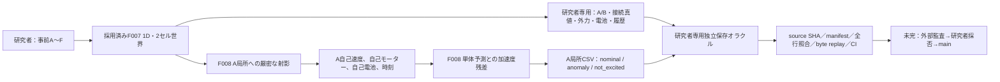

# F008：局所運動から未知負荷を検出する — 検証記録

**設計事前登録（2026-10-17）。実装・SOMA実験・CI・監査・正式採用はまだ行っていない。**

[研究Issue #22](https://github.com/ryonakayama234/SOMA-Synthetic-Organism-Morphogenesis-Arena/issues/22) / [仮説・境界](../topics/F008-local-load-detection/SPEC.md) / [対照A〜F](../experiments/F008/PLAN.md)

## 事前の理論参照（Wolfram計算・SOMA実測ではない）
A/B各1kg、A駆動2N、dt=0.25s、drag0。非結合：加速度2m/s²、初回Δv0.5m/s、半陰的Euler変位0.125m。結合：加速度1m/s²、初回Δv0.25m/s、変位0.0625m。未観測外力−1Nの非接続でも加速度1m/s²を作り、局所信号だけでは結合を一意に特定できない。

| 事前対照 | 実行 | 実測 | 判定 | 生証拠 |
| --- | --- | --- | --- | --- |
| A 非接続 | 未実施 | なし | 未実施 | なし |
| B 接続 | 未実施 | なし | 未実施 | なし |
| C 切断 | 未実施 | なし | 未実施 | なし |
| D 未観測外力 | 未実施 | なし | 未実施 | なし |
| E 電池拒否 | 未実施 | なし | 未実施 | なし |
| F 漏洩・改変・再現 | 未実施 | なし | 未実施 | なし |

## 採用ゲート
- [x] 問い／仮説／反証／誤同定対照／理論参照を実験前に登録
- [x] 設計PRでシステム図、データ契約、PLAN、未実施findingsを同期
- [ ] 独立設計レビュー
- [ ] 別PRで局所観測境界・負荷残差の最小実装
- [ ] Python3.11/3.12全回帰、A〜F、独立数理照合、生ログ、改変拒否・完全リプレイ
- [ ] 独立視点の数理・コード・証拠監査
- [ ] ユーザーによる正式採否判断
- [ ] 採用決定時のみmain統合

**限界**：応答異常は結合構造の確定ではない。地面反力の欠けたF007有効力、離散計算のdt依存、実機でないことを保持する。未知の身体を発見したとは主張しない。
## 2026-10-18 F008実装候補の観測・監査結果【最新判断：モデル内支持、正式採用前】

**時系列と出自を区別すること。** 上の「未実施」は2026-10-17設計PR #23における事前登録時点の履歴であり、削除・修正しない。2026-10-18、既存のF008候補ブランチを再利用し、[実装Draft PR #27](https://github.com/ryonakayama234/SOMA-Synthetic-Organism-Morphogenesis-Arena/pull/27)で実装監査、試験失敗の再現、修正、GitHub Actionsでの再検証を行った。**F008はmain未統合・ユーザーによる正式採用前。**

### 仮説と凍結した条件

事前登録の[Issue #22](https://github.com/ryonakayama234/SOMA-Synthetic-Organism-Morphogenesis-Arena/issues/22)、[SPEC](../topics/F008-local-load-detection/SPEC.md)、[PLAN](../experiments/F008/PLAN.md)を変更せず実施した。質量A/B各1kg、指令2N、dt=0.25s、drag=0、各1sの4区間。既知A単体モデルの予測加速度 `a0=motor_applied_n/1kg` と自己速度差からの `a=(v1-v0)/dt` の残差 `r=a-a0` を使う。|r|>1e-12m/s²は固定条件における `anomaly`、0適用力は `not_excited`（残差null）。**この閾値は一般的な計測器のノイズ性能・因果推定を校正した値ではない。**

| 条件と仮説 | 実際のCIで照合したA局所観測（4区間の加速度、m/s²） | 検証上の判定 |
| --- | --- | --- |
| A 非接続・他外力なし（H008a） | 2, 2, 2, 2；残差0、`nominal` | **支持**：既知単体応答に一致 |
| B 結合（H008a） | 1, 1, 1, 1；残差−1、`anomaly` | **支持**：A側から応答異常を検出 |
| C 接続後t=0.5sで切断（H008b） | 1, 1, 2, 2；`anomaly, anomaly, nominal, nominal` | **支持**：切断後の速度応答変化を検出 |
| D 非接続＋A未知外力−1N（H008d） | 1, 1, 1, 1；Bと**完全に同一のA局所時系列** | **支持**：異常は接続の一意な証明ではない |
| E A電池空、指令2N／適用0N | 0, 0, 0, 0；全区間`not_excited`・残差null | **支持**：非駆動時に無効な負荷推定をしない |
| F 局所漏洩・証拠改変・完全再現（H008c） | 局所CSVにB/リンク/未知外力の項目なし、改変・偽出自を拒否、37ファイルのbyte replay一致 | **ソフトウェア境界内で支持**：実機センサ隔離は未実施 |

Cの切断イベントは区間2の**終点**で発火し、F007の同時刻の世界フラグは切断後である。区間2は結合状態の運動、区間3から自由運動。イベント時刻の真値をAに入力せず、速度応答だけを見る。

### 実行した検証（実コミット対応）

- **初回失敗を保存**：中間コミット `1368453a65a5e6c208f9a89d035726bef284598c` の[GitHub Actions #39091680062](https://github.com/ryonakayama234/SOMA-Synthetic-Organism-Morphogenesis-Arena/actions/runs/39091680062)は**failure**。Python 3.11/3.12の全135テストのうち4件のF008保存スイートテストが失敗し、F001〜F007の他workflowにも波及した。原因はF008検証器が全階層の `manifest.json` を一覧から誤って除外し、含まれるべき各F007子manifestを「存在しない」と扱ったこと。**科学仮説の反証ではなく証拠検証コードの実装不備**。採用済みF007実装や事前予測を変更せず、スイート最上位のmanifestだけを除外するよう修正した。
- **修正後実測**：コミット `a6658beccacc5251277d22dc33810eae7a923d04` に対応する[GitHub Actions #39091761268](https://github.com/ryonakayama234/SOMA-Synthetic-Organism-Morphogenesis-Arena/actions/runs/39091761268)が**success**。Python 3.11/3.12の各jobで**全135テスト成功**、最適化`python -O`下で**F008の9テスト成功**、独立F007数値オラクルとF008の保存局所CSV別計算で**5物理条件／20局所区間**を照合。各jobで同一条件の**37ファイルの完全byte replay一致**。AとBの実装済み既存物理は変更なし。F001〜F008の**全8つのActionsワークフローが同一コミットでsuccess**したことをGitHubで確認。
- **残存する実物証拠**：[Python 3.11アーティファクト #12122439644](https://github.com/ryonakayama234/SOMA-Synthetic-Organism-Morphogenesis-Arena/actions/runs/39091761268/artifacts/12122439644) と [Python 3.12アーティファクト #12122444556](https://github.com/ryonakayama234/SOMA-Synthetic-Organism-Morphogenesis-Arena/actions/runs/39091761268/artifacts/12122444556)。各ZIPは約49,730バイト、GitHubの保持期限は2027-01-16 UTC。再作成には[手順](../experiments/F008/README.md)を使う。上記CI番号とSHAが**この段階**の検証対象であり、後続文書コミットのCIを代替しない。
- **出自の監査修正**：保存manifestの既存F007依存SHAに加え、F008 detector、runner、独立verify、tests、workflow、SPEC、PLAN、findings、図・契約、README、AGENTS、監査判断ログ等の固定ファイルをSHA256に含めた。偽造した`f008_source_hashes`が保存側と外部供給された期待値の双方で一致していても、実checkoutとの一致を要求する追加負例を成功させた。保存manifest自体から信頼済み期待値を逆生成してはならない。
- **独立数理照合**：Wolfram Languageで有理数の `a={2,1,1,0}`（A,B,D,E）、`Δv={1/2,1/4,1/4,0}`、半陰的Euler `Δx={1/8,1/16,1/16,0}`、Cの区間加速度 `{1,1,2,2}`、B/Dの等価性Trueを確認。**Eの無駆動について`a0=2`と置いた形式的な「残差」は使わない。**
- **独立性の限界**：F008 verifierはF008 detectorをimportせず、保存済みの全行を再計算する。F007原本には採用済みF007独立保存オラクルも適用した。ただしコード作成者とは別の人間・外部AIによる独立コードレビューは**未実施**であり、同一支援AIによるWolfram照合・別式監査を第三者の承認と混同しない。

### システムの知識境界と不採用事項

**現時点の評価**：H008a/H008b/H008dは固定1D離散ソフトウェア対照で**支持**、H008cはallowlist・テスト・実ログの範囲で**支持**。未知外力のある環境での原因識別、接続形態の同定、任意質量・抵抗・dt・ノイズでの汎化、実時間センサ、実機の推進・知能・身体創発は**判定不能／未実施**。GitHubの技術的CI成功は科学的な普遍性・正式採用を意味しない。設計PR #23と実装Draft PR #27をレビューして外部独立監査を追加し、**ユーザーが正式採否を明示**した場合にのみmain統合可。旧証拠は保持。
