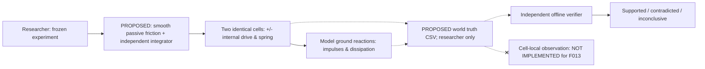

# F013 — Robustness of passive-contact rectification in two identical 1D cells
**FROZEN BEFORE ALL F013 CODE AND RUNS**. Authorized experiment/design only. Baseline main `004d4dcf045bbea42a6b2aa2ecbe6c125f7881bf`. Design-only draft, do not call an observed result. F011/F012 original physics and evidence, F011 no-ground 9.6 s INCONCLUSIVE and V001 drafts stay unchanged.

## One question
Is persistent COM displacement in F011's two-cell equal/opposite internal periodic drive robust to an independently specified smooth dissipative directional ground law, rather than unique to F011's velocity-proximal Coulomb projection? Determine where numeric timestep vs friction constitutive semantics affect results. No claim of real ground fidelity or self-chosen organism roles.

## Competing hypotheses and predetermined classifications
- **H13a (robust-drift candidate):** directional case C, when interpreted under smooth ground friction, may exhibit persistent positive COM drift on the finest grid, and its mirror D negative, across all THREE preselected smoothing widths. Persistent means final TWO 1.2s displacements same sign, each strictly >0.001m, smaller >= 0.5 * larger, and |r(T)-r(T-1.2)|<=0.01m. C positive required; D mirror. If valid converged cases violate this, **CONTRADICTED for that frozen model**, not evidence of universal impossibility. A positive result is model robustness at those widths only.
- **H13b (numerical convergence):** for each fixed width eps and each valid B–E case, absolute COM final difference between h=0.005 and h=0.0025 <= max(0.002m, 0.1 * abs(fine final COM)) and same COM-motion sign (unless both numerically zero); tighter convergence is NOT presumed. If failed, numerical **INCONCLUSIVE**, do not attribute change to physics.
- **H13c (constitutive sensitivity):** independent smooth-law C COM at eps=0.001, h=0.0025 compared with accepted F011 C h=0.0025 may differ; report signed discrepancy explicitly, without acceptance threshold for equality. Epsilon sequence is diagnostic, **not** proof of eps→0 convergence or equivalence of physical static friction. Mark model-equivalence conclusions **INCONCLUSIVE** absent stronger analysis.
- **H13d (symmetry/passivity):** B isotropic (mu+=mu-=0.04) COM(t)=0; E motor off static; C/D pointwise mirrored coordinates, velocities, signed COM and ground forces, same r and ground dissipation, at every eps × dt; per-step momentum ΔP= h(fA+fB), nonpositive friction work. Any material failure is an **integrity invalidation**, never scientific robustness support.

### Proposed independent smooth contact mathematical rule
For each cell mass 1kg, spring force `F_int = u + 20(r-0.5)` N with `r=xB-xA`; forces +F_int on A and -F_int on B. Pre-ground velocities `vstar_A=vA+h F_int`, `vstar_B=vB-h F_int`.
Define `f_eps(v)=-mg*mu_dir(v)*tanh(v/eps)` with mu_dir(v)=mu_plus for v>0, mu_minus for v<0, f_eps(0)=0, g=9.81m/s². `eps` unit m/s, chosen before any F013 run; `v f_eps(v)<=0` for either sign. Backward Euler contact substep solves `vnext=vstar + h*f_eps(vnext)/m` by monotone bisection with bracket [0,vstar] (ordering for negative sign). Absolute velocity bracket target width <=1e-13m/s, at most 80 iterations; log failure, never guess a root. Positions use `xnext=x+h*vnext` (semi-implicit). Ground forces are `f=(vnext-vstar)*m/h`. The smooth rule is a **different constitutive model** from F011's genuine static velocity projection; changing eps is not merely improving integration accuracy. No work budget or F012 gate.
The exact discretized energy identity for same semi-implicit mechanical step (K+spring S, `Wmotor=h*u*(vA_next-vB_next)`, `Wground=h*(fA*vA_next+fB*vB_next)`) is `(K'+S')-(K+S)-Wmotor-Wground = (k/2)*(Δr)^2-(m/2)*((ΔvA)^2+(ΔvB)^2)`; do not demand zero discrete defect.

## Locked controls
B isotropic mu=(0.04,0.04), C directional=(0.02,0.08), D mirror=(0.08,0.02), E C-friction but no motor. EACH cell has same law; no cell labels/roles. `mA=mB=1kg; xa0=-.25m,xb0=.25m, va0=vb0=0; k=20N/m; L=.5m; u=+1N for [0,.6) then -1N [.6,1.2), repeat 8 periods T=9.6s; E u=0; 0.2<=r<=0.8m`. If stroke violated: save valid prefix and classify condition INCONCLUSIVE, NOT clamp. No no-ground 9.6s A restoration here (Issue #37). No random seed.
`eps=[0.02,0.005,0.001] m/s`, `dt=[0.01,0.005,0.0025] s`: total **36 trials** B/C/D/E × 3 ×3. No adaptive sweep, no selection after viewing data, no efficiency or new contact morphology claims.

## Evidence contract and exit gate
Save versioned config+CSV (per-step x/v/r/COM, u, both ground forces, work, kinetic/spring, momentum residual, energy defect), frozen comparison summary, manifest with source/checkout identity, SHA256 of all evidence, source-bound independent raw CSV solver (NO imports from soma.f013), negative tamper cases, two-directory byte-identical replay. Require Python3.11 & 3.12 F013 CI on exact final HEAD plus existing regressions. Keep scientific outcomes SUPPORTED / CONTRADICTED / INCONCLUSIVE / UNEXECUTED separate from software PASS. External human reviewer absent: disclose. No formal adoption, main merge or destructive changes without researcher's explicit consent.

## Knowledge boundary and conceptual flow

