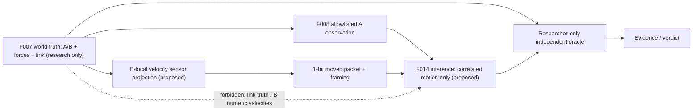

# F014 — 分散身体図式の最初の1ビット

**研究判断：次の研究対象として選択。設計・数式事前検算のみ。F014の新規実装、数値実験、GitHub CI、科学的採用は未実施。** [Issue #45](https://github.com/ryonakayama234/SOMA-Synthetic-Organism-Morphogenesis-Arena/issues/45) / [PLAN](../../experiments/F014/PLAN.md) / [FINDINGS](../../findings/F014-validation.md)。

## 唯一の問い
既存F010でA局所履歴が完全一致する「二セル剛体結合」対「非結合+入力依存隠れ外力」を、相手Bが送る**局所運動の1ビット**で区別できるか。さらに、Bも外力で同時に動く非結合系を入れると、その観測ではなお機械的接続が同定不能となるか。

この研究は**通信された同時運動の検出能力**が対象。「attach検出」「身体全体の推定」「通信だけで力を運ぶ」「能動制御の創発」は対象外。

## 凍結する理想条件・数学的仮説
F007の二質点1D運動、mA=mB=1 kg、初期 xA=0 m, xB=0.5 m、vA=vB=0、dt=0.25 s、T=1s、抵抗0、Aモーター指令 u ∈ {2,1,0.5} N。各入力ごとに完全に初期化した独立試行。A初期電池はF010と同じ3,000,000 µJ、B残量0。F007の外部有効力・理想モーター会計であり実機駆動/接地反作用ではない。

| Case | 物理結合 | dA (N) | dB (N) | A加速度 (m/s²) | B加速度 (m/s²) | Bの1ビット |
|---|---|---|---|---|---|---|
| L-linked | 有 | 0 | 0 | u/2 | u/2 | 1 |
| G-ghost | 無 | -u/2 | 0 | u/2 | 0 | 0 |
| C-coforced | 無 | -u/2 | +u/2 | u/2 | u/2 | 1 |
| N-free | 無 | 0 | 0 | u | 0 | 0 |
| E-unexcited | 無 | 0 | 0 | 0 (電池拒否) | 0 | 0 |

上の数値はWolframによる2026-10-20**事前理論計算**であり、F014新規ランの観測値ではない。非結合時のBへの外力は研究者が固定する反例機構であり、セルからは見えない。

Bのローカルセンサーが `abs(vB_current - vB_previous)>1e-10 m/s` を満たす場合だけ `moved=True`、それ以外はFalse。固定した無雑音の有理数条件に限るしきい値で、実センサーの検出精度を意味しない。Aに送る**測定値ペイロードは1ビット**、配送用の識別子・時刻・エラー検知情報は別に必要で通信総量が1ビットとは主張しない。欠落パケットはFalseと区別してエラー/INCONCLUSIVEとする。

## 事前登録 H014
- **H14a（限定的な識別）:** 全3入力×全4ステップでL/G/CのF008 A局所許可フィールドが完全一致する。Bの1ビットはL=1, G=0, C=1。よってL/Gの限定二択は判別できる。
- **H14b（構造同定不能性）:** LとCは同じA局所履歴と同じBビット履歴を生成する。したがって、これらの入力だけに依存するいかなる決定論的判定器も「物理接続済み」を一般には証明できない。
- **H14c（無励起・欠損）:** Aモーター実行拒否、異なる時刻/連続性破れ、Bパケット欠落では「接続/非接続」を断定せずINCONCLUSIVEまたは入力拒否。
- **H14d（観測境界）:** A側の判定器へ渡せるのはF008 `LocalObservation`とBの単一booleanだけ。生のB速度、リンク状態、ケース名、外力、研究者側ラベルが少しでも混入したら契約違反。
- **H14e（証拠整合性）:** 独立オラクルで各F007生行・局所射影・B局所1bit・サマリーを再計算し、真のL/C観測同値と改ざん負例、再実行byte一致を検証。モデル観測の科学評価とCI成功を混同しない。

反証条件：理想試行でL/G/C A局所履歴が一致しない、Bビットが理論と異なる、L/Cを完全観測から確実に判別したと主張する、無励起を非結合と断定する、証拠検査に失敗。離散値に対して絶対許容差1e-12を使用する検算と、ビット閾値を混同しない。

## 提案システムと知識境界

## 採用・再現性ゲート
実装は既存F001–F013の採用済み力学コードを変更せず別モジュールに分離。Aの通信内容に必ず明示的なプロジェクションを施し、型とフィールドallowlist検査を実施。H014a–eに加え負例、source SHA、immutable raw F007 and packet CSV、二か所再生一致、Python3.11/3.12全回帰、レビュー記録が必要。変更と同じレビュー単位でREADME/ARCHITECTURE/DATA_CONTRACTS/FINDINGSを同期。

判定はSUPPORTED / CONTRADICTED / INCONCLUSIVE / UNEXECUTEDを維持。科学的に「一般的なリンク同定は不可能」という否定結果も重要な成果として記録する。F011–F013の受動接地モデルとは別の世界。実センサー、ノイズ、真正性、独立人間査読、自律探査、2D/3Dは未検証。**この文書のPRは事前登録であり正式採用でもmain統合承認でもない。**
