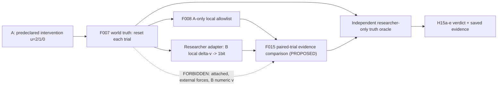

# F015 — 能動介入で身体関係の識別限界を測る（事前登録・未実装）

**状態：DESIGN ONLY / UNEXECUTED。** [Issue #48](https://github.com/ryonakayama234/SOMA-Synthetic-Organism-Morphogenesis-Arena/issues/48) / [PLAN](../../experiments/F015/PLAN.md) / [findings](../../findings/F015-validation.md)。この仕様はF014の正式限定採用とは独立した**次の問い**であり、既存の成果の言い換えではない。F015のモジュール/プローブ結果/CI/正式採用はまだ存在しない。

## 唯一の研究質問
Aが自分で駆動指令を変え、各試行を初期状態に戻したとき、F008のA-local許可観測とF014のB-local moved 1-bitから、**u=2Nでは同値である結合Lと非結合F-fixed**を区別できるか。同時に、外力が指令依存で変化する**T-tracking非結合反例**では識別不能が残るか。

「能動性」は研究者が固定した**介入スケジュールをAが実行する**ことだけを意味する。自律的な実験計画/学習/形態選択/身体図式完成は未対象。

## 凍結した最小世界
- 既存F007固定理想2質点1D（F011–F013の接地モデルではない）、mA=mB=1kg、初期xA=0,xB=.5m、vA=vB=0、drag=0、dt=.25s、T=1s、4ステップ/独立試行。
- 介入uを**2N→1N→0N**とし、3つの独立した試行ごとに世界と電池を完全初期化する。介入値は事前指定であり観測後に最適化しない。
- L/F/T/NのA初期電池3,000,000 µJ、B初期0、EはA初期0。F007 motor = **外部有効駆動力**であり実機の内部電動/接地反作用ではない。
- B移動ペイロード `abs(vB[k]-vB[k-1])>1e-10 m/s` の1 bit + source/step/time枠。数値B速度・外力・リンク真値・ケース名は推定器禁止。
- ケースに与えるdA,dBは**研究者が設定する物理真値**。固定外力を前提にした識別は、その前提をAが自力で検証したことを意味しない。

| Case | 物理結合（研究者真値） | dA,dB [N]（研究者真値） | 実適用時のaA,aB [m/s²] |
|---|---|---|---|
| L-linked | 有 | 0,0 | u/2,u/2 |
| F-fixed | 無 | -1,+1：全uの試行間で同じ | u-1,1 |
| T-tracking | 無 | -u/2,+u/2：指令追随 | u/2,u/2 |
| N-free | 無 | 0,0 | u,0 |
| E-disabled | 無 | 0,0：A電池0 | 0,0（実適用0） |

## 事前仮説と反証条件
- **H15a 基準同値:** u=2NのL/F/Tは、F008許可済みA局所全フィールドおよびF014 B packetの4ステップ履歴で同一（数値許容差1e-12、boolean完全一致）。違えばCONTRADICTED。
- **H15b 条件付き可分:** u=2→1→0の独立リセット介入後、F-fixedとLは観測系列が異なる。A-only系列とA+bit系列を別々に比較し、Bチャネルの増分効果がゼロならゼロと記録する。区別できなければCONTRADICTED。
- **H15c 構造同定不能:** T-trackingとLは全uでA-localおよびB packet履歴が同一。あらゆる決定論的推定器はこの観測だけで普遍的な物理接続を証明できない。推定器がconnected等を出したら契約違反。
- **H15d 単独無励起の誤推定禁止:** u=0のB静止は「非結合」の証拠ではない。意図的OFF試行は**対照系列の一部**、Eで電池不足の拒否は別事象。packet欠落・誤時刻・誤source、リセット・A時計不一致はINCONCLUSIVE/拒否。
- **H15e 保存証拠:** F007原本、F008投影、Bの1bit投影を研究者専用独立オラクルが逐行照合。ケース真値が推定器へ流出したら拒否。SHA source binding/改ざん再ハッシュ負例/2-root byte replay/Python3.11+3.12全回帰。

予測を満たすことだけを検証するテストでは不十分。誤った結合ラベルの偽造、A-onlyから可能な推論をB追加の功績と誤認する偽造、T反例を削除した要約の偽造を**反証可能なnegative controls**にする。

## 設計提案（実体はまだない）

### 将来の暫定API方針
入力は厳格に型検証した3介入×4ステップの `F008.LocalObservation` と `F014.PeerPacket | None` のみ（uはA localの実適用・指令から読む）。出力に許容するのは `observation_signature_changed`, `observation_signature_same`, `inconclusive` と試行単位の検査内訳。**connected/attached/topology_verified、true world case labelを含めない**。外力固定仮定の妥当性自体はA側の観測から証明されず、研究者側の条件ラベルとして別に報告する。

F014の単試行 `estimate_trial` はu=0をinconclusiveとする仕様のまま維持。F015は新規の**複数試行介入**としてraw B moved bitを扱い、単試行判定結果を誤って「非結合」へ変換しない。学習器には制約・リンク真値を提供しない。

## 分離と採用ゲート
この事前登録とWolframの有理数チェックは実験結果ではない。**別implementation PR**でのみF015コード・15-run証拠・独立audit・CI・観測に基づくfindings追記を行う。F001–F014、V001 Draft、F011 no-ground Issue #37を無改変。採用は理想1Dモデルの条件付き介入/識別境界に限定し、実世界の因果識別や通信・ノイズ・自律学習・形態創発を含めない。外部人間査読は実施しない限り主張しない。

## 2026-10-21 — Post-experiment limited scientific acceptance (append-only; not new preregistration)

[Observed evidence](../../findings/F015-validation.md) on implementation HEAD `9725c556741b373184a53e6a407644644ff75952` supports H15a–e **only for the fixed ideal F007 1D numerical experiment**: L/F/T identical at u2, held F differs already via A-only at u1/u0, tracking T retains full L equivalence under all u. B one-bit **adds zero unique discrimination** given the complete A-only schedule; this absence of gain is an important negative result. Typed `f015.comparison.v1` is accepted only as an explicit ideal-reference *observation-signature* comparison, never connected topology or general body schema learning. E/transport missing remain INCONCLUSIVE. Python3.11/3.12 191 full +5 optimized tests each, 15 runs, 60+60 observations, 138-file byte replay and rehashed forgery negatives checked at the cited SHA. Wolfram symbolic checks are not new model runs; same-author auditor is not external human peer review.

**Decision:** LIMITED ADOPTION APPROVED, **conditional on final documentation-inclusive CI and actual merge verification**. All earlier front-matter/status and design-only notes are preserved as historical snapshots. No hardware claims, spontaneous morphogenesis, self-directed probe planning, full causal identification without nuisance assumptions, physical energy/ground, sensor noise or external human peer review. The two PRs must be merged in order after final CI; record resulting SHA and post-main Actions in Issue #48. If the final exact-HEAD run fails, integration is not authorized until fixed and re-audited.

