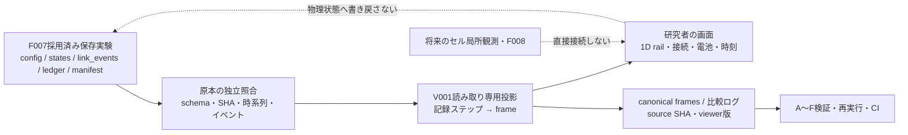
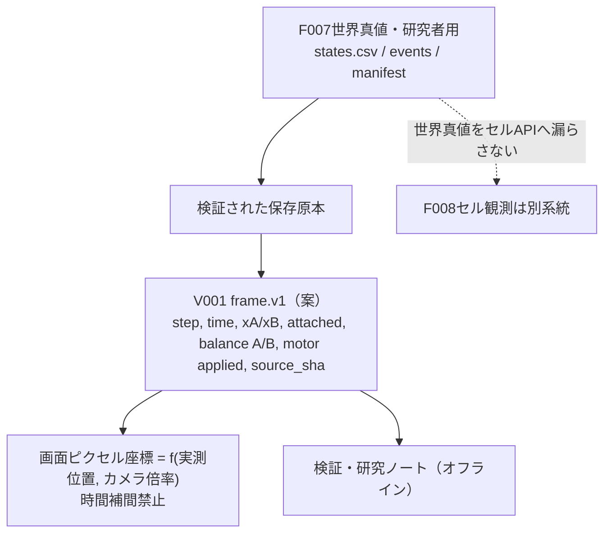

# V001 — 身体の動きを研究者が直接観察する

**提案のみ。実装・表示実行・実験・CI・採用はいずれも未実施。**

[Issue #24](https://github.com/ryonakayama234/SOMA-Synthetic-Organism-Morphogenesis-Arena/issues/24) / [A〜F事前登録](../../experiments/V001/PLAN.md) / [検証記録（未実施）](../../findings/V001-validation.md)

## 唯一の新能力と目的
採用済みF007の保存された**1D・2セル**世界状態を、研究者向けにステップ単位で**読み取り専用再生**する。視覚表示の正確性・再現性を評価するための**研究計測器**であり、ロボット細胞自身の機能やシミュレータの力学は変えない。

- UI：時刻ステップ選択／再生・一時停止、レール上のA/B位置、理想リンクON/OFF、A/B電池、Aのmotor適用/拒否、ケース・実験由来を表示する。
- F007 `motion.svg` は数値推移の既存表示。V001は**時刻ごとの空間状態とイベントの観察**に限る。
- 初期バージョンは任意中間時刻の補間を禁止（保存時刻のみ）。画面上のセル形状は記号であり実機設計や3D形態を表さない。
- 未対象：F008センサー/身体認識、2D/3D、衝突、自己組立、セル・オートマトンの局所ルール、群体の創発、学習、外界推進の力学妥当性。

## 仮説（反証可能）
H-V001a：保存 `states.csv` の時刻・位置・リンク状態・電池・A実適用力が、可視化フレーム内で意味・値を変更されず表現できる。

H-V001b：リンク切断の前後で実際の保存行に無い位置/速度ジャンプを表示しない。イベントログと状態行の矛盾は検知して拒否する。

H-V001c：同じ検証済み原本は、同じ**canonical frame record**系列を生成する。スクリーンショットのピクセル同一性は環境依存のため受入条件にしない。

H-V001d：改変ログ、欠損列、不正な時刻や出自が拒否され、UI起動を「証拠の正当性の証明」と取り違えない。

## アーキテクチャ（**未実装**）

## データ契約の事前案（実装時に列順・型を固定）

入力は既存F007の `config.json`, `states.csv`, `ledger/events.csv`, `link_events.csv`, `manifest.json`。版 `f007.v1` のみを初版の対象とする。

投影フィールド（提案）：`step_index` (int)、`time_s` (s)、`x_a_m`/`x_b_m` (m)、`v_a_m_s`/`v_b_m_s` (m/s)、`attached` (bool)、`balance_a_uj`/`balance_b_uj` (integer µJ)、`motor_applied_n` (N)、`decision_reason`、`source_artifact_sha256`。別途 `link_events.csv` のイベント境界と整合させる。

保存フレームはUIの描画キャッシュではなく、**元CSVを読むだけの再構成表現**。元の数値の丸め上書きをせず、軸スケール・最小/最大範囲・原点・表示時刻を明示する。背景グリッド・アイコンは物理的な計測値ではない。

## 採用ゲート
1. 図・データ案・A〜F計画・未実施findingsを同じ設計PRで固定。
2. 設計レビュー後、別の実装PRでUIと投影コード・テスト・CI・図・契約・findings・README/AGENTSを同期。
3. 既存F007原本の独立参照に照合し、切断・電池の対照、改変負例、正規化フレーム再実行一致を確認する。
4. 独立監査後に、研究者が明示的に採否を決める。採用判断なしにmain統合しない。

## 将来への道筋
V001は1Dデータをまず正しく見るための器具。将来のV002（2D物理ビューア）、局所ルールによる分散結合、3Dの機械的表現、形態・能力の発見は**別の機能・研究課題**として扱う。可視化自体を「創発」の証拠としない。
