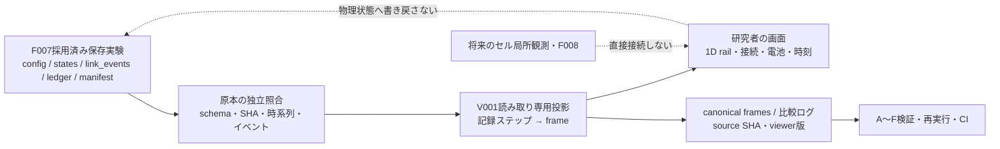
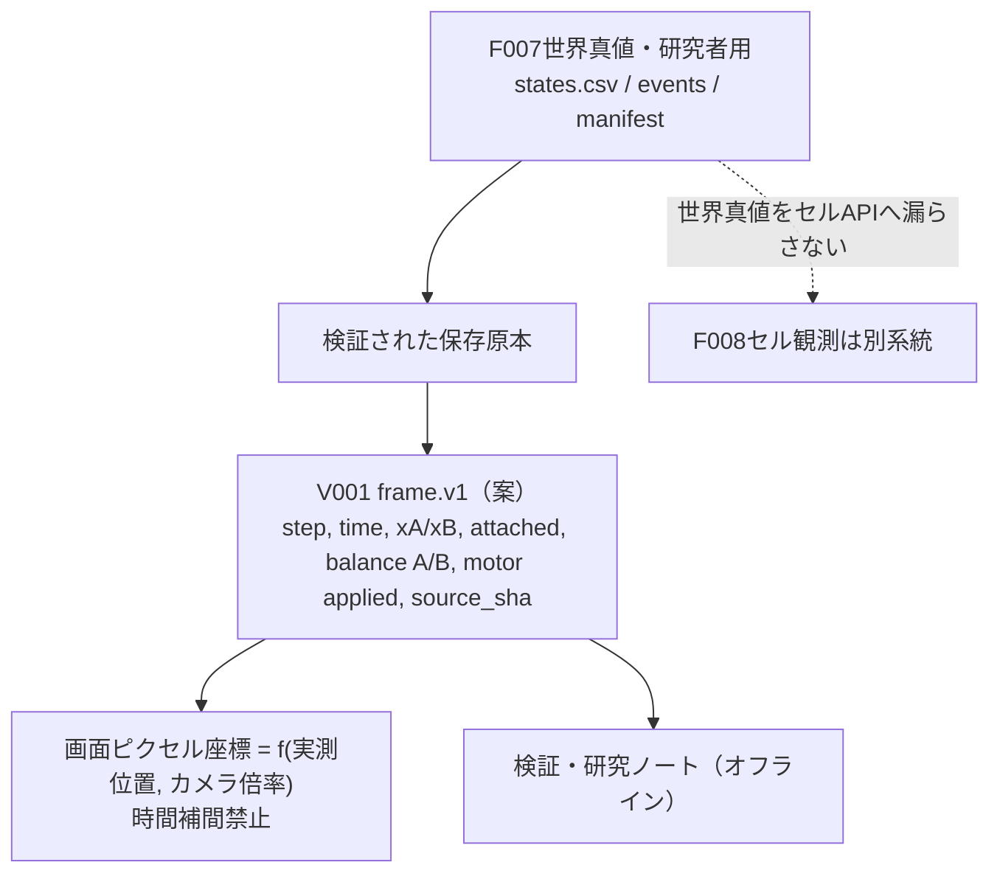

# V001 — 身体の動きを研究者が直接観察する

**提案のみ。実装・表示実行・実験・CI・採用はいずれも未実施。**

[Issue #24](https://github.com/ryonakayama234/SOMA-Synthetic-Organism-Morphogenesis-Arena/issues/24) / [A〜F事前登録](../../experiments/V001/PLAN.md) / [検証記録（未実施）](../../findings/V001-validation.md)

## 唯一の新能力と目的
採用済みF007の保存された**1D・2セル**世界状態を、研究者向けにステップ単位で**読み取り専用再生**する。視覚表示の正確性・再現性を評価するための**研究計測器**であり、ロボット細胞自身の機能やシミュレータの力学は変えない。

- UI：時刻ステップ選択／再生・一時停止、レール上のA/B位置、理想リンクON/OFF、A/B電池、Aのmotor適用/拒否、ケース・実験由来を表示する。
- F007 `motion.svg` は数値推移の既存表示。V001は**時刻ごとの空間状態とイベントの観察**に限る。
- 初期バージョンは任意中間時刻の補間を禁止（保存時刻のみ）。画面上のセル形状は記号であり実機設計や3D形態を表さない。
- 未対象：F008センサー/身体認識、2D/3D、衝突、自己組立、セル・オートマトンの局所ルール、群体の創発、学習、外界推進の力学妥当性。

## 仮説（反証可能）
H-V001a：保存 `states.csv` の時刻・位置・リンク状態・電池・A実適用力が、可視化フレーム内で意味・値を変更されず表現できる。

H-V001b：リンク切断の前後で実際の保存行に無い位置/速度ジャンプを表示しない。イベントログと状態行の矛盾は検知して拒否する。

H-V001c：同じ検証済み原本は、同じ**canonical frame record**系列を生成する。スクリーンショットのピクセル同一性は環境依存のため受入条件にしない。

H-V001d：改変ログ、欠損列、不正な時刻や出自が拒否され、UI起動を「証拠の正当性の証明」と取り違えない。

## アーキテクチャ（**未実装**）

## データ契約の事前案（実装時に列順・型を固定）

入力は既存F007の `config.json`, `states.csv`, `ledger/events.csv`, `link_events.csv`, `manifest.json`。版 `f007.v1` のみを初版の対象とする。

投影フィールド（提案）：`step_index` (int)、`time_s` (s)、`x_a_m`/`x_b_m` (m)、`v_a_m_s`/`v_b_m_s` (m/s)、`attached` (bool)、`balance_a_uj`/`balance_b_uj` (integer µJ)、`motor_applied_n` (N)、`decision_reason`、`source_artifact_sha256`。別途 `link_events.csv` のイベント境界と整合させる。

保存フレームはUIの描画キャッシュではなく、**元CSVを読むだけの再構成表現**。元の数値の丸め上書きをせず、軸スケール・最小/最大範囲・原点・表示時刻を明示する。背景グリッド・アイコンは物理的な計測値ではない。

## 採用ゲート
1. 図・データ案・A〜F計画・未実施findingsを同じ設計PRで固定。
2. 設計レビュー後、別の実装PRでUIと投影コード・テスト・CI・図・契約・findings・README/AGENTSを同期。
3. 既存F007原本の独立参照に照合し、切断・電池の対照、改変負例、正規化フレーム再実行一致を確認する。
4. 独立監査後に、研究者が明示的に採否を決める。採用判断なしにmain統合しない。

## 将来への道筋
V001は1Dデータをまず正しく見るための器具。将来のV002（2D物理ビューア）、局所ルールによる分散結合、3Dの機械的表現、形態・能力の発見は**別の機能・研究課題**として扱う。可視化自体を「創発」の証拠としない。

## 2026-10-17 具体実装案（設計追補：**未実装・未実験**）

### 最小実装を選ぶ理由
**Python標準ライブラリ + 埋込データ付き単独HTML + SVG + 素のJavaScript**。F007に外部Python依存がなくWSL2で再現できるため、まずフレーム投影の検証を優先する。React/ゲームエンジン/リアルタイムサーバーはV001の研究能力に不要。ネット接続や常駐プロセスも不要。

想定コード（**未作成**）：
- `soma/v001.py`：監査済みF007保存データから表示フレームを生成。運動方程式を再計算せず、元列をそのまま型付き投影する。
- `experiments/V001/build_view.py`：原本を検査→canonical framesを出力→単独`viewer.html`生成。信頼できるcheckout/source identityを別経路から得て出自照合する。歴史的artifactのmanifest自己申告だけを信用しない。
- `experiments/V001/viewer_template.html`：記録ステップ選択/戻る/進む/再生/一時停止、レールの実メートル軸、A/Bのシンボル、接続ON/OFF、時刻、A/B電池とAのmotor command/applied/reasonを表示する。DOM textContent 等で実験文字列を安全に表示。フレーム補間、計算ループ、原本への書き戻しは禁止。
- `experiments/V001/verify.py` / `tests/test_v001.py` / `.github/workflows/v001.yml`：フレーム原本照合、A〜F、改変拒否、byte replay、3.11/3.12全回帰とGitHub Actions artifact。

### 入出力・安全な境界
CLI想定：`python -m experiments.V001.build_view --source runs/F007-ci/E-cut --output runs/V001/E-cut-view`。入力は既存F007の**保存ディレクトリ**、出力は**別の未使用ディレクトリ**。V001は入力ディレクトリを変更・削除しない。検証失敗時は部分表示を公開しない。

出力想定：`viewer.html`（埋込フレーム、offlineで開く）、`frames.json`（正規化した監査可能なフレーム原本）、`viewer_manifest.json`（元F007 artifact SHA256、viewer code SHA、フレームSHA、環境とschema、表示資料のhash）。実装前に厳密な列順/出自を固定。フレームの値を強制丸めして描画座標に再利用せず、px変換を描画側のみに閉じ込める。

保存時刻の連続した整数ステップを時間軸とする。再生速度倍率は**表示の速さだけ**変える。ブラウザの描画FPSや画面ピクセル一致は科学的検証値にしない。標準表示範囲（原点、余白、m目盛）は**同じrun全体で固定**し、動いていないセルがカメラの拡大縮小で動いたように見えないようにする。

### V001受け入れ契約（実装前の定義）
1. **記録フレーム全件**：有効な `states.csv` の行を、初期行を含め欠落/重複なく1:1で再現（coverage 100%）。
2. **保存数値忠実性**：時刻、位置、速度、motor appliedは元CSVをパースした数値と**同じ数値**。電池残量・step・attached・reasonは厳密一致。見た目のピクセル量子化は別。
3. **接続/切断**：`link_events.csv` と事象・post-event `attached` の一致。F007 E-cut の **t=0.50 s で描画は既にOFF**。イベントのbefore/after位置速度は一致し、架空のジャンプを表示しない。
4. **失敗時停止**：sha、schema、列欠損、時間逆順、切断ログ・支出ログ改変、信頼するsource identityとの矛盾、余分な危険な文字列を含む入力は、仕様に従い拒否/安全表示する。検証しないまま「信頼済み」と表示しない。
5. **証拠の再現**：同じ信頼する原本・同じviewerコード・設定から`frames.json`と`viewer.html`がそれぞれbyte一致。動的タイムスタンプをcanonicalデータへ混入しない。
6. **既存能力に非干渉**：F001〜F007 source/API、過去のrun、F008提案は変更せず、3.11/3.12の既存テスト・V001のA〜F負例に合格。
7. **ユーザー評価（定性）**：非接続、結合、切断、枯渇をステップ操作だけで視覚判別できる。これ自体は仕様の使いやすさ確認で、科学的物理妥当性の実証ではない。

**独立したWolfram離散参照（V001実験結果ではない）**：F007名目E-cut、h=1/4s、uA=2N、mA=mB=1kg、initial xA=0,xB=1/2、t=1/2で切断。{t,xA,xB,vA,vB,attached,A残高[J]}：
`{0,0,1/2,0,0,ON,3}`、
`{1/4,1/16,9/16,1/4,1/4,ON,47/16}`、
`{1/2,3/16,11/16,1/2,1/2,OFF,11/4}`、
`{3/4,7/16,13/16,1,1/2,OFF,19/8}`、
`{1,13/16,15/16,3/2,1/2,OFF,7/4}`。この離散出力はWolframで別式確認した理論値であり、F007の既存試験記録とV001の将来実験を混同しない。

**実行順序**：既存設計Draft PR #25内で仕様レビュー → 別の実装Draft PR → 検証・独立監査 → 研究者の明示採否 → 採用時のみmain統合。

## V001 実装候補の現状（2026-10-17、設計時の「未実装」記録より後）

[実装Draft PR #26](https://github.com/ryonakayama234/SOMA-Synthetic-Organism-Morphogenesis-Arena/pull/26)で `soma/v001.py`, `experiments/V001/{build_view,verify,run_suite}.py`, `viewer_template.html`, `tests/test_v001.py`, `.github/workflows/v001.yml` を追加。実装内容は**F007の保存runを監査・型付き投影し、オフラインHTML/SVGで記録stepのみ再生する**一能力に限る。F001〜F007計算本体、F008設計、過去の証拠を変更しない。

**修正後コードHEAD `a608e9f`** は[Actions #39036952305](https://github.com/ryonakayama234/SOMA-Synthetic-Organism-Morphogenesis-Arena/actions/runs/39036952305)で3.11/3.12各136 tests + 10 optimized、9ケース42 frame、82 artifact byte replay一致を確認。これらは保存原本からの正確な投影・生成物の範囲のみ**支持候補**。画面操作による定性的使い勝手、第三者人間レビューとユーザーの明示的正式採用判断は未実施。設計PR #25と実装PR #26はDraftのままでmain未統合。最新の結果と失敗訂正は [findings](../../findings/V001-validation.md) を優先する。
